# Настанова розробника вебзастосунку «ReadMania»

> **Статус документа:** редакція 1.0 від 16.11.2026. Документ звірено з кодом `backend/`, міграціями V1–V10, `R__dev_seed.sql`, ТЗ і SRS. У разі змін коду оновлюйте відповідні розділи (п. 12.3).

## Зміст

1. [Вступ](#1-вступ)
2. [Технологічний стек та архітектура](#2-технологічний-стек-та-архітектура)
3. [Середовище розробки та конфігурація](#3-середовище-розробки-та-конфігурація)
4. [База даних та міграції Flyway](#4-база-даних-та-міграції-flyway)
5. [Доменна модель](#5-доменна-модель)
6. [Підсистема безпеки](#6-підсистема-безпеки)
7. [Бізнес-підсистеми](#7-бізнес-підсистеми)
8. [REST API](#8-rest-api)
9. [Обробка помилок](#9-обробка-помилок)
10. [Тестування](#10-тестування)
11. [Матриця трасування вимог](#11-матриця-трасування-вимог)
12. [Порядок внесення змін](#12-порядок-внесення-змін)

---

## 1. Вступ

### 1.1. Призначення документа

Ця настанова описує внутрішню будову серверної частини вебзастосунку «ReadMania»: архітектуру, модель даних, підсистему безпеки, бізнес-логіку, програмний інтерфейс (REST API) і засоби тестування. Вона доповнює автоматично згенеровану документацію REST API (Swagger / OpenAPI), ER-діаграму та UML-діаграми класів, яких вимагає розділ 5 технічного завдання («Технічна документація для розробників»).

### 1.2. Цільова аудиторія

Документ призначений для:

- розробників серверної частини (Java / Spring), які супроводжують і розвивають бекенд;
- розробників клієнтської частини (React), яким потрібен опис контрактів API, моделі безпеки (сесії, CSRF) і формату помилок;
- тестувальників, які складають програму і методику випробувань (ТЗ, розділ 8);
- ІТ-фахівця Замовника, відповідального за розгортання та супровід (SRS, вимоги S1–S4, R4–R5).

### 1.3. Джерела істини та правила пріоритету

Під час підготовки настанови використано такі джерела, від найвищого пріоритету до найнижчого:

| Пріоритет | Джерело | Розташування |
|---|---|---|
| 1 | Вихідний код серверної частини | `backend/src/main/java/ua/readmania/**` |
| 2 | Міграції Flyway та сценарій наповнення | `backend/src/main/resources/db/migration/V1__init.sql` … `V10__institutions_unique_name.sql`, `backend/src/main/resources/db/seed/R__dev_seed.sql` |
| 3 | Автоматизовані тести | `backend/src/test/java/ua/readmania/**` |
| 4 | Конфігурація збірки та розгортання | `backend/pom.xml`, `backend/src/main/resources/application*.yml`, `docker-compose.yml`, `backend/Dockerfile`, `frontend/Dockerfile`, `frontend/nginx.conf`, `.github/workflows/backend-ci.yml`, `run-docker.sh` |
| 5 | Вимоги | `docs/Тех_завдання.pdf` (ТЗ), `docs/Специфікація_вимог.pdf` (SRS), `docs/Проєктування_досвіду_користувача.pdf` |
| 6 | Наявна супровідна документація | `README.md`, `docs/API.md`, `docs/openapi.json`, `docs/CURRENT_STATE.md`, `docs/DATABASE_DECISIONS.md`, `docs/ERD.md`, `docs/EMAIL_NOTIFICATIONS.md` |

**Правило розв'язання суперечностей.** Якщо супровідна документація (джерело 6) суперечить коду, міграціям або тестам (джерела 1–3), правильним вважається код. Виявлені розбіжності зведено в п. 1.6.

### 1.4. Короткий опис предметної області

«ReadMania» — книжковий інтернет-магазин ТОВ «ReadMania» типу «магазин із кошиком», доповнений елементами гейміфікації (ТЗ, п. 3.2). Вебзастосунок підтримує повний цикл «перегляд каталогу → оформлення замовлення → відстеження статусу», програму лояльності, читацькі виклики, оцінювання видань і благодійні замовлення в дар закладам-одержувачам.

Актори (SRS, розділ 1.3, Таблиця 1):

| Актор | Префікс ВВ | Роль у системі (`ua.readmania.domain.user.Role`) | Опис |
|---|---|---|---|
| Гість | G | — (анонімний запит) | Переглядає каталог, реєструється, автентифікується |
| Користувач | C | `USER` | Зареєстрований покупець; варіанти використання доступні лише для облікового запису зі станом «активний» (`UserStatus.ACTIVE`) |
| Менеджер | M | `MANAGER` | Працівник Замовника: веде каталог, замовлення, облікові записи, виклики, заклади, аналітику |

### 1.5. Глосарій

Терміни наведено за SRS (розділ 1.3) разом з їхніми відповідниками в коді.

| Термін SRS | Відповідник у коді | Пояснення |
|---|---|---|
| Видання | `Book` (таблиця `books`) | Позиція каталогу: назва, автори, видавництво, рік видання, жанр, опис, ціна, кількість примірників, обкладинка, ISBN |
| Замовлення | `Order` (таблиця `orders`) | Покупка видань: склад, вартість, знижка, сума до сплати, спосіб доставки та оплати, статус |
| Замовлення в дар | `Order` з `OrderType.GIFT` | Замовлення, яке доставляють на адресу закладу-одержувача |
| Заклад-одержувач | `Institution`, `InstitutionType` | Дитячий будинок, інтернат або бібліотека |
| Журнал подарованих книг | `GiftLog` (таблиця `gift_log`) | Записи про поставлені замовлення в дар |
| Статус замовлення | `OrderStatus` | Одне з чотирьох значень: «очікує оплати», «оплачено», «поставлений», «скасований» |
| Бонусний бал | `User.bonusBalance`, `BonusTransaction` | 1 бал = знижка 10 грн; нараховується за поставлене замовлення, оцінку, виконаний виклик |
| Читацький виклик | `Challenge`, `ChallengeCompletion` | Завдання з умовою, строком і нагородою в балах |
| Подарунковий набір | `GiftSetService` (без окремої таблиці) | Випадковий добір видань за сумою, жанрами та кількістю |
| Обліковий запис без активності | `ManagerInactiveUserService` | Активний запис без входу понад 2 роки або заблокований запис, не розблокований понад 2 роки |
| Дамп БД | `scripts/backup.sh`, `scripts/restore.sh`, контейнер `db-backup` | Резервна копія БД (`pg_dump` у форматі custom `-Fc`), щоденний автоматичний запуск і зберігання 14 днів (SRS, R5) |

Скорочення: **ВВ** — варіант використання; **ТЗ** — технічне завдання; **SRS** — специфікація вимог до програмного засобу; **FSM** — скінченний автомат станів; **DTO** — об'єкт передачі даних; **RBAC** — розмежування доступу за ролями.

### 1.6. Відомі розбіжності супровідної документації з кодом

Під час звірки виявлено такі розбіжності. В інших розділах настанови описано стан, що відповідає коду.

| № | Твердження в супровідній документації | Фактичний стан у репозиторії |
|---|---|---|
| 1 | `README.md` і `docs/CURRENT_STATE.md`: міграції `V1__init.sql` … `V9__schema_fixes.sql` («9 послідовних версій») | Існує ще міграція `V10__institutions_unique_name.sql`: вона зливає заклади-дублікати і створює унікальний індекс `uk_institutions_lower_name` на `LOWER(name)`. Файл `V1__init.sql` порожній. |
| 2 | `README.md`: `R__dev_seed.sql` застосовується лише в профілі `local` | Сценарій розташовано в `db/seed/`. Каталог `classpath:db/seed` указано у `spring.flyway.locations` як у `application-local.yml`, так і в **базовому** `application.yml`, тому сценарій застосовується і в профілі `default`. Виключає його лише `application-prod.yml`. |
| 3 | `README.md`: PDF-файли «Технічне завдання розробки Вебзастосунку.pdf» та «Cпецифікація вимог до Вебзастосунку.pdf»; SRS посилається на «Лаба1_ТЗReadMania_Брояко.pdf» | Фактичні імена файлів: `docs/Тех_завдання.pdf`, `docs/Специфікація_вимог.pdf`, `docs/Проєктування_досвіду_користувача.pdf`. |
| 4 | `README.md`: перелік контролерів і HTTP-файлів | Не згадано `DeliveryController` і `NovaPoshtaDeliveryService` (інтеграція з API «Нової пошти»), `ManagerAnalyticsController`, `ManagerChallengeController`, `ManagerGiftLogController`, `ManagerInstitutionController`, `ManagerUserController`, `GiftSetController`, а також файли `backend/http/delivery.http` і `backend/http/manager.http`. |
| 5 | `docs/CURRENT_STATE.md`: альтернативна назва міграції `V9__srs_alignment.sql` | У репозиторії є лише `V9__schema_fixes.sql`. |
| 6 | `docs/CURRENT_STATE.md`, п. 2.2: назви `idx_users_email_lower`, `idx_users_active_last_login`, `idx_books_isbn_active`, `chk_orders_discount_calc`, `chk_orders_total_calc`, `chk_orders_discount_limit`, `idx_bonus_unique_order_reward`, `idx_bonus_unique_challenge_reward`; колонки `order_items.price_snapshot`, `title_snapshot` | Фактичні назви в міграціях: `uk_users_lower_email`, `idx_users_m5_inactive`, `uk_books_isbn_active`, `chk_orders_discount_points`, `chk_orders_total_to_pay`, `chk_orders_max_discount`, `uk_bonus_order_reward`, `uk_bonus_challenge_reward`; колонки `order_items.book_title`, `book_price` (поля `OrderItem.bookTitle`, `bookPrice`). |
| 7 | `docs/DATABASE_DECISIONS.md`, рішення 10: для `institutions.type` створено індекс | Міграція `V9__schema_fixes.sql` додає колонку та `CHECK` `chk_institutions_type`, але індексу на `type` не створює. |
| 8 | `docs/CURRENT_STATE.md`, п. 2.2: `V8__gift_log.sql` — унікальність `(order_id, book_title)` як єдина особливість | Міграція V9 робить `gift_log.order_id` необов'язковим (`DROP NOT NULL`) і змінює правило зовнішнього ключа з `ON DELETE CASCADE` на `ON DELETE SET NULL`. |
| 9 | `README.md`: Swagger UI доступний у профілях `local`/`test` | `SecurityConfig` відкриває `/v3/api-docs/**`, `/swagger-ui/**`, `/swagger-ui.html` **лише** в профілі `local`; в усіх інших профілях (зокрема `default` і `test`) до цих шляхів застосовується `denyAll()`. У `prod` springdoc додатково вимкнено в `application-prod.yml`. |
| 10 | `README.md`, `docs/CURRENT_STATE.md`: перелік публічних шляхів; Javadoc `SecurityConfig` | Додатково публічні `/api/auth/logout`, `/api/ratings/book/**`, `/api/delivery/**` (а в `README.md` — ще й `/api/institutions/**`, `/api/challenges/**`, `/api/gift-sets/**`). Javadoc класу `SecurityConfig` стверджує, що CSRF вимкнено («Stage 0»), але це застаріло: CSRF увімкнено в усіх профілях, крім `test`. |
| 11 | `docs/CURRENT_STATE.md`, п. 2.7: «повний набір із **116 автоматизованих тестів**», `AuthIntegrationTest` — 17, `SchemaIT` — 18, `GlobalExceptionHandlerTest` — 18, `Slice4GamificationAndGiftSetIT` — 12 тестів | У коді 150 методів `@Test` у 17 класах; виконується 149 (`ReadmaniaBackendApplicationTests` не підпадає під шаблони surefire). Фактичні кількості: `AuthIntegrationTest` — 15, `SchemaIT` — 21, `GlobalExceptionHandlerTest` — 19, `Slice4GamificationAndGiftSetIT` — 16 (див. п. 10.3). |

---

## 2. Технологічний стек та архітектура

### 2.1. Технологічний стек

Версії взято з `backend/pom.xml`, `frontend/package.json`, Dockerfile-ів і `docker-compose.yml`.

| Рівень | Технологія | Версія / артефакт | Відповідність вимогам |
|---|---|---|---|
| Мова | Java | 21 (`java.version`) | SRS D5 (JDK 17+), S1 |
| Каркас | Spring Boot | 4.1.1 (`spring-boot-starter-parent`) | ТЗ 4.5, SRS D5 |
| Веб-шар | Spring MVC | `spring-boot-starter-webmvc` | SRS D5 |
| Доступ до даних | Spring Data JPA / Hibernate | `spring-boot-starter-data-jpa` | SRS D5 |
| Безпека | Spring Security, BCrypt | `spring-boot-starter-security` | ТЗ 4.2.1, SRS D2, D3 |
| Валідація | Jakarta Bean Validation | `spring-boot-starter-validation` | SRS U2 |
| Міграції | Flyway | `spring-boot-starter-flyway`, `flyway-database-postgresql` | — |
| СКБД | PostgreSQL | 17 (образ `postgres:17`, кодування UTF8) | ТЗ 4.5, SRS D7 |
| Пошта | Spring Mail (JavaMailSender) | `spring-boot-starter-mail` | — |
| Документація API | springdoc-openapi | `springdoc-openapi-starter-webmvc-ui` 2.8.5 | ТЗ, розділ 5 |
| Моніторинг | Spring Boot Actuator | `spring-boot-starter-actuator` (лише `health`) | — |
| Тестування | JUnit 5, Spring Boot Test, MockMvc, Testcontainers (PostgreSQL) | `spring-boot-starter-*-test`, `spring-boot-testcontainers`, `testcontainers-postgresql` | ТЗ, розділ 8 |
| Збірка | Maven (Maven Wrapper) | `mvnw`, `.mvn/wrapper` | — |
| Клієнтська частина | React, Vite, Mantine, TanStack Query, React Router, Recharts | React ^19.2.8, Vite ^8.3.0, `@mantine/*` ^9.8.0, `@tanstack/react-query` ^5.107.1, `react-router` ^8.5.1, `recharts` ^3.10.1 | ТЗ 4.5, SRS D6 |
| Лінтер клієнта | Oxlint | ^1.81.0 | — |
| Контейнеризація | Docker, Docker Compose, Nginx | `maven:3.9.9-eclipse-temurin-21`, `eclipse-temurin:21-jre-jammy`, `node:22-alpine`, `nginx:alpine` | — |
| CI | GitHub Actions | `.github/workflows/backend-ci.yml` | — |

### 2.2. Архітектурний стиль

Система є **монорепозиторієм** із двома окремо розгортуваними частинами:

- **Бекенд** — моноліт Spring Boot, що надає REST API у форматі JSON під префіксом `/api/**`;
- **Фронтенд** — односторінковий застосунок (SPA) на React, який після збірки роздає Nginx. Nginx також проксіює запити `/api`, `/swagger-ui`, `/v3/api-docs` і `/actuator` на бекенд.

Клієнт і сервер працюють з **одного джерела (same origin)**: запити до API проходять через проксі Nginx або dev-сервера Vite. Завдяки цьому сесійна cookie `JSESSIONID` і CSRF-cookie `XSRF-TOKEN` працюють без налаштування CORS (див. коментар у `frontend/vite.config.js`).

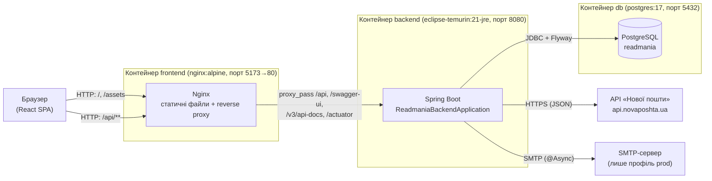

### 2.3. Шарова архітектура бекенду

Бекенд побудовано за класичною тришаровою схемою з наскрізними компонентами безпеки та обробки помилок:

| Шар | Пакет | Відповідальність |
|---|---|---|
| Представлення (REST) | `ua.readmania.controller` | Маршрутизація HTTP-запитів, валідація DTO (`@Valid`), отримання поточного користувача, перетворення результату на HTTP-відповідь |
| Об'єкти передачі даних | `ua.readmania.dto.*` | Request / Response DTO, згруповані за підсистемами (`auth`, `cart`, `catalog`, `challenge`, `giftset`, `institution`, `loyalty`, `manager.*`, `order`, `rating`, `user`) |
| Бізнес-логіка | `ua.readmania.service`, `ua.readmania.service.*` | Транзакційні сценарії варіантів використання, перевірка бізнес-правил, побічні дії (бонуси, сповіщення, журнал дарунків) |
| Інтеграції | `ua.readmania.delivery` | Клієнт зовнішнього API «Нової пошти» (`NovaPoshtaDeliveryService`) та його DTO |
| Доменна модель і доступ до даних | `ua.readmania.domain.*` | JPA-сутності, перерахування, Spring Data репозиторії, `Specification`-и для динамічної фільтрації |
| Безпека | `ua.readmania.security` | Ланцюжок фільтрів Spring Security, CSRF для SPA, перевірка статусу облікового запису, обробники 401/403 |
| Наскрізні компоненти | `ua.readmania.common` | Доменні винятки та глобальний обробник помилок (RFC 9457) |
| Ініціалізація | `ua.readmania` (кореневий) | Точка входу, створення першого менеджера, засівання обкладинок |

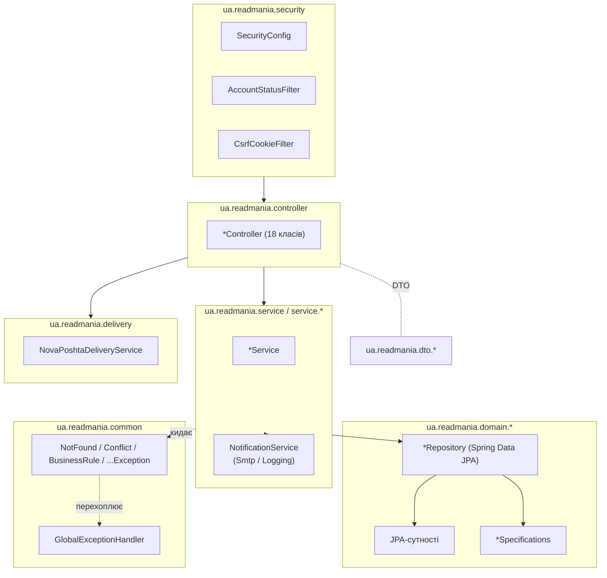

**Примітка щодо відхилень від строгої шаровості.** Контролери `CartController`, `ChallengeController`, `LoyaltyController`, `OrderController`, `ManagerOrderController` і `RatingController` напряму залежать від `UserRepository`: через нього вони отримують сутність поточного користувача за даними автентифікації. Сервісний шар у цьому випадку не залучено.

### 2.4. Відображення контролерів на сервіси

Нижче показано залежності, впроваджені через конструктори контролерів пакета `ua.readmania.controller`.

```mermaid
classDiagram
    direction LR
    class AuthController
    class ProfileController
    class CatalogController
    class ManagerCatalogController
    class CartController
    class OrderController
    class ManagerOrderController
    class LoyaltyController
    class ChallengeController
    class ManagerChallengeController
    class RatingController
    class GiftSetController
    class InstitutionController
    class ManagerInstitutionController
    class ManagerGiftLogController
    class ManagerAnalyticsController
    class ManagerUserController
    class DeliveryController

    class AuthService
    class UserService
    class CatalogService
    class ManagerCatalogService
    class CartService
    class OrderService
    class ManagerOrderService
    class LoyaltyService
    class ChallengeService
    class RatingService
    class GiftSetService
    class InstitutionService
    class GiftLogService
    class AnalyticsService
    class ManagerUserService
    class ManagerInactiveUserService
    class NovaPoshtaDeliveryService
    class UserRepository

    AuthController --> AuthService
    ProfileController --> UserService
    CatalogController --> CatalogService
    ManagerCatalogController --> ManagerCatalogService
    CartController --> CartService
    CartController --> UserRepository
    OrderController --> OrderService
    OrderController --> UserRepository
    ManagerOrderController --> ManagerOrderService
    ManagerOrderController --> UserRepository
    LoyaltyController --> LoyaltyService
    LoyaltyController --> UserRepository
    ChallengeController --> ChallengeService
    ChallengeController --> UserRepository
    ManagerChallengeController --> ChallengeService
    RatingController --> RatingService
    RatingController --> UserRepository
    GiftSetController --> GiftSetService
    InstitutionController --> InstitutionService
    ManagerInstitutionController --> InstitutionService
    ManagerGiftLogController --> GiftLogService
    ManagerAnalyticsController --> AnalyticsService
    ManagerUserController --> ManagerUserService
    ManagerUserController --> ManagerInactiveUserService
    DeliveryController --> NovaPoshtaDeliveryService
```

Базові шляхи контролерів (`@RequestMapping`):

| Контролер | Базовий шлях | Основні ВВ SRS |
|---|---|---|
| `AuthController` | `/api/auth` | G2, G3, C10, M7 (подання запиту на розблокування) |
| `ProfileController` | `/api/account`, `/api/profile` | C5 |
| `CatalogController` | `/api/catalog` | G1 |
| `ManagerCatalogController` | `/api/manager` | M1.1–M1.3, M2 |
| `CartController` | `/api/cart` | C1.1–C1.3 |
| `OrderController` | `/api/orders` | C2, C3, C4, C8 |
| `ManagerOrderController` | `/api/manager/orders` | M3 |
| `LoyaltyController` | `/api/loyalty` | C7, C8 |
| `ChallengeController` | `/api/challenges` | C7 |
| `ManagerChallengeController` | `/api/manager/challenges` | M4.1–M4.3 |
| `RatingController` | `/api/ratings` | C6 |
| `GiftSetController` | `/api/gift-sets` | C9 |
| `InstitutionController` | `/api/institutions` | C2 (вибір закладу для замовлення в дар) |
| `ManagerInstitutionController` | `/api/manager/institutions` | M8.1–M8.3, M12 |
| `ManagerGiftLogController` | `/api/manager/gift-log` | M9 |
| `ManagerAnalyticsController` | `/api/manager/analytics` | M10 |
| `ManagerUserController` | `/api/manager/users` | M5, M6, M7, M11 |
| `DeliveryController` | `/api/delivery` | C2 (вибір міста та відділення «Нової пошти») |

Повний перелік ендпоінтів наведено в розділі 8.

### 2.5. Точка входу та компоненти ініціалізації

| Клас | Тип | Призначення |
|---|---|---|
| `ReadmaniaBackendApplication` | `@SpringBootApplication` | Точка входу. Увімкнено `@EnableAsync` (асинхронні сповіщення), `@EnableScheduling` (планувальник викликів) та `@EnableSpringDataWebSupport(pageSerializationMode = VIA_DTO)`: об'єкти `Page` серіалізуються у стабільну JSON-структуру `PagedModel` |
| `ManagerBootstrapInitializer` | `ApplicationRunner`, `@Component` | Під час старту читає `app.initial-manager.email` і `app.initial-manager.password` (змінні середовища `APP_INITIAL_MANAGER_EMAIL`, `APP_INITIAL_MANAGER_PASSWORD`). Якщо обидва значення задано і користувача з таким email (без урахування регістру) немає, створює `User` з роллю `MANAGER`, статусом `ACTIVE`, нульовим балансом та ім'ям «Тестовий Менеджер». Пароль хешується `PasswordEncoder`. |
| `LocalCoverSeeder` | `ApplicationRunner`, `@Profile({"local", "dev", "default"})` | Під час старту сканує `classpath*:seed-covers/*`. Для кожного файлу шукає книгу за ISBN з імені файлу (наприклад, `978-966-03-7000-1.png`). Якщо в книги ще немає обкладинки, створює `BookCover` із MIME-типом за розширенням (`png`, `webp`, `gif`, інакше `image/jpeg`). Помилки лише логуються й не зупиняють старт. |

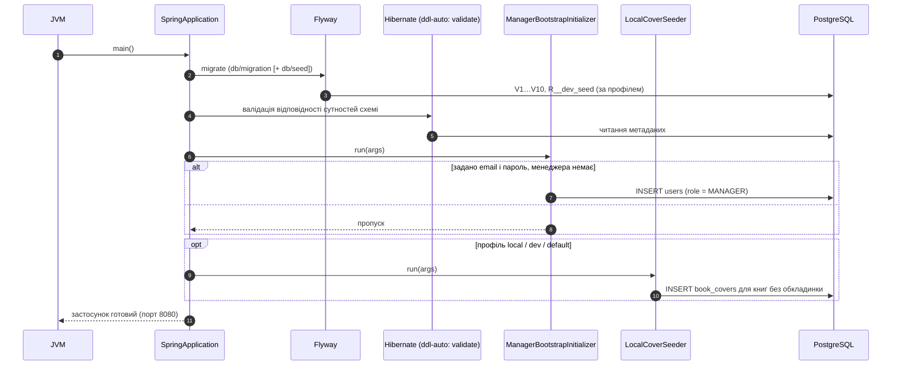

---

## 3. Середовище розробки та конфігурація

### 3.1. Попередні вимоги

| Інструмент | Мінімальна версія | Призначення |
|---|---|---|
| JDK | 21 (рекомендовано Eclipse Temurin) | Збірка та запуск бекенду поза Docker |
| Docker Engine та Docker Compose v2 | актуальна | Повний стек; Testcontainers в інтеграційних тестах |
| Node.js та npm | 20+ (образ збірки використовує Node 22) | Локальний запуск фронтенду |
| IntelliJ IDEA (рекомендовано) | — | HTTP Client для файлів `backend/http/*.http` |

Maven окремо встановлювати не потрібно: використовується Maven Wrapper (`backend/mvnw`, `backend/mvnw.cmd`).

### 3.2. Структура репозиторію (верхній рівень)

```
ReadMania/
├── .github/workflows/backend-ci.yml   # CI бекенду
├── backend/                           # Spring Boot (Maven)
│   ├── Dockerfile                     # Multi-stage: maven:3.9.9-eclipse-temurin-21 → eclipse-temurin:21-jre-jammy
│   ├── http/                          # auth.http, catalog.http, delivery.http, manager.http, orders.http + env-файли
│   ├── pom.xml
│   └── src/
│       ├── main/java/ua/readmania/    # common, controller, delivery, domain, dto, security, service
│       ├── main/resources/
│       │   ├── application.yml, application-local.yml, application-prod.yml, application-example.yml
│       │   ├── db/migration/          # V1__init.sql … V10__institutions_unique_name.sql
│       │   ├── db/seed/               # R__dev_seed.sql
│       │   └── seed-covers/           # обкладинки для LocalCoverSeeder (ім'я файлу = ISBN)
│       └── test/
│           ├── java/ua/readmania/     # інтеграційні та модульні тести
│           └── resources/             # application.yml, application-test.yml
├── frontend/                          # React 19 + Vite (Dockerfile, nginx.conf)
├── docs/                              # проєктна документація та PDF вимог
├── docker-compose.yml
├── run-docker.sh
└── .editorconfig                      # UTF-8, LF, 4 пробіли (2 для yml/json/js/jsx/css/html)
```

### 3.3. Запуск повного стеку в Docker

Оркестрацію описано в `docker-compose.yml`. Стек складається з чотирьох сервісів в одній мережі `readmania-net` (драйвер `bridge`):

| Сервіс | Контейнер | Образ / збірка | Порт хоста | Перевірка стану (healthcheck) | Залежність |
|---|---|---|---|---|---|
| `db` | `readmania-db` | `postgres:17`, `POSTGRES_INITDB_ARGS=--encoding=UTF8`, том `pgdata` | 5432 | `pg_isready -U readmania -d readmania` | — |
| `db-backup` | `readmania-db-backup` | `postgres:17` (`scripts/docker-backup-daemon.sh`), том `./backups:/backups` | — | — | `db: service_healthy` |
| `backend` | `readmania-backend` | `./backend/Dockerfile` | 8080 | `curl -f http://localhost:8080/actuator/health` | `db: service_healthy` |
| `frontend` | `readmania-frontend` | `./frontend/Dockerfile` | 5173 → 80 | `wget -qO- http://localhost:80/` | `backend: service_healthy` |

Змінні середовища контейнера `backend`: `SPRING_PROFILES_ACTIVE=local`, `DB_URL=jdbc:postgresql://db:5432/readmania`, `DB_USERNAME`, `DB_PASSWORD`, `APP_INITIAL_MANAGER_EMAIL`, `APP_INITIAL_MANAGER_PASSWORD`, `APP_NOVAPOSHTA_API_KEY` (береться із середовища хоста; за замовчуванням порожня).

Контейнер `db-backup` реалізує автоматичне щоденне резервне копіювання БД (SRS R5): щоденно о 03:00 UTC (та при старті контейнера) створюється стиснений кастомний дамп (`pg_dump -Fc`), зберігається у томі `./backups` та автоматично виконується ротація з видаленням копій, старших за 14 днів.

Скрипт `run-docker.sh` обгортає команди Docker Compose:

| Команда | Синонім | Дія |
|---|---|---|
| `./run-docker.sh up` | `start` (типова команда) | `docker compose up -d --build` |
| `./run-docker.sh down` | `stop` | `docker compose down` |
| `./run-docker.sh restart` | — | `down`, потім `up -d --build` |
| `./run-docker.sh logs` | — | `docker compose logs -f` |
| `./run-docker.sh status` | `ps` | `docker compose ps` |
| `./run-docker.sh clean` | — | `docker compose down -v` (**видаляє том `pgdata` разом з усіма даними БД**) |
| `./run-docker.sh backup` | — | Створення резервної копії БД через `scripts/backup.sh` (`pg_dump -Fc`, зберігання 14 днів, SRS R5) |
| `./run-docker.sh restore` | — | Відновлення БД з дампу через `scripts/restore.sh` (`pg_restore`, SRS R4, R5) |

Адреси після запуску: інтерфейс — `http://localhost:5173`; API — `http://localhost:8080`; Swagger UI — `http://localhost:8080/swagger-ui.html`; стан бекенду — `http://localhost:8080/actuator/health`.

**Особливості образів:**

- Образ бекенду збирається з прапорцем `-DskipTests`. Тести в образі не виконуються, їх перевіряє CI (п. 3.8).
- Застосунок у контейнері працює від непривілейованого користувача `spring:spring`.
- Nginx роздає SPA з резервним маршрутом `try_files $uri $uri/ /index.html`, вмикає gzip і додає заголовки `X-Frame-Options: SAMEORIGIN`, `X-Content-Type-Options: nosniff`, `X-XSS-Protection: 1; mode=block`.

### 3.4. Локальний запуск без Docker для застосунку

```bash
# 1. Лише БД у Docker
docker compose up -d db

# 2. Бекенд (профіль local: тестові дані, початковий менеджер)
cd backend
./mvnw spring-boot:run -Dspring-boot.run.profiles=local

# 3. Фронтенд (Vite dev server, HMR, проксі /api → http://localhost:8080)
cd frontend
npm install
npm run dev
```

Скрипти `frontend/package.json`: `dev` (Vite), `build` (виробнича збірка), `lint` (Oxlint), `preview` (перегляд зібраної версії).

### 3.5. Профілі Spring та конфігураційні файли

| Файл | Профіль | Ключові налаштування |
|---|---|---|
| `application.yml` | базовий (завжди) | `server.forward-headers-strategy: framework`; сесія 30 хв; cookie `http-only: true`, `same-site: lax`, `secure: false`; datasource з `DB_URL` / `DB_USERNAME` / `DB_PASSWORD` (за замовчуванням `localhost:5432/readmania`, `readmania/readmania`); `jpa.open-in-view: false`; `hibernate.ddl-auto: validate`; Flyway `locations: [classpath:db/migration, classpath:db/seed]`, `ignore-migration-patterns: ["*:missing", "*:future"]`; Actuator відкриває лише `health` без деталей; `app.novaposhta.*` |
| `application-local.yml` | `local` | Flyway `locations: [db/migration, db/seed]`; `app.initial-manager.email: manager@readmania.ua`, `app.initial-manager.password: Manager123!` |
| `application-prod.yml` | `prod` | `server.servlet.session.cookie.secure: true`; Flyway лише `classpath:db/migration` (без сценарію наповнення); `springdoc.api-docs.enabled: false`, `springdoc.swagger-ui.enabled: false` |
| `application-example.yml` | — (шаблон) | Приклад локальної конфігурації із заглушками пароля БД і ключа «Нової пошти» |
| `src/test/resources/application.yml` | тести | **Затіняє** основний `application.yml` у тестовому classpath: `ddl-auto: validate`, Flyway зі стандартним розташуванням `classpath:db/migration` (без `db/seed`), Actuator `health`. Datasource надає Testcontainers через `@ServiceConnection`. |
| `src/test/resources/application-test.yml` | `test` | Аналогічні перевизначення для профілю `test` |

Профіль визначає, яка реалізація `NotificationService` буде активна і чи працює `LocalCoverSeeder`. Відповідність профілів біновим компонентам описано в розділах 6 і 7.

### 3.6. Змінні середовища

| Змінна | Властивість Spring | Значення за замовчуванням | Призначення |
|---|---|---|---|
| `SPRING_PROFILES_ACTIVE` | `spring.profiles.active` | — (`default`) | Вибір профілю (`local`, `prod`, …) |
| `DB_URL` | `spring.datasource.url` | `jdbc:postgresql://localhost:5432/readmania` | URL підключення до БД |
| `DB_USERNAME` | `spring.datasource.username` | `readmania` | Користувач БД |
| `DB_PASSWORD` | `spring.datasource.password` | `readmania` | Пароль БД |
| `APP_INITIAL_MANAGER_EMAIL` | `app.initial-manager.email` | порожньо (у `local` — `manager@readmania.ua`) | Email першого менеджера |
| `APP_INITIAL_MANAGER_PASSWORD` | `app.initial-manager.password` | порожньо (у `local` — `Manager123!`) | Пароль першого менеджера |
| `APP_NOVAPOSHTA_API_KEY` | `app.novaposhta.api-key` | порожньо | Ключ API «Нової пошти» |
| — | `app.novaposhta.api-url` | `https://api.novaposhta.ua/v2.0/json/` | Адреса API «Нової пошти» |
| — | `app.novaposhta.timeout-ms` | `3000` | Тайм-аут запитів до «Нової пошти», мс |

Змінні `APP_INITIAL_MANAGER_*` зв'язуються з властивостями `app.initial-manager.*` через механізм relaxed binding Spring Boot. Налаштування SMTP для профілю `prod` описано в `docs/EMAIL_NOTIFICATIONS.md` і в розділі 7.

> **Безпека.** Облікові дані з `application-local.yml` і `docker-compose.yml` призначені лише для локальної розробки. У продуктивному середовищі паролі БД, менеджера та ключ «Нової пошти» потрібно передавати лише через змінні середовища або сховище секретів (SRS S3–S4).

### 3.7. Тестові облікові записи (профілі `local` / `default`)

| Роль | Email | Пароль | Джерело |
|---|---|---|---|
| `MANAGER` | `manager@readmania.ua` | `Manager123!` | `ManagerBootstrapInitializer` (`application-local.yml` / `docker-compose.yml`) та `R__dev_seed.sql` |
| `USER` | `user@readmania.ua` | `User123!` | `R__dev_seed.sql` (статус `ACTIVE`, 150 бонусних балів) |
| `USER` | `reader@readmania.ua` | `User123!` | `R__dev_seed.sql` (статус `ACTIVE`, 50 балів; має тестовий токен скидання пароля `dev-reset-token-reader-12345`) |
| `USER` | `blocked@readmania.ua` | `User123!` | `R__dev_seed.sql` (статус `BLOCKED`; має запит на розблокування зі статусом `PENDING`) |

Повний вміст сценарію наповнення описано в розділі 4.

### 3.8. Збірка, тести та безперервна інтеграція

```bash
cd backend
./mvnw test      # усі тести (потрібен запущений Docker для Testcontainers)
./mvnw verify    # повна перевірка, як у CI
```

`maven-surefire-plugin` запускає класи за шаблонами `**/*Test.java` і `**/*IT.java`, тому інтеграційні тести `*IT` виконуються вже у фазі `test`. `maven-compiler-plugin` компілює з прапорцем `-parameters`, щоб Spring міг отримувати імена параметрів методів.

Робочий процес GitHub Actions `Backend CI` (`.github/workflows/backend-ci.yml`):

- запускається на `push` і `pull_request` у гілку `main`, якщо змінено `backend/**` або сам файл workflow;
- працює на `ubuntu-latest` з тайм-аутом 10 хв і робочим каталогом `backend`;
- кроки: `actions/checkout@v4` → `actions/setup-java@v4` (Temurin 21, кеш Maven за `backend/pom.xml`) → `chmod +x ./mvnw` → `./mvnw -B verify`.

### 3.9. Ручне тестування API (IntelliJ HTTP Client)

У каталозі `backend/http/` зібрано виконувані запити:

| Файл | Зміст |
|---|---|
| `auth.http` | Реєстрація, вхід, поточний користувач, вихід, сценарії помилок |
| `catalog.http` | Публічний каталог, фільтри, деталі книги, операції менеджера з каталогом |
| `orders.http` | Попередній розрахунок, звичайні та подарункові замовлення, скасування, зміна статусу |
| `manager.http` | Менеджерські операції |
| `delivery.http` | Запити до проксі «Нової пошти» (`/api/delivery`) |
| `http-client.env.json` | Публічні змінні середовищ |
| `http-client.private.env.json.example` | Шаблон приватних змінних (паролі); робочий файл `http-client.private.env.json` не комітиться |

HTTP Client автоматично зберігає cookie `JSESSIONID` між запитами. Для запитів, що змінюють стан, потрібен також CSRF-токен (див. розділ 6).

### 3.10. Стандарти оформлення коду

Файл `.editorconfig` задає кодування UTF-8, закінчення рядків LF (CRLF для `*.cmd` і `*.bat`), обов'язковий фінальний перенос рядка, відступ 4 пробіли (2 пробіли для `yml`, `yaml`, `json`, `js`, `jsx`, `ts`, `tsx`, `css`, `html`). Для `*.md` кінцеві пробіли не обрізаються.

---

## 4. База даних та міграції Flyway

### 4.1. Загальні принципи

| Принцип | Реалізація | Вимога |
|---|---|---|
| СКБД і кодування | PostgreSQL 17, БД створюється з `--encoding=UTF8` (`docker-compose.yml`) | ТЗ 4.5, SRS D7 |
| Керування схемою | Лише Flyway; Hibernate працює в режимі `ddl-auto: validate` і не змінює схему, а під час старту перевіряє відповідність сутностей таблицям | — |
| Первинні ключі | `BIGINT GENERATED BY DEFAULT AS IDENTITY`; складені PK у таблицях зв'язку (`book_authors`, `cart_items`, `challenge_completions`); спільний PK у `book_covers` (`book_id`) | — |
| Грошові величини | `NUMERIC(12,2)` з `CHECK (... >= 0)` | — |
| Часові мітки | `TIMESTAMPTZ` (↔ `java.time.Instant`); `gift_log.delivered_date` має тип `DATE` | — |
| Перерахування | `VARCHAR(50)` + `CHECK (... IN (...))` (↔ `@Enumerated(EnumType.STRING)`) | — |
| Регістронезалежна унікальність | Функціональні унікальні індекси на `LOWER(...)`: `users.email`, `genres.name`, `authors.name`, `institutions.name` | G2, M1, M8 |
| Нормалізація | 3НФ: автори винесено в `authors` + `book_authors` (M:N), жанри — у `genres` | SRS D7 |
| Індексація FK | Кожна колонка зовнішнього ключа покрита індексом (окремим або як провідна колонка PK чи складеного індексу); перевіряє тест `SchemaIT` | SRS D7 |
| Оптимістичне блокування | Колонка `version BIGINT NOT NULL DEFAULT 0` у `books` та `orders` | SRS 7.2.2.8 |
| Захист фінансових інваріантів | CHECK-обмеження формул знижки та суми до сплати безпосередньо в `orders` | C8 |

### 4.2. Конфігурація Flyway

- Розташування міграцій: `classpath:db/migration` (версійні `V<N>__<опис>.sql`) і `classpath:db/seed` (повторювана `R__dev_seed.sql`). Набір розташувань залежить від профілю (п. 3.5): у `prod` використовується лише `db/migration`.
- `ignore-migration-patterns: ["*:missing", "*:future"]` — Flyway не повідомляє про помилку, якщо в історії `flyway_schema_history` є міграції, відсутні в classpath (наприклад, повторювану міграцію при запуску в `prod`) або новіші за наявні файли.
- Повторювана міграція `R__dev_seed.sql` виконується після всіх версійних і перезапускається щоразу, коли змінюється її контрольна сума. Тому сценарій написано **ідемпотентно**: `WHERE NOT EXISTS`, `ON CONFLICT DO NOTHING`.

### 4.3. Реєстр міграцій

| Версія | Файл | Зміст | ВВ / вимоги |
|---|---|---|---|
| V1 | `V1__init.sql` | Порожній файл (0 рядків); зберігає нумерацію базової версії | — |
| V2 | `V2__users.sql` | Таблиця `users`; `uk_users_lower_email` на `LOWER(email)`; частковий індекс `idx_users_m5_inactive` на `last_login_at` `WHERE status = 'ACTIVE'` | G2, G3, C5, M5, M6 |
| V3 | `V3__catalog.sql` | `genres`, `authors`, `books`, `book_authors`, `book_covers`; частковий унікальний `uk_books_isbn_active` `WHERE deleted_at IS NULL`; індекси `idx_books_lower_title`, `idx_books_genre_id`, `idx_books_price`, `idx_books_deleted_at`, `idx_authors_lower_name`, `idx_book_authors_author_id` | G1, M1, M2 |
| V4 | `V4__cart_institutions.sql` | `cart_items` (PK `(user_id, book_id)`, `quantity > 0`), `institutions`; індекси `idx_cart_items_book_id`, `idx_institutions_name` | C1, C2, M8 |
| V5 | `V5__orders.sql` | `orders`, `order_items`, `order_status_history`; CHECK-обмеження формул; індекси `idx_orders_user_created_at`, `idx_orders_status_created_at`, `idx_orders_institution_id`, `idx_order_items_order_id`, `idx_order_items_book_id`, `idx_order_status_history_order_id`, `idx_order_status_history_changed_by`. Початковий набір статусів містив 6 значень (`AWAITING_PAYMENT`, `PROCESSING`, `ASSEMBLED`, `DELIVERING`, `DELIVERED`, `CANCELLED`) зі значенням за замовчуванням `PROCESSING` | C2, C3, C4, M3 |
| V6 | `V6__loyalty.sql` | `bonus_transactions` (без FK на виклик — його додано у V7), `ratings`; часткові унікальні `uk_bonus_order_reward` (`order_id` `WHERE type = 'ORDER_REWARD'`), `uk_bonus_challenge_reward` (`(user_id, challenge_id)` `WHERE type = 'CHALLENGE_REWARD'`), `uk_ratings_user_book` (`(user_id, book_id)` `WHERE user_id IS NOT NULL`) | C6, C7, C8 |
| V7 | `V7__challenges.sql` | `challenges`, `challenge_completions`; FK `fk_bonus_transactions_challenge` (`bonus_transactions.challenge_id → challenges.id ON DELETE SET NULL`) | C7, M4 |
| V8 | `V8__gift_log.sql` | `gift_log` з `uk_gift_log_order_book (order_id, book_title)`; індекси `idx_gift_log_institution_delivered`, `idx_gift_log_order_id` | M9 |
| V9 | `V9__schema_fixes.sql` | Узгодження зі SRS (див. п. 4.4) | G3, M3, M6–M8, M12, A.1, A.4, A.10 |
| V10 | `V10__institutions_unique_name.sql` | Злиття закладів-дублікатів (без урахування регістру) до запису з найменшим `id` з переприв'язкою `orders.institution_id` і `gift_log.institution_id`; видалення дублікатів; унікальний індекс `uk_institutions_lower_name` на `LOWER(name)` | M8.1, M8.2 |
| R | `db/seed/R__dev_seed.sql` | Тестові дані (див. п. 4.10) | — |

### 4.4. Зміни міграції V9 (`V9__schema_fixes.sql`)

| № | Зміна | Деталі |
|---|---|---|
| 1 | Захист від підбору пароля (G3) | `users.failed_login_attempts INT NOT NULL DEFAULT 0`, `users.locked_until TIMESTAMPTZ`. Інструкції `ADD COLUMN IF NOT EXISTS` для `blocked_at` і `block_reason` нічого не змінюють, оскільки ці колонки вже створено у V2. Тому `block_reason` лишається `VARCHAR(1000)`, а не `TEXT`. |
| 2 | Скидання пароля (G3) | Таблиця `password_reset_tokens` (`token VARCHAR(255) NOT NULL UNIQUE`, `expires_at`, `used_at`); індекси `idx_password_reset_tokens_user_id`, `idx_password_reset_tokens_token` |
| 3 | Запити на розблокування (M6, M7) | Таблиця `unblock_requests` (`status IN ('PENDING','APPROVED','REJECTED')`, `manager_comment`, `resolved_by_user_id`, `resolved_at`); індекси `idx_unblock_requests_user_id`, `idx_unblock_requests_status`, `idx_unblock_requests_resolved_by` |
| 4 | Типи закладів (M8, M12) | `institutions.type VARCHAR(50) NOT NULL DEFAULT 'ORPHANAGE'` + `chk_institutions_type` (`ORPHANAGE`, `BOARDING_SCHOOL`, `LIBRARY`) |
| 5 | Чотири статуси замовлення (A.1, SRS Таблиця 3) | Дані: `PROCESSING`, `ASSEMBLED`, `DELIVERING` → `PAID` (в `orders` та `order_status_history`). Значення за замовчуванням `orders.status` → `AWAITING_PAYMENT`. Блоки `DO $$ … $$` видаляють усі старі обмеження на колонках статусу (знайдені через `information_schema.constraint_column_usage`) і створюють `chk_orders_status`, `chk_order_status_history_from_status` (допускає `NULL`), `chk_order_status_history_to_status` |
| 6 | Видавництво та рік (A.4) | `books.publisher VARCHAR(255) NOT NULL DEFAULT 'Невідоме видавництво'`, `books.publication_year INT NOT NULL DEFAULT 2024` + `chk_books_publication_year` (1450–2100); індекс `idx_books_publication_year` |
| 7 | Контактна особа закладу (A.10) | `orders.institution_contact_person VARCHAR(255)`; `chk_orders_gift_institution` перевизначено: для `GIFT` обов'язкові і `institution_name`, і `institution_contact_person` |
| 8 | Вибірки менеджера та архівування (M3, SRS 7.2.2.6, 7.2.2.7) | Частковий індекс `idx_orders_unpaid_awaiting` (`created_at` `WHERE status = 'AWAITING_PAYMENT'`); функціональний частковий `idx_orders_archived` (`COALESCE(status_changed_at, created_at)` `WHERE status IN ('DELIVERED','CANCELLED')`); `gift_log.order_id` став необов'язковим, FK `gift_log_order_id_fkey` → `ON DELETE SET NULL` |

### 4.5. ER-діаграма

Діаграма відображає підсумковий стан схеми після застосування V1–V10. Службову таблицю Flyway `flyway_schema_history` не показано.

```mermaid
erDiagram
    users {
        BIGINT id PK
        VARCHAR email "UK lower(email)"
        VARCHAR password_hash
        VARCHAR role "USER | MANAGER"
        VARCHAR status "ACTIVE | BLOCKED"
        VARCHAR block_reason
        TIMESTAMPTZ blocked_at
        VARCHAR full_name
        VARCHAR phone
        VARCHAR delivery_address
        INT bonus_balance ">= 0"
        INT failed_login_attempts
        TIMESTAMPTZ locked_until
        TIMESTAMPTZ created_at
        TIMESTAMPTZ last_login_at
    }
    password_reset_tokens {
        BIGINT id PK
        BIGINT user_id FK
        VARCHAR token UK
        TIMESTAMPTZ expires_at
        TIMESTAMPTZ used_at
        TIMESTAMPTZ created_at
    }
    unblock_requests {
        BIGINT id PK
        BIGINT user_id FK
        TEXT reason
        VARCHAR status "PENDING | APPROVED | REJECTED"
        TEXT manager_comment
        BIGINT resolved_by_user_id FK
        TIMESTAMPTZ resolved_at
        TIMESTAMPTZ created_at
    }
    genres {
        BIGINT id PK
        VARCHAR name "UK lower(name)"
        TIMESTAMPTZ created_at
    }
    authors {
        BIGINT id PK
        VARCHAR name "UK lower(name)"
        TIMESTAMPTZ created_at
    }
    books {
        BIGINT id PK
        VARCHAR title
        TEXT description
        VARCHAR isbn "UK where deleted_at is null"
        BIGINT genre_id FK
        NUMERIC price ">= 0"
        INT stock ">= 0"
        VARCHAR publisher
        INT publication_year "1450..2100"
        TIMESTAMPTZ deleted_at
        BIGINT version
        TIMESTAMPTZ created_at
        TIMESTAMPTZ updated_at
    }
    book_authors {
        BIGINT book_id PK, FK
        BIGINT author_id PK, FK
    }
    book_covers {
        BIGINT book_id PK, FK
        VARCHAR content_type
        BYTEA data
        TIMESTAMPTZ created_at
    }
    cart_items {
        BIGINT user_id PK, FK
        BIGINT book_id PK, FK
        INT quantity "> 0"
        TIMESTAMPTZ created_at
    }
    institutions {
        BIGINT id PK
        VARCHAR name "UK lower(name)"
        VARCHAR type "ORPHANAGE | BOARDING_SCHOOL | LIBRARY"
        VARCHAR address
        VARCHAR contact_person
        VARCHAR phone
        TIMESTAMPTZ created_at
    }
    orders {
        BIGINT id PK
        BIGINT user_id FK "nullable"
        VARCHAR type "REGULAR | GIFT"
        VARCHAR status "AWAITING_PAYMENT | PAID | DELIVERED | CANCELLED"
        VARCHAR delivery_method "COURIER | POST_OFFICE | null"
        VARCHAR payment_method "ON_DELIVERY | TRANSFER"
        VARCHAR recipient_name
        VARCHAR recipient_phone
        VARCHAR delivery_address
        BIGINT institution_id FK "nullable"
        VARCHAR institution_name
        VARCHAR institution_contact_person
        NUMERIC items_total
        NUMERIC discount_amount
        INT points_used
        NUMERIC total_to_pay
        BIGINT version
        TIMESTAMPTZ created_at
        TIMESTAMPTZ status_changed_at
        TIMESTAMPTZ delivered_at
    }
    order_items {
        BIGINT id PK
        BIGINT order_id FK
        BIGINT book_id FK "nullable"
        VARCHAR book_title
        NUMERIC book_price
        INT quantity "> 0"
    }
    order_status_history {
        BIGINT id PK
        BIGINT order_id FK
        VARCHAR from_status "nullable"
        VARCHAR to_status
        TIMESTAMPTZ changed_at
        BIGINT changed_by_user_id FK "nullable"
        VARCHAR comment
    }
    bonus_transactions {
        BIGINT id PK
        BIGINT user_id FK
        INT points "+/-"
        VARCHAR type "ORDER_REWARD | RATING_REWARD | CHALLENGE_REWARD | SPENT | REFUND"
        BIGINT order_id FK "nullable"
        BIGINT book_id FK "nullable"
        BIGINT challenge_id FK "nullable"
        TIMESTAMPTZ created_at
    }
    ratings {
        BIGINT id PK
        BIGINT user_id FK "nullable"
        BIGINT book_id FK
        BIGINT order_id FK "nullable"
        SMALLINT value "1..5"
        TIMESTAMPTZ created_at
        TIMESTAMPTZ updated_at
    }
    challenges {
        BIGINT id PK
        VARCHAR title
        TEXT description
        INT required_books "> 0"
        BIGINT genre_id FK "nullable"
        TIMESTAMPTZ deadline
        INT reward_points ">= 0"
        VARCHAR status "ACTIVE | COMPLETED | EXPIRED | CANCELLED"
        TIMESTAMPTZ finished_at
        TIMESTAMPTZ created_at
    }
    challenge_completions {
        BIGINT user_id PK, FK
        BIGINT challenge_id PK, FK
        TIMESTAMPTZ completed_at
    }
    gift_log {
        BIGINT id PK
        BIGINT order_id FK "nullable"
        BIGINT institution_id FK "nullable"
        VARCHAR institution_name
        VARCHAR book_title
        INT quantity "> 0"
        DATE delivered_date
        TIMESTAMPTZ created_at
    }

    users ||--o{ password_reset_tokens : "CASCADE"
    users ||--o{ unblock_requests : "подає (CASCADE)"
    users |o--o{ unblock_requests : "розглядає (SET NULL)"
    genres ||--o{ books : "RESTRICT"
    books ||--o{ book_authors : "CASCADE"
    authors ||--o{ book_authors : "RESTRICT"
    books ||--o| book_covers : "CASCADE"
    users ||--o{ cart_items : "CASCADE"
    books ||--o{ cart_items : "CASCADE"
    users |o--o{ orders : "SET NULL"
    institutions |o--o{ orders : "SET NULL"
    orders ||--|{ order_items : "CASCADE"
    books |o--o{ order_items : "SET NULL"
    orders ||--o{ order_status_history : "CASCADE"
    users |o--o{ order_status_history : "змінив (SET NULL)"
    users ||--o{ bonus_transactions : "CASCADE"
    orders |o--o{ bonus_transactions : "SET NULL"
    books |o--o{ bonus_transactions : "SET NULL"
    challenges |o--o{ bonus_transactions : "SET NULL"
    users |o--o{ ratings : "SET NULL"
    books ||--o{ ratings : "CASCADE"
    orders |o--o{ ratings : "SET NULL"
    genres |o--o{ challenges : "RESTRICT"
    users ||--o{ challenge_completions : "CASCADE"
    challenges ||--o{ challenge_completions : "CASCADE"
    orders |o--o{ gift_log : "SET NULL"
    institutions |o--o{ gift_log : "SET NULL"
```

### 4.6. Поведінка зовнішніх ключів під час видалення

Правила `ON DELETE` визначають, як система поводиться під час видалення неактивних облікових записів (M5), застарілих замовлень (SRS 7.2.2.7) та закладів (M8.3).

| Батьківська таблиця | Дочірня таблиця.колонка | Правило | Наслідок |
|---|---|---|---|
| `users` | `cart_items.user_id`, `bonus_transactions.user_id`, `challenge_completions.user_id`, `password_reset_tokens.user_id`, `unblock_requests.user_id` | `CASCADE` | Персональні службові дані видаляються разом з обліковим записом |
| `users` | `orders.user_id`, `ratings.user_id`, `order_status_history.changed_by_user_id`, `unblock_requests.resolved_by_user_id` | `SET NULL` | Замовлення, оцінки й аудит зберігаються знеособленими (M5) |
| `genres` | `books.genre_id`, `challenges.genre_id` | `RESTRICT` | Жанр, до якого належать книги (зокрема м'яко видалені) або виклики, видалити неможливо |
| `authors` | `book_authors.author_id` | `RESTRICT` | Автора, пов'язаного з книгами, видалити неможливо |
| `books` | `book_authors.book_id`, `book_covers.book_id`, `cart_items.book_id`, `ratings.book_id` | `CASCADE` | Діє лише для фізичного видалення книги. Застосунок використовує м'яке видалення (`deleted_at`), тому зазвичай це правило не спрацьовує |
| `books` | `order_items.book_id`, `bonus_transactions.book_id` | `SET NULL` | Позиція замовлення зберігає знімок `book_title` / `book_price` |
| `orders` | `order_items.order_id`, `order_status_history.order_id` | `CASCADE` | Повне видалення архівного замовлення видаляє його склад та історію |
| `orders` | `bonus_transactions.order_id`, `ratings.order_id`, `gift_log.order_id` | `SET NULL` | Журнал балів, оцінки та журнал дарунків зберігаються (SRS 7.2.2.7) |
| `institutions` | `orders.institution_id`, `gift_log.institution_id` | `SET NULL` | Замовлення та журнал зберігають знімки `institution_name` / `institution_contact_person` |
| `challenges` | `challenge_completions.challenge_id` | `CASCADE` | — |
| `challenges` | `bonus_transactions.challenge_id` | `SET NULL` | Нараховані бали зберігаються |

### 4.7. Бізнес-обмеження на рівні БД

СКБД є останньою лінією захисту бізнес-правил: навіть за помилки в сервісному коді некоректний запис буде відхилено, а `GlobalExceptionHandler` перетворить відповідний `DataIntegrityViolationException` на `409 Conflict`.

| Обмеження | Таблиця | Вираз / умова | Правило SRS |
|---|---|---|---|
| `chk_orders_discount_points` | `orders` | `discount_amount = (points_used * 10)::numeric(12,2)` | 1 бал = 10 грн (SRS 1.3, C8) |
| `chk_orders_total_to_pay` | `orders` | `total_to_pay = items_total - discount_amount` | «Сума до сплати» (SRS 1.3) |
| `chk_orders_max_discount` | `orders` | `discount_amount * 10 <= items_total * 3` | Знижка ≤ 30 % вартості (C8) |
| `chk_orders_gift_institution` | `orders` | `type != 'GIFT' OR (institution_name IS NOT NULL AND institution_contact_person IS NOT NULL)` | Замовлення в дар (C2, A.10) |
| `chk_orders_status` | `orders` | `status IN ('AWAITING_PAYMENT','PAID','DELIVERED','CANCELLED')` | SRS Таблиця 3 (A.1) |
| `chk_order_status_history_from_status`, `chk_order_status_history_to_status` | `order_status_history` | Ті самі 4 значення (`from_status` може бути `NULL`) | A.1 |
| `chk_books_publication_year` | `books` | `publication_year BETWEEN 1450 AND 2100` | A.4 |
| `chk_institutions_type` | `institutions` | `type IN ('ORPHANAGE','BOARDING_SCHOOL','LIBRARY')` | M8, M12 |
| Безіменні CHECK | `users`, `books`, `cart_items`, `order_items`, `ratings`, `challenges`, `gift_log`, `unblock_requests`, `bonus_transactions`, `orders` | `bonus_balance >= 0`, `price >= 0`, `stock >= 0`, `quantity > 0`, `value BETWEEN 1 AND 5`, `required_books > 0`, `reward_points >= 0`, перелічувані значення `role`, `status`, `type`, `delivery_method`, `payment_method` | C1, C6, C8, M1, M4 |
| `uk_books_isbn_active` | `books` | Унікальність ISBN серед не видалених книг | M1.1, M2 |
| `uk_bonus_order_reward` | `bonus_transactions` | Не більше одного `ORDER_REWARD` на замовлення | C8 (захист від повторного нарахування) |
| `uk_bonus_challenge_reward` | `bonus_transactions` | Не більше одного `CHALLENGE_REWARD` на пару користувач–виклик | C7 |
| `uk_ratings_user_book` | `ratings` | Одна оцінка користувача на книгу (для не знеособлених оцінок) | C6 |
| `uk_gift_log_order_book` | `gift_log` | Один запис на пару замовлення–назва книги | M9 |

### 4.8. Індекси

| Призначення | Індекси |
|---|---|
| Унікальність | `uk_users_lower_email`, `uk_genres_lower_name`, `uk_authors_lower_name`, `uk_institutions_lower_name`, `uk_books_isbn_active`, `uk_bonus_order_reward`, `uk_bonus_challenge_reward`, `uk_ratings_user_book`, `uk_gift_log_order_book`, `password_reset_tokens.token` (UNIQUE) |
| Пошук і фільтрація каталогу (G1, SRS D7) | `idx_books_lower_title`, `idx_authors_lower_name`, `idx_books_genre_id`, `idx_books_price`, `idx_books_deleted_at`, `idx_books_publication_year` |
| Вибірки замовлень (C4, M3) | `idx_orders_user_created_at`, `idx_orders_status_created_at`, `idx_orders_unpaid_awaiting`, `idx_orders_archived` |
| Неактивні облікові записи (M5) | `idx_users_m5_inactive` |
| Виклики та журнал дарунків | `idx_challenges_status`, `idx_gift_log_institution_delivered` |
| Покриття FK (SRS D7) | `idx_cart_items_book_id`, `idx_book_authors_author_id`, `idx_orders_institution_id`, `idx_order_items_order_id`, `idx_order_items_book_id`, `idx_order_status_history_order_id`, `idx_order_status_history_changed_by`, `idx_bonus_transactions_user_id`, `idx_bonus_transactions_order_id`, `idx_bonus_transactions_book_id`, `idx_bonus_transactions_challenge_id`, `idx_ratings_book_id`, `idx_ratings_user_id`, `idx_ratings_order_id`, `idx_challenges_genre_id`, `idx_challenge_completions_challenge_id`, `idx_gift_log_order_id`, `idx_password_reset_tokens_user_id`, `idx_unblock_requests_user_id`, `idx_unblock_requests_resolved_by` |
| Інші | `idx_institutions_name`, `idx_unblock_requests_status`, `idx_password_reset_tokens_token` |

Колонки `book_authors.book_id`, `cart_items.user_id`, `challenge_completions.user_id`, `book_covers.book_id`, `orders.user_id` і `gift_log.institution_id` покриті як провідні колонки первинних ключів або складених індексів. Тест `SchemaIT` («D7: На кожній FK-колонці обов'язково присутній індекс (pg_constraint / pg_index)») автоматично перевіряє це правило для всієї схеми.

**Спостереження для супроводу.** Деякі індекси дублюють уже наявні: `idx_authors_lower_name` дублює `uk_authors_lower_name`, а `idx_password_reset_tokens_token` — неявний індекс обмеження `UNIQUE` на `token`. Після V10 запити з точним збігом назви закладу без урахування регістру обслуговує `uk_institutions_lower_name`. Ці індекси коректні, але збільшують вартість запису. Видаляти їх можна лише новою міграцією (п. 4.11).

### 4.9. Ключові проєктні рішення

| Рішення | Реалізація у схемі | Обґрунтування |
|---|---|---|
| М'яке видалення книг (M1.3) | `books.deleted_at`, частковий `uk_books_isbn_active` | Зберігає історію замовлень, оцінок і аналітику; дозволяє повторно використати ISBN після видалення |
| Знімки даних у замовленні | `order_items.book_title`, `book_price`; `orders.recipient_*`, `delivery_address`, `institution_name`, `institution_contact_person`; `gift_log.institution_name`, `book_title` | Фінансова й звітна історія не залежить від подальших змін або видалення книг, закладів і користувачів |
| Обкладинки в окремій таблиці | `book_covers.data BYTEA` з PK = FK на `books` | Вибірки каталогу не завантажують бінарні дані; обкладинки потрапляють у дамп `pg_dump` (SRS R5) |
| Баланс + журнал балів | `users.bonus_balance` (`CHECK >= 0`) + `bonus_transactions` | Журнал забезпечує аудит, а денормалізований баланс з обмеженням не дає списати більше, ніж є, за конкурентних запитів |
| Динамічний прогрес викликів | Лічильників прогресу немає; є лише факт виконання в `challenge_completions` | Прогрес обчислюється із замовлень зі статусом `DELIVERED` (деталі — у розділі 7) |
| Оптимістичне блокування | `books.version`, `orders.version` | Запобігає втраті оновлень залишків і статусів (SRS 7.2.2.8 «Статус змінив інший учасник») |
| Знеособлення замість каскадного видалення | `SET NULL` для `orders.user_id`, `ratings.user_id` | Видалення неактивних облікових записів (M5) не руйнує звітність |
| Спосіб доставки для дарунку | `orders.delivery_method` допускає `NULL` | Для `GIFT` спосіб доставки не обирається |

### 4.10. Сценарій тестових даних `R__dev_seed.sql`

Сценарій заповнює всі таблиці мінімальним узгодженим набором даних для демонстрації і ручного тестування. Ідемпотентність перевіряє тест `SchemaIT.shouldExecuteDevSeedIdempotentlyAndPopulateAllEntities`: сценарій виконується двічі, і кількість записів не змінюється.

| № | Блок сценарію | Дані |
|---|---|---|
| 1 | Користувачі | 4 записи: `manager@readmania.ua` (`MANAGER`), `user@readmania.ua` (150 балів), `reader@readmania.ua` (50 балів), `blocked@readmania.ua` (`BLOCKED`) |
| 2 | Запити на розблокування | 1 запит `PENDING` від `blocked@readmania.ua` |
| 3 | Токени скидання пароля | `dev-reset-token-reader-12345` для `reader@readmania.ua` (дійсний до 2026-12-31) |
| 4 | Жанри | 7: Класика, Поезія, Драматургія, Фантастика, Детектив, Дитяча література, Нон-фікшн |
| 5 | Автори | 11 (Т. Шевченко, Леся Українка, І. Франко, Дж. Орвелл, А. Крісті, С. Лем, А. Конан Дойл, В. Нестайко, В. Підмогильний, І. Нечуй-Левицький, Р. Бредбері) |
| 6 | Заклади-одержувачі | 3 заклади типів зі SRS |
| 7–8 | Книги та зв'язки з авторами | 13 книг з ISBN `978-966-03-7000-1` … `978-966-03-7001-3` (їм відповідають файли в `seed-covers/`) |
| 9 | Кошик | 2 позиції в кошику `user@readmania.ua` |
| 10–11 | Читацькі виклики | 2 виклики (активний і завершений) та 1 факт виконання |
| 12 | Замовлення | 5 замовлень, що охоплюють усі статуси і типи: доставлене звичайне з балами, оплачене, очікує оплати, доставлений дарунок, скасоване; разом з позиціями та історією статусів |
| 13–15 | Журнал дарунків, оцінки, транзакції балів | Узгоджені із замовленнями записи `gift_log`, `ratings`, `bonus_transactions` (`SPENT`, `ORDER_REWARD`, `CHALLENGE_REWARD`, `RATING_REWARD`) |

### 4.11. Правила створення нових міграцій

1. **Не змінюйте застосовані версійні міграції.** Flyway перевіряє контрольні суми, тому зміна вже застосованого файлу зупинить старт застосунку на наявних БД. Будь-які зміни вносьте новим файлом `V11__<опис>.sql`, `V12__…` тощо.
2. **Іменування.** Версія — ціле число без пропусків; опис — `snake_case` англійською; перший рядок файлу — коментар з іменем файлу, другий — опис українською (як у наявних міграціях).
3. **Об'єкти схеми.** Використовуйте префікси `uk_` для унікальних індексів, `idx_` для звичайних, `chk_` для CHECK-обмежень, `fk_` для іменованих зовнішніх ключів. Кожна нова FK-колонка **обов'язково** має індекс, інакше тест D7 у `SchemaIT` не пройде.
4. **Синхронізація із сутностями.** Через `ddl-auto: validate` кожна зміна колонки потребує узгодженої зміни JPA-сутності, інакше контекст не завантажиться.
5. **Дані.** Міграції даних (як у V9 і V10) мають бути безпечними для повторного аналізу: перед додаванням обмеження приведіть наявні рядки до нього.
6. **Тестові дані.** Нові обов'язкові колонки потрібно врахувати в `R__dev_seed.sql`, зберігши його ідемпотентність, і перевірити тестом `SchemaIT`.

---

## 5. Доменна модель

### 5.1. Організація пакета `ua.readmania.domain`

Доменний шар поділено на підпакети за підсистемами. Кожен підпакет містить JPA-сутності, перерахування, Spring Data репозиторії та, де потрібно, класи `*Specifications` для динамічних запитів.

| Підпакет | Сутності | Перерахування | Репозиторії | Інше |
|---|---|---|---|---|
| `user` | `User`, `PasswordResetToken`, `UnblockRequest` | `Role`, `UserStatus`, `UnblockRequestStatus` | `UserRepository`, `PasswordResetTokenRepository`, `UnblockRequestRepository` | `UserSpecifications` |
| `catalog` | `Book`, `Genre`, `Author`, `BookCover` | — | `BookRepository`, `GenreRepository`, `AuthorRepository`, `BookCoverRepository` | `BookSpecifications` |
| `cart` | `CartItem` | — | `CartItemRepository` | `CartItemId` (`@Embeddable`) |
| `institution` | `Institution` | `InstitutionType` | `InstitutionRepository` | — |
| `order` | `Order`, `OrderItem`, `OrderStatusHistory` | `OrderStatus`, `OrderType`, `DeliveryMethod`, `PaymentMethod` | `OrderRepository`, `OrderItemRepository`, `OrderStatusHistoryRepository` | — |
| `loyalty` | `BonusTransaction`, `Rating` | `BonusTransactionType` | `BonusTransactionRepository`, `RatingRepository` | — |
| `challenge` | `Challenge`, `ChallengeCompletion` | `ChallengeStatus` | `ChallengeRepository`, `ChallengeCompletionRepository` | `ChallengeCompletionId` (`@Embeddable`) |
| `gift` | `GiftLog` | — | `GiftLogRepository` | `GiftLogSpecifications` |

Разом: 16 сутностей, 2 вбудовувані складені ключі та 10 перерахувань.

### 5.2. Загальні угоди відображення

| Угода | Реалізація |
|---|---|
| Ідентифікатори | `@Id @GeneratedValue(strategy = GenerationType.IDENTITY) Long id` (відповідає `GENERATED BY DEFAULT AS IDENTITY`) |
| Складені ключі | `@EmbeddedId` + `@MapsId("…")` на зв'язках `@ManyToOne` (`CartItem`, `ChallengeCompletion`); спільний первинний ключ `@OneToOne @MapsId` (`BookCover`) |
| Перерахування | `@Enumerated(EnumType.STRING)`: у БД зберігається ім'я константи, яке має збігатися зі списком у CHECK-обмеженні |
| Зв'язки | Усі `@ManyToOne` / `@OneToOne` мають `FetchType.LAZY`; щоб уникнути проблеми N+1, графи завантаження задано в репозиторіях через `@EntityGraph` |
| Колекції | Двонапрямлена колекція лише одна: `Order.items` (`@OneToMany(mappedBy = "order", cascade = CascadeType.ALL, orphanRemoval = true)`) з допоміжними методами `addItem` / `removeItem`. Однонапрямлене M:N — `Book.authors` (`@ManyToMany` + `@JoinTable(name = "book_authors")`) з методами `addAuthor` / `removeAuthor` |
| Час | `java.time.Instant` ↔ `TIMESTAMPTZ`; `java.time.LocalDate` ↔ `DATE` (`GiftLog.deliveredDate`) |
| Гроші | `java.math.BigDecimal` з `precision = 12, scale = 2` |
| Оптимістичне блокування | `@Version Long version` у `Book` та `Order` |
| М'яке видалення | `@SQLRestriction("deleted_at IS NULL")` на `Book`: Hibernate автоматично відкидає видалені книги з усіх JPQL- і Criteria-запитів, зокрема з асоціацій. Щоб отримати видалену книгу, використовуються нативні запити `BookRepository.findByIdIncludingDeleted`, `existsAnyByGenreIdIncludingDeleted` |
| Відкриття сесії у view | Вимкнено (`spring.jpa.open-in-view: false`): ліниві асоціації потрібно ініціалізувати в межах транзакції сервісу |

### 5.3. Діаграма класів: користувачі та доступ

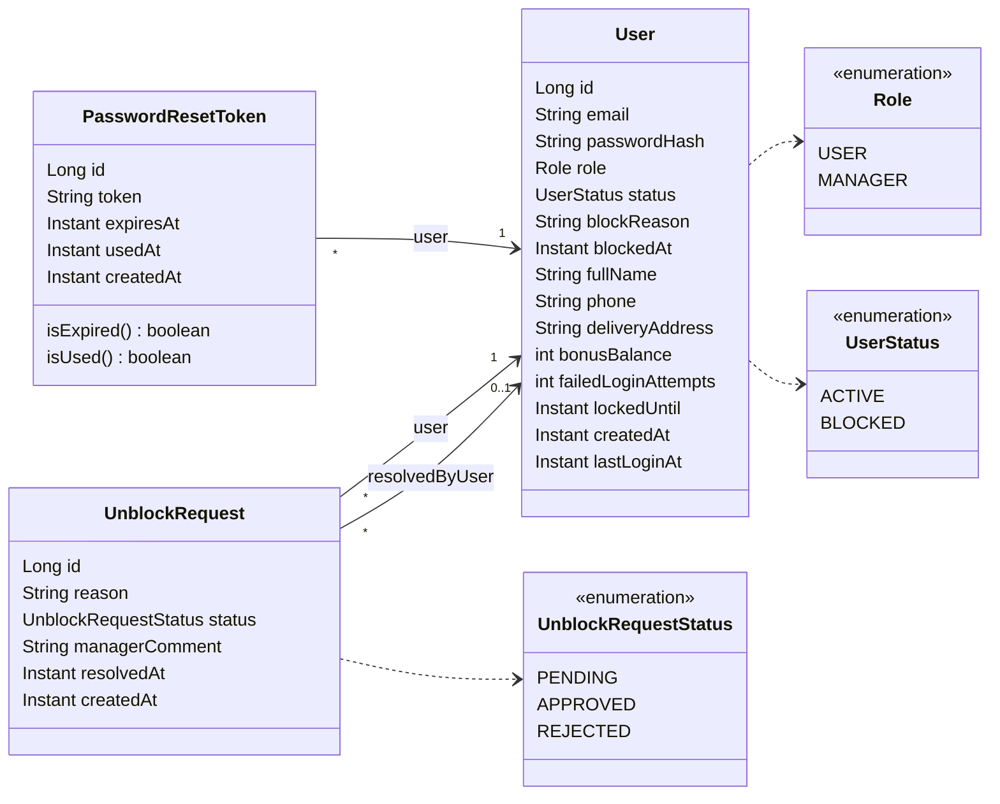

### 5.4. Діаграма класів: каталог і кошик

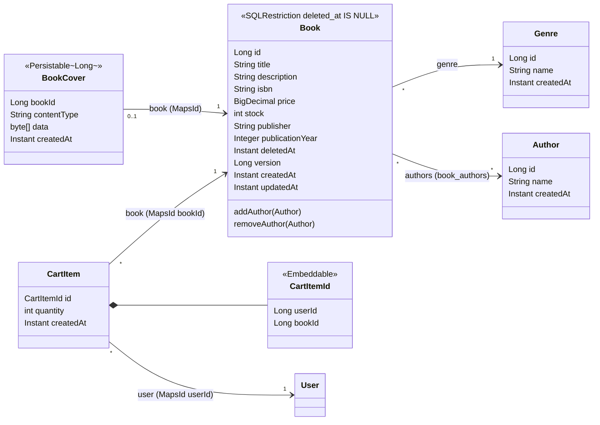

`BookCover` реалізує `Persistable<Long>` із прапорцем `isNew`. Ідентифікатор обкладинки береться з книги (`@MapsId`), тому без цього прапорця Spring Data вважав би сутність уже наявною й виконував би `merge` замість `persist`.

### 5.5. Діаграма класів: замовлення та заклади

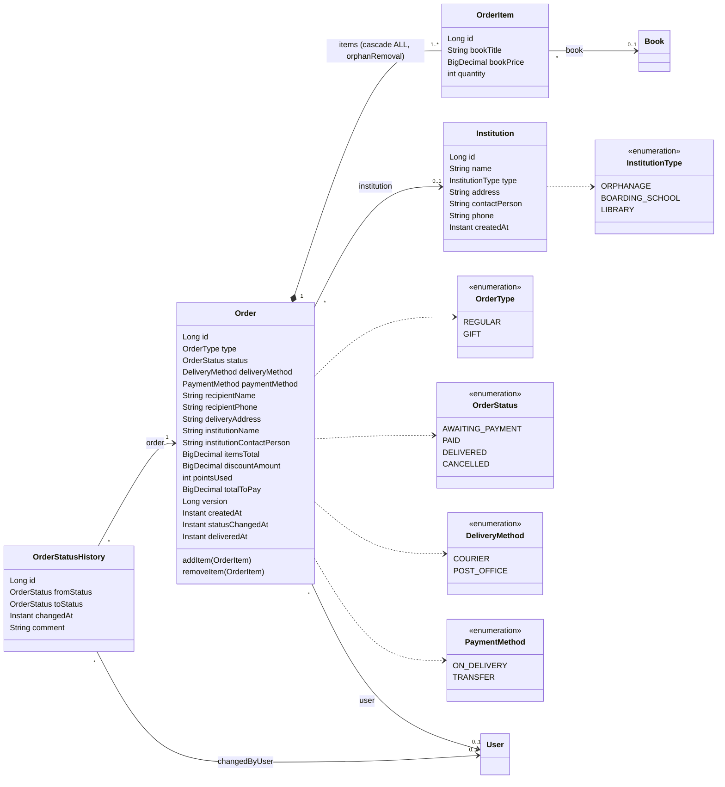

### 5.6. Діаграма класів: лояльність, виклики, журнал дарунків

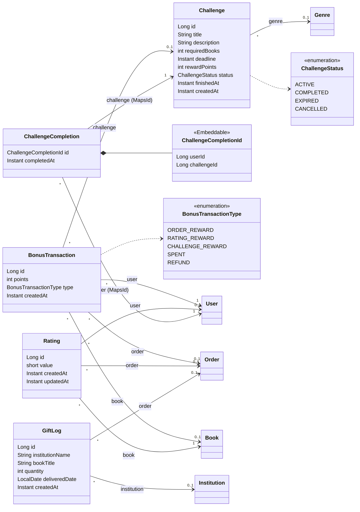

### 5.7. Перерахування та їхня семантика

| Перерахування | Значення | Семантика (SRS) |
|---|---|---|
| `Role` | `USER`, `MANAGER` | Актори «Користувач» і «Менеджер»; у Spring Security перетворюються на повноваження `ROLE_USER` / `ROLE_MANAGER` |
| `UserStatus` | `ACTIVE`, `BLOCKED` | Стан облікового запису «активний» / «заблокований» (M6, M7) |
| `UnblockRequestStatus` | `PENDING`, `APPROVED`, `REJECTED` | Стан запиту на розблокування (M7) |
| `OrderStatus` | `AWAITING_PAYMENT`, `PAID`, `DELIVERED`, `CANCELLED` | «очікує оплати», «оплачено», «поставлений», «скасований» (SRS, Таблиця 3) |
| `OrderType` | `REGULAR`, `GIFT` | Звичайне замовлення / замовлення в дар |
| `DeliveryMethod` | `COURIER`, `POST_OFFICE` | Кур'єр / відділення пошти; для `GIFT` — `null` |
| `PaymentMethod` | `ON_DELIVERY`, `TRANSFER` | Оплата під час отримання / переказ |
| `InstitutionType` | `ORPHANAGE`, `BOARDING_SCHOOL`, `LIBRARY` | Дитячий будинок, інтернат, бібліотека |
| `BonusTransactionType` | `ORDER_REWARD`, `RATING_REWARD`, `CHALLENGE_REWARD`, `SPENT`, `REFUND` | Нарахування за поставлене замовлення, оцінку, виклик; списання; повернення балів у разі скасування |
| `ChallengeStatus` | `ACTIVE`, `COMPLETED`, `EXPIRED`, `CANCELLED` | Стан читацького виклику; зміни станів описано в розділі 7 |

### 5.8. Репозиторії: нестандартні методи

Нижче наведено лише методи з явними `@Query`, `@EntityGraph`, `@Modifying` або нетривіальною семантикою. Похідні методи (`findBy…`, `existsBy…`) працюють за стандартними правилами Spring Data.

| Репозиторій | Метод | Призначення |
|---|---|---|
| `BookRepository` (+ `JpaSpecificationExecutor`) | `findById`, `findAll(Pageable)`, `findAll(Specification, Pageable)`, `findAll(Specification)`, `findByIsbn` | Перевизначені з `@EntityGraph({"genre", "authors"})`, щоб уникнути N+1 |
| | `findAvailableByGenreIds`, `findCandidatesForReplace` | Добір книг у наявності (`stock > 0`) за жанрами для подарункового набору (C9) |
| | `existsActiveByIsbn`, `existsActiveByIsbnAndIdNot` | Нативна перевірка унікальності ISBN серед не видалених книг |
| | `existsAnyByGenreIdIncludingDeleted` | Чи є в жанру книги, зокрема видалені (захист `RESTRICT`) |
| | `countActiveBooksByGenreGrouped` | Кількість активних книг за жанрами (`booksCount`) |
| | `softDeleteById` | `UPDATE books SET deleted_at = CURRENT_TIMESTAMP` (M1.3) |
| | `findByIdIncludingDeleted` | Нативне читання книги в обхід `@SQLRestriction` |
| `OrderRepository` (+ `JpaSpecificationExecutor`) | `findWithDetailsById` | Замовлення з `user`, `institution`, `items`, `items.book` |
| | `findByUserIdOrderByCreatedAtDesc`, `findAllByOrderByCreatedAtDesc`, `findByStatusOrderByCreatedAtDesc` | Сторінкові списки з `@EntityGraph` |
| | `findDeliveredOrdersByUserIdAndBookId` | Поставлені замовлення користувача з цією книгою (передумова оцінювання, C6) |
| | `findUnpaidOrdersOlderThan[Paged]` | `AWAITING_PAYMENT`, створені раніше за межу (SRS 7.2.2.6) |
| | `findArchivedOrdersOlderThan[Paged]` | `DELIVERED`/`CANCELLED`, у яких `COALESCE(statusChangedAt, createdAt)` раніше за межу (SRS 7.2.2.7) |
| | `countOrdersByStatusForUser` | Агрегація кількості замовлень за статусами для картки користувача (M11) |
| | `anonymizeOrdersForUsers` | Знеособлення: `user = null`, `recipientName = 'Видалений користувач'`, `recipientPhone = null`, `deliveryAddress = null` (M5) |
| | `existsByInstitutionIdAndStatusIn`, `existsByInstitutionIdInAndStatusIn`, `findByInstitutionIdInAndStatusIn`, `countByInstitutionId`, `deleteByInstitutionIdInAndStatusIn` | Перевірки й операції під час видалення закладів (M8.3) |
| `OrderItemRepository` | `existsByBookIdAndOrderStatusIn` | Чи бере книга участь у замовленнях із заданими статусами (обчислення `canDelete`) |
| | `countDeliveredBooksForChallenge` | Сума `quantity` у поставлених замовленнях користувача за період і, за потреби, жанром; дата поставки — `COALESCE(deliveredAt, statusChangedAt, createdAt)` (прогрес викликів, C7) |
| `CartItemRepository` | `findByUserId`, `findByUserIdAndBookId` | З `@EntityGraph({"book", "book.genre", "book.authors"})` |
| | `deleteByUserId`, `deleteByUserIdAndBookId`, `deleteByUserIdAndBookIdIn` | Масове видалення JPQL-запитами `@Modifying` |
| `UserRepository` (+ `JpaSpecificationExecutor`) | `findByEmailIgnoreCase`, `findByEmailLower` (default-метод-синонім), `existsByEmailIgnoreCase` | Регістронезалежний пошук за email |
| | `findInactiveUsers(UserStatus, Instant)` | Користувачі зі статусом, які не входили після вказаної дати |
| | `findInactiveUsers(Instant cutoff)` | Кандидати M5: роль `USER` і (`ACTIVE` з `COALESCE(lastLoginAt, createdAt) < cutoff`) або (`BLOCKED` з `blockedAt < cutoff`) |
| `RatingRepository` | `findAverageRatingByBookId`, `countByBookId`, `findAverageRatingsByBookIds` | Агрегати рейтингу (середнє значення, кількість) для каталогу та аналітики |
| | `anonymizeRatingsForUsers` | `user = null` для оцінок видалених користувачів (M5) |
| `InstitutionRepository` | `searchInstitutions(type, query)` | Фільтр за типом і підрядком у назві або адресі, сортування за назвою (M12) |
| `GiftLogRepository` (+ `JpaSpecificationExecutor`) | `findByInstitutionIdOrderByDeliveredDateDesc`, `findAllByOrderByDeliveredDateDesc` | З `@EntityGraph({"institution", "order"})` |
| | `detachInstitutions`, `detachOrders` | `@Modifying(clearAutomatically = true, flushAutomatically = true)`: обнулення посилань перед видаленням закладів чи замовлень |
| `UnblockRequestRepository` | `findAllByOrderByCreatedAtDesc`, `findByStatusOrderByCreatedAtDesc` | З `@EntityGraph({"user"})` |
| | `findFirstByUserIdAndStatus`, `findTopByUserIdOrderByCreatedAtDesc` | Поточний або останній запит користувача |
| `ChallengeRepository` | `findByStatusAndDeadlineBefore` | Виклики з минулим дедлайном (планувальник `EXPIRED`) |
| `PasswordResetTokenRepository` | `findByToken`, `deleteByUserId` | Пошук токена; видалення попередніх токенів перед створенням нового |

### 5.9. Специфікації (Criteria API)

| Клас | Метод | Умови |
|---|---|---|
| `BookSpecifications` | `filter(query, genreName, genreId, authorName, authorId, minPrice, maxPrice, stockMin, stockMax, inStock)` (+ два скорочені перевантаження) | `query` — підрядок без урахування регістру в назві **або** імені автора (`LEFT JOIN authors`, `DISTINCT`); жанр за `genreId` або точною назвою; автор за `authorId` або підрядком імені; діапазони `price` і `stock`; `inStock = true` → `stock > 0` |
| | `priceGreaterThanOrEqual`, `priceLessThanOrEqual`, `stockGreaterThanOrEqual`, `stockLessThanOrEqual`, `inStockOnly` | Окремі предикати для композиції |
| `UserSpecifications` | `findUsers(email, status)` | Завжди `role = USER`; підрядок email без урахування регістру; точний статус (M11) |
| `GiftLogSpecifications` | `withFilters(institutionId, institutionName, dateFrom, dateTo)` | Фільтри журналу дарунків за закладом і діапазоном дат (M9) |

---

## 6. Підсистема безпеки

### 6.1. Огляд

Безпеку реалізовано засобами Spring Security (вимоги ТЗ 4.2.1, SRS D2, D3, U1) у пакеті `ua.readmania.security`:

| Клас | Роль |
|---|---|
| `SecurityConfig` | Конфігурація `SecurityFilterChain`, біни `PasswordEncoder` (`BCryptPasswordEncoder`), `SecurityContextRepository` (`HttpSessionSecurityContextRepository`), `AuthenticationManager` |
| `CustomUserDetailsService` | `UserDetailsService`: завантажує `User` за email без урахування регістру |
| `CustomUserDetails` | Адаптер `UserDetails`: `id`, `email`, `passwordHash`, `role`, `status`, `lockedUntil`; повноваження `ROLE_<role>` |
| `AccountStatusFilter` | `OncePerRequestFilter`: блокує запити заблокованих користувачів в активній сесії (M6) |
| `CsrfCookieFilter` | Примусово генерує CSRF-токен, щоб клієнт отримав cookie `XSRF-TOKEN` |
| `SpaCsrfTokenRequestHandler` | Обробник CSRF-токена для SPA: читає «сирий» токен із заголовка і зберігає захист від BREACH для параметрів запиту |
| `ProblemDetailsAuthenticationEntryPoint` | Відповідь `401` у форматі `application/problem+json` |
| `ProblemDetailsAccessDeniedHandler` | Відповідь `403` з `type = urn:readmania:error:access-denied` |

Модель автентифікації — **серверна сесія** (cookie `JSESSIONID`). Токени JWT не використовуються. CORS вимкнено (`http.cors(disable)`), оскільки клієнт працює з того самого джерела через проксі (п. 2.2).

### 6.2. Правила авторизації

Правила `authorizeHttpRequests` у `SecurityConfig.securityFilterChain` застосовуються в порядку оголошення:

| № | Шаблон шляху | Правило | Примітка |
|---|---|---|---|
| 1 | `/v3/api-docs/**`, `/swagger-ui/**`, `/swagger-ui.html` | `permitAll()` у профілі `local`, інакше `denyAll()` | Документація API доступна лише локально |
| 2 | `/api/auth/register`, `/api/auth/login`, `/api/auth/logout`, `/api/auth/password-reset/**`, `/api/auth/unblock-request` | `permitAll()` | G2, G3, C10, M7 |
| 3 | `/api/auth/me` | `authenticated()` | Поточний користувач |
| 4 | `/api/catalog/**`, `/api/institutions/**`, `/api/challenges/**`, `/api/gift-sets/**`, `/api/ratings/book/**`, `/api/delivery/**` | `permitAll()` | Публічні дані для гостя (G1, C9 тощо). Методи, яким потрібен користувач (наприклад, особисті дані викликів), самі отримують `Principal` і обробляють його відсутність |
| 5 | `/actuator/health` | `permitAll()` | Перевірка стану без деталей |
| 6 | `/api/manager/**` | `hasRole("MANAGER")` | U1: панель менеджера |
| 7 | `/api/**` | `authenticated()` | **Default deny** для решти API |
| 8 | Статичні ресурси (`PathRequest.toStaticResources().atCommonLocations()`) | `permitAll()` | — |
| 9 | Будь-який інший запит | `permitAll()` | Маршрути SPA |

### 6.3. Ланцюжок фільтрів

Нестандартні фільтри вбудовано в ланцюжок так:

- `AccountStatusFilter` — **після** `SecurityContextHolderFilter`, тобто одразу після відновлення `SecurityContext` із сесії;
- `CsrfCookieFilter` — **після** `BasicAuthenticationFilter`, тобто після `CsrfFilter`, який кладе `CsrfToken` в атрибути запиту.

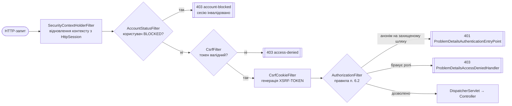

### 6.4. Сесії та cookie

| Параметр | Значення | Джерело |
|---|---|---|
| Сховище контексту | `HttpSessionSecurityContextRepository` | `SecurityConfig.securityContextRepository()` |
| Тайм-аут сесії | 30 хв | `server.servlet.session.timeout` |
| `HttpOnly` | `true` | `server.servlet.session.cookie.http-only` |
| `SameSite` | `Lax` | `server.servlet.session.cookie.same-site` |
| `Secure` | `false`; `true` у профілі `prod` | `application.yml` / `application-prod.yml` |
| Заголовки проксі | `server.forward-headers-strategy: framework` (у базовому `application.yml`) | Коректна схема й адреса клієнта за зворотним проксі (HTTPS, SRS D2) |

### 6.5. Автентифікація (G3) та захист від підбору пароля

Вхід виконується не через `formLogin`, а REST-ендпоінтом `POST /api/auth/login` (`AuthController.login` → `AuthService.login`). Метод сам викликає `AuthenticationManager` (з `DaoAuthenticationProvider` на базі `CustomUserDetailsService` та `BCryptPasswordEncoder`) і зберігає `SecurityContext` у сесії через `SecurityContextRepository.saveContext`.

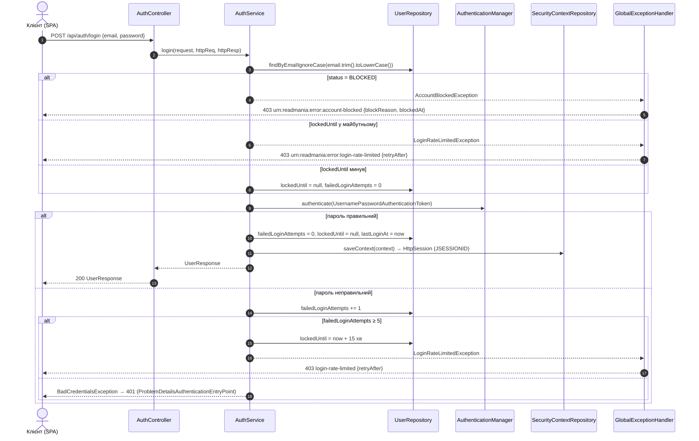

Стан облікового запису щодо підбору пароля:

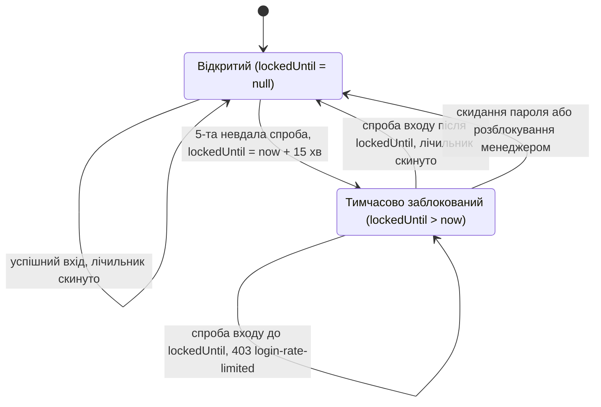

Особливості реалізації:

- Email нормалізується (`trim().toLowerCase()`) під час реєстрації, входу, скидання пароля та подання запиту на розблокування.
- Для неіснуючого email і для неправильного пароля повертається однакова відповідь `401` («Невірний email або пароль»), тому за відповіддю не можна визначити, чи існує обліковий запис.
- `CustomUserDetails.isAccountNonLocked()` повертає `false`, якщо статус `BLOCKED` або `lockedUntil` ще не минув, а `isEnabled()` — лише для `ACTIVE`. Це другий рубіж захисту на рівні `DaoAuthenticationProvider`.
- Помилки автентифікації `GlobalExceptionHandler` не перетворює на `500`. Обробник «останнього рубежу» `handleGeneralException` прокидає `AuthenticationException` та `AccessDeniedException` далі, до шару Spring Security.

### 6.6. Вихід із системи (C10) та поточний користувач

- `POST /api/auth/logout` → `AuthService.logout`: очищає `SecurityContextHolder` та інвалідовує `HttpSession`. Ендпоінт публічний і звільнений від перевірки CSRF.
- `GET /api/auth/me` → `AuthService.getCurrentUser(principal.getName())`: повертає `UserResponse` поточного користувача; потребує автентифікації.

### 6.7. CSRF-захист для SPA

| Аспект | Реалізація |
|---|---|
| Сховище токена | `CookieCsrfTokenRepository.withHttpOnlyFalse()`: cookie `XSRF-TOKEN`, доступна з JavaScript |
| Передача токена | Заголовок `X-XSRF-TOKEN` (типова назва заголовка `CookieCsrfTokenRepository`) у запитах `POST`, `PUT`, `PATCH`, `DELETE` |
| Обробник | `SpaCsrfTokenRequestHandler` (розширює `CsrfTokenRequestAttributeHandler`). Якщо заголовок присутній, токен порівнюється «як є». Інакше працює `XorCsrfTokenRequestAttributeHandler`, що захищає від BREACH. `handle(...)` завжди делегує XOR-обробнику |
| Генерація cookie | `CsrfCookieFilter` викликає `csrfToken.getToken()` на кожному запиті, тож відкладений (deferred) токен матеріалізується, і cookie надсилається клієнту вже на першому `GET` |
| Виключення | `/api/auth/login`, `/api/auth/register`, `/api/auth/password-reset/**`, `/api/auth/unblock-request`, `/api/auth/logout` |
| Профіль `test` | CSRF **повністю вимкнено** (`http.csrf(AbstractHttpConfigurer::disable)`) |
| Тести | `TestcontainersConfiguration` реєструє `MockMvcBuilderCustomizer`, який через `CsrfTestHelper.csrfToken()` додає до кожного запиту MockMvc токен `test-csrf-token`: атрибут `CsrfToken`, заголовок `X-XSRF-TOKEN` і cookie `XSRF-TOKEN`. Тому тести в профілях з увімкненим CSRF (наприклад, `local`) не потребують ручного додавання токена. `CsrfTestHelper` також містить власний `MockMvcConfigurer`-бін (`@TestConfiguration`) |

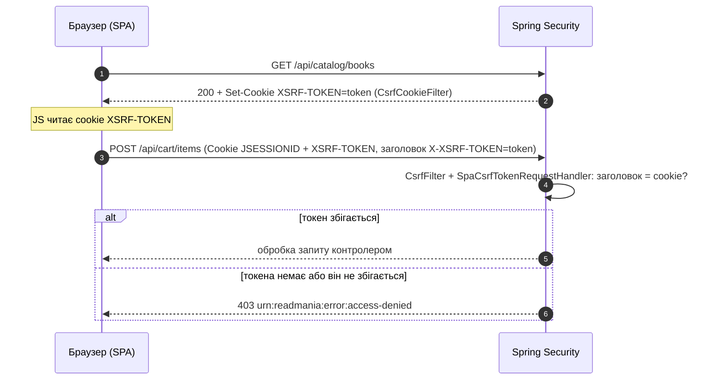

### 6.8. Блокування в активній сесії (M6)

`AccountStatusFilter` на кожному запиті автентифікованого користувача (крім `anonymousUser`) перечитує `User` з БД за `authentication.getName()`. Якщо статус `BLOCKED`, фільтр:

1. очищає `SecurityContextHolder` та інвалідовує сесію;
2. повертає `403` (`application/problem+json`) з `type = urn:readmania:error:account-blocked`, `detail` = причина блокування (або «Обліковий запис заблоковано»), а також полями `blockReason` і `blockedAt`.

Так блокування менеджером (`POST /api/manager/users/{id}/block`) набуває чинності на наступному ж запиті користувача, без очікування завершення сесії.

> **Вартість.** Фільтр виконує один запит `SELECT` до `users` на кожен автентифікований HTTP-запит. Пошук іде за унікальним функціональним індексом `uk_users_lower_email`.

### 6.9. Відновлення доступу

**Скидання пароля (G3):**

1. `POST /api/auth/password-reset/request {email}` → `AuthService.requestPasswordReset`. Якщо користувач існує, попередні токени видаляються (`deleteByUserId`), створюється новий `PasswordResetToken` (UUID, строк дії **1 година**), а посилання надсилається через `NotificationService.sendPasswordResetLink`. Відповідь завжди однакова: `200` «Якщо обліковий запис існує, лист надіслано». Токен у відповіді ніколи не повертається.
2. `POST /api/auth/password-reset/confirm {token, newPassword, confirmPassword}` → `confirmPasswordReset`. Якщо паролі не збігаються — `400`; якщо токен не знайдено — `404`; якщо він прострочений або використаний — `400`. Інакше встановлюється новий хеш, лічильник невдалих спроб і `lockedUntil` скидаються, а токен позначається `usedAt`.

**Запит на розблокування (M7, подання користувачем):**

`POST /api/auth/unblock-request {email, password, reason}` → `AuthService.submitUnblockRequest`. Метод перевіряє пароль (`400` «Невірний пароль») і статус `BLOCKED` (`400` «Обліковий запис не заблокований»). Якщо вже є запит `PENDING`, оновлюються його `reason` і `createdAt`; інакше створюється новий `UnblockRequest`. Розгляд запитів менеджером описано в розділі 7.

> **Спостереження.** На відміну від входу, для неіснуючого email цей ендпоінт повертає `404` («Користувача з такою електронною адресою не знайдено»). Тому через нього можна з'ясувати, чи існує обліковий запис з певним email.

### 6.10. Зміна облікових даних (C5)

`ProfileController` (`/api/account`, `/api/profile`; зміна пароля — `PUT .../password`) → `UserService`:

- `updateProfile` вимагає `currentPassword` (`400`, якщо його не вказано або він неправильний). Метод перевіряє унікальність нового email (`409`) і оновлює `fullName`, `phone`, `deliveryAddress`. Якщо email змінено, створюється новий `CustomUserDetails`, а `SecurityContext` перезаписується в сесії, щоб `AccountStatusFilter` і `principal.getName()` працювали з новою адресою.
- `changePassword` перевіряє збіг нового пароля з підтвердженням (`400`) і правильність поточного пароля (`400`), після чого зберігає новий BCrypt-хеш. Інші активні сесії користувача **не** інвалідуються.

### 6.11. Отримання поточного користувача в контролерах

Контролери `CartController`, `OrderController`, `ManagerOrderController`, `LoyaltyController`, `RatingController` мають однаковий приватний метод `resolveUserId(CustomUserDetails, Principal)`:

1. якщо principal — `CustomUserDetails` (звичайний вхід), повертається його `getId()`;
2. інакше, якщо є `Principal` (наприклад, у тестах з іншим типом principal), користувача шукають через `UserRepository.findByEmailLower(principal.getName().toLowerCase())`; якщо його не знайдено — `NotFoundException` (`404`);
3. якщо немає ні того, ні іншого, метод кидає `NotFoundException` «Користувача не авторизовано».

Саме тому ці контролери напряму залежать від `UserRepository` (п. 2.3).

### 6.12. Хешування паролів (SRS D3)

Бін `PasswordEncoder` — `new BCryptPasswordEncoder()` з типовою вартістю (cost factor 10; хеші мають префікс `$2a$10$`, як у `R__dev_seed.sql`). Паролі у відкритому вигляді не зберігаються й не логуються. Для перевірки використовується лише `passwordEncoder.matches(...)`.

---

## 7. Бізнес-підсистеми

Розділ описує сервісний шар за підсистемами і для кожної вказує варіанти використання SRS, які вона реалізує. Коди відповідей наведено відповідно до мапінгу винятків (розділ 9): `NotFoundException` → `404`, `ConflictException` → `409`, `BusinessRuleException` → `400` (або статус, переданий у конструктор), `OrderStatusConflictException` → `409`.

### 7.1. Каталог (G1, M1, M2)

#### 7.1.1. Публічний каталог — `CatalogService`

Клас `@Transactional(readOnly = true)`, контролер — `CatalogController` (`/api/catalog`).

| Метод | Призначення та правила |
|---|---|
| `getBooks(...)` | Сторінка книг за `BookSpecifications.filter(...)` (п. 5.9). Рейтинги підтягуються одним агрегатним запитом `findAverageRatingsByBookIds` (`avgRating`, `ratingsCount`), наявність обкладинок — одним запитом `bookCoverRepository.findAllById(ids)`. Для книги без оцінок `avgRating = null`, `ratingsCount = 0` |
| `getBookById(id)` | Деталі книги з `avgRating`, `ratingsCount`, `hasCover`, `canDelete`; якщо книги немає або вона видалена — `404` |
| `getBookCover(bookId)` | Бінарна обкладинка; якщо обкладинки немає — `404` |
| `getGenres()` | Жанри за алфавітом; `booksCount` береться з `countActiveBooksByGenreGrouped()` (лише не видалені книги) |
| `getAuthors()` | Автори за алфавітом |

Параметри `GET /api/catalog/books`, які обробляє контролер:

- фільтри: `query` (або синонім `q`), `genre`, `genreId`, `author`, `authorId`, `priceMin`, `priceMax`, `stockMin`, `stockMax`, `inStock`;
- пагінація: `page` (типово `0`), `size` (типово `10`, без верхньої межі);
- сортування: `sort=поле[,desc]`. Дозволені поля: `price`, `title`, `stock`, `publicationYear` (синоніми `publication_year`, `year`), `createdAt` (синонім `created_at`). Будь-яке інше значення замінюється на `id`; типове сортування — `id DESC`;
- `400`, якщо `page < 0`, `size <= 0`, ціни чи залишки від'ємні, `priceMin > priceMax` або `stockMin > stockMax`.

Обкладинка віддається з `Content-Type` збереженого зображення (якщо його не вдається розібрати — `image/jpeg`) і заголовком `Cache-Control: max-age=86400, public` (кешування на 24 год, SRS P1).

**Правило `canDelete`** (його використовують і `CatalogService`, і `ManagerCatalogService`): `stock == 0` **і** книга не входить у замовлення зі статусами `AWAITING_PAYMENT` або `PAID` (`OrderItemRepository.existsByBookIdAndOrderStatusIn`).

#### 7.1.2. Керування каталогом — `ManagerCatalogService`

Клас `@Transactional`, контролер — `ManagerCatalogController` (`/api/manager`, роль `MANAGER`).

| Операція (ВВ) | Правила | Помилки |
|---|---|---|
| `createBook` (M1.1) | ISBN обрізається від пробілів; жанр визначає `resolveGenre`, автори — `resolveAuthors` (див. нижче); `publisher` і `publicationYear` обов'язкові на рівні DTO (`@NotBlank`, `1450..2100`) | `409` — активна книга з таким ISBN уже є (`existsActiveByIsbn`) |
| `updateBook` (M1.2) | Перезаписує `title`, `isbn`, `price`, `stock`, жанр, авторів, `description`; `publisher` і `publicationYear` змінюються, лише якщо їх передано | `404` — книги немає або вона видалена; `409` — ISBN належить іншій активній книзі |
| `deleteBook` (M1.3) | **М'яке видалення**: `deletedAt = now` | `404`; `400` — `stock > 0`; `409` — книга є в замовленнях `AWAITING_PAYMENT` або `PAID` |
| `uploadCover` | Multipart-поле `file`; якщо обкладинка вже є, вона оновлюється, інакше створюється. Типовий `contentType` — `image/jpeg` | `404`; `400` — порожній файл |
| `createGenre` / `updateGenre` | Назва унікальна без урахування регістру | `409` — дублікат; `404` — жанру немає |
| `deleteGenre` (M1.3) | — | `409` — до жанру належать книги, зокрема видалені (`existsAnyByGenreIdIncludingDeleted`) |
| `createAuthor` | Ім'я (`fullName`) унікальне без урахування регістру | `409` |
| `importFromCsv` (M2) | Делегує виконання до `CsvImportService` | `400` — порожній або нечитабельний файл (перевіряє контролер) |

- `resolveGenre(genreId, genre)`: пріоритет має `genreId` (якщо такого жанру немає — `404`). Інакше жанр шукається за назвою без урахування регістру, а якщо не знайдений — **створюється**. Якщо не задано ні ідентифікатора, ні назви — `400`.
- `resolveAuthors(authorIds, authors, author)`: об'єднує три джерела: наявних авторів за `authorIds` (невідомі ідентифікатори мовчки ігноруються), список імен і рядок `author`, розбитий за `;` (або `,`, якщо `;` немає). Відсутніх авторів створює. Якщо в підсумку жодного автора — `400`.

#### 7.1.3. Імпорт CSV — `CsvImportService` (M2)

| Аспект | Реалізація |
|---|---|
| Кодування | UTF-8 |
| Роздільник | Визначається за рядком заголовка: `;`, якщо він є в заголовку; інакше табуляція; інакше `,` |
| Заголовок | Перший рядок. Назви колонок порівнюються без урахування регістру, пробілів, `_` і `-`; підтримуються українські та англійські синоніми (`назва`/`title`, `ісбн`/`isbn`, `ціна`/`price`, `кількість`/`stock`, `видавництво`/`publisher`, `рік видання`/`publicationYear`, `опис`/`description`, `жанр`/`genre`, `автори`/`authors`, `обкладинка`/`cover` тощо) |
| Лапки | Підтримуються `"` і екранування `""`; багаторядкові поля не підтримуються |
| Обов'язкові колонки | `title`, `isbn`, `price`, `publisher`, `publicationYear`. Якщо якоїсь немає, файл відхиляється з одним записом про помилку в рядку 1 |
| Валідація рядка | Перша знайдена помилка відхиляє рядок. Порядок перевірок: порожня назва → порожній ISBN → дубль ISBN у файлі (перша поява приймається) → ISBN уже є в БД серед активних книг → порожнє видавництво → порожній рік → рік не ціле число або поза `1450..2100` → порожні автори, жанр, опис, ціна, кількість чи обкладинка → URL обкладинки не починається з `http://` або `https://` → ціна не число (кома допускається як десятковий роздільник) або `< 0` → кількість не ціле число `>= 0` |
| Створення | Жанр і автори знаходяться або створюються (автори розділяються `;` або `,`). Обкладинка завантажується HTTP GET за URL (тайм-аути 4 с, редиректи дозволено). Помилка завантаження лише логується, книга все одно додається |
| Відповідь | `CsvImportResponse { totalRows, addedCount, rejectedCount, rejectedRows[] }`; `CsvRejectedRow { rowNumber, isbn, title, reason }`, де `rowNumber` — номер рядка файлу (заголовок має номер 1). Порожні рядки пропускаються й не враховуються в `totalRows` |
| Транзакційність | Метод `@Transactional`, але внутрішній `catch (Exception)` перехоплює помилки, тому вже додані рядки зберігаються навіть після збою. Імпорт **частковий**, а не «все або нічого» |

> **Особливість реалізації.** Хоча в заголовку обов'язковими є лише п'ять колонок, кожен рядок мусить мати заповненими також авторів, жанр, опис, ціну, кількість і URL обкладинки. Якщо в файлі відсутня, наприклад, колонка обкладинки, файл формально приймається, але всі його рядки буде відхилено.

### 7.2. Кошик (C1.1–C1.3) — `CartService`

Контролер — `CartController` (`/api/cart`, потрібна автентифікація).

| Операція | Правила | Помилки |
|---|---|---|
| `getCart` | Повертає `CartResponse(items, totalItems, totalPrice, allAvailable)` | — |
| `addToCart` (C1.1) | Якщо `quantity <= 0`, береться `1`. Для наявної позиції кількості сумуються | `404` — немає користувача чи книги; `400` — книга видалена, `stock <= 0` або підсумкова кількість `> stock` |
| `updateCartItem` (C1.3) | Нова кількість у межах `1..stock` | `404` — позиції немає; `400` — книга недоступна або кількість поза межами |
| `removeFromCart` (C1.2) | Якщо позиції немає, повертає кошик без помилки | — |
| `clearCart` | Видаляє всі позиції користувача | — |

- `CartItemResponse.available = deletedAt == null && stock > 0`. Видалені книги з кошика автоматично **не** вилучаються: вони відображаються з `available = false` (SRS C1.2).
- `totalItems` — сума кількостей усіх позицій; `totalPrice` — сума `subtotal` лише доступних позицій; `allAvailable = false`, якщо є недоступна позиція або кількість перевищує залишок.
- Кошик не змінює залишків на складі: їх резервує лише оформлення замовлення.

### 7.3. Замовлення (C2, C3, C4, C8, M3)

#### 7.3.1. Попередній розрахунок (C8) — `OrderService.previewOrder`

`POST /api/orders/preview`. Якщо позиції в запиті не передано, береться кошик користувача (`resolveItemRequests`). Тоді до розрахунку потрапляють лише доступні позиції кошика: книга не видалена і `stock > 0`.

| Величина | Формула |
|---|---|
| `itemsTotal` | Σ `price × quantity` лише за доступними позиціями (`!deleted && stock >= quantity`). Недоступні позиції показуються з `available = false` і в суму не входять |
| `maxBonusPoints` | `min(userBonusBalance, ⌊0.30 × itemsTotal / 10⌋)` |
| `pointsUsed` | `min(max(requestedPoints, 0), maxBonusPoints)`: у попередньому розрахунку запит обрізається до допустимого, без помилки |
| `discountAmount` | `pointsUsed × 10` грн |
| `totalToPay` | `itemsTotal − discountAmount` |

#### 7.3.2. Оформлення замовлення (C2) — `createRegularOrder`, `createGiftOrder`

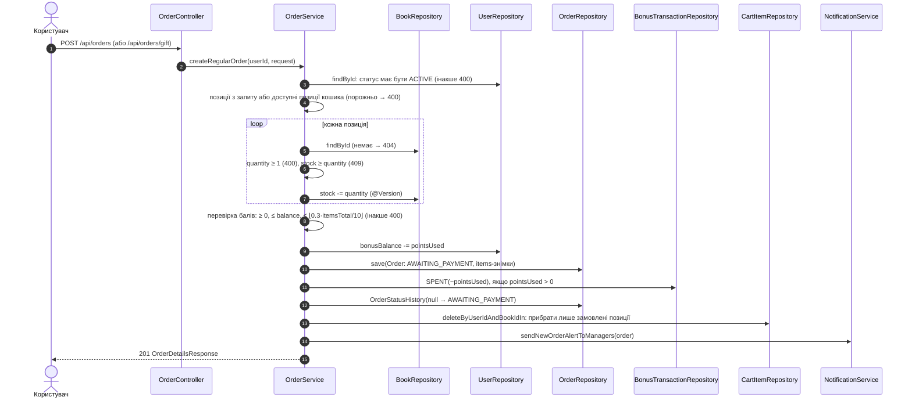

| Аспект | Звичайне (`REGULAR`) | У дар (`GIFT`) |
|---|---|---|
| Ендпоінт | `POST /api/orders` | `POST /api/orders/gift` |
| Спосіб оплати | `ON_DELIVERY` або `TRANSFER` з запиту | Лише `TRANSFER`: інший спосіб дає `400`, якщо не вказано — встановлюється `TRANSFER` |
| Доставка | `deliveryMethod`, адреса та контакти (`recipientName`, `recipientPhone`) із запиту | `deliveryMethod = null`. Адреса, `recipientName`, `institutionName` та `institutionContactPerson` — **знімок** закладу на момент оформлення (A.10). Заклад має існувати (`404`) |
| Початковий статус | `AWAITING_PAYMENT` | `AWAITING_PAYMENT` |
| Коментар в історії | «Оформлення замовлення» | «Оформлення замовлення в дар» |

Загальні правила:

- залишки зменшуються **в момент оформлення**, а конкурентне замовлення останнього примірника захищає оптимістичне блокування `Book.version` (результат — `409`);
- у `order_items` зберігаються знімки `bookTitle` і `bookPrice`;
- з кошика видаляються лише замовлені позиції, недоступні лишаються (SRS C2);
- `Order.items` зберігається каскадом (`CascadeType.ALL`).

> **Примітка щодо видалених книг.** Гілка коду `book.isDeleted()` → `409` фактично недосяжна: через `@SQLRestriction` метод `findById` не знаходить видалену книгу, і клієнт отримує `404` «Книгу з ID … не знайдено».

#### 7.3.3. Перегляд і скасування замовлення покупцем (C3, C4)

- `GET /api/orders` — сторінка власних замовлень (типово `size = 10`), за спаданням дати.
- `GET /api/orders/{id}` — деталі з історією статусів і полем `userRating` для кожної позиції (оцінка користувача, якщо є). Чуже або неіснуюче замовлення — `404`, щоб не розкривати існування чужих замовлень.
- `POST /api/orders/{id}/cancel` (C3) — дозволено лише для **власного** замовлення у статусі `AWAITING_PAYMENT` з оплатою `TRANSFER`:
  - інший статус → `409` `order-status-conflict` з полем `currentStatus`;
  - оплата `ON_DELIVERY` → `400`;
  - побічні дії: залишки повертаються на склад, бали повертаються на баланс (`REFUND`), додається запис історії «Скасовано покупцем», надсилається сповіщення `sendOrderStatusChanged`;
  - якщо під час збереження спрацювало оптимістичне блокування `Order.version`, повертається `409` з актуальним статусом (SRS 7.2.2.8).

#### 7.3.4. Скінченний автомат статусів (M3, SRS Таблиця 3) — `ManagerOrderService.updateOrderStatus`

`PATCH /api/manager/orders/{id}/status` з тілом `UpdateOrderStatusRequest { status, expectedStatus?, comment? }`.

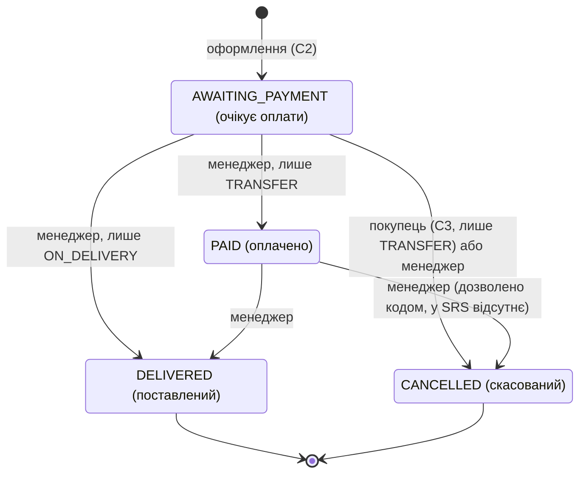

Порядок перевірок:

1. Замовлення існує (`404`).
2. Якщо передано `expectedStatus` і він не збігається з поточним статусом → `409` `order-status-conflict` (`currentStatus`). Так реалізовано захист від одночасної зміни (SRS 7.2.2.8).
3. Поточний статус фінальний (`DELIVERED`, `CANCELLED`) → `409`.
4. Перехід не дозволений таблицею вище (з урахуванням способу оплати) → `409`.

Побічні дії переходу:

| Цільовий статус | Дії |
|---|---|
| `PAID` | Лише зміна статусу та `statusChangedAt` |
| `CANCELLED` | Залишки повертаються на склад; бали повертаються (`REFUND`), якщо їх списували |
| `DELIVERED` | `deliveredAt = now`. **(1)** Нараховується `ORDER_REWARD = ⌊itemsTotal / 100⌋` (від вартості **до** знижки), якщо такого нарахування для замовлення ще не було; повтор додатково блокує індекс `uk_bonus_order_reward`. **(2)** Перевіряються всі активні виклики, ще не виконані користувачем і з дедлайном у майбутньому: якщо `countDeliveredBooksForChallenge(user, challenge.createdAt, challenge.deadline, genre) ≥ requiredBooks`, створюється `ChallengeCompletion` і нараховується `CHALLENGE_REWARD = rewardPoints`. **(3)** Для `GIFT` на кожну позицію створюється запис `GiftLog` (`institutionName`, `bookTitle`, `quantity`, `deliveredDate = today`) |

Після цього замовлення зберігається через `saveAndFlush` (оптимістичний конфлікт → `409` з актуальним статусом), додається запис `OrderStatusHistory` (`changedByUser` = менеджер, `comment` із запиту) і надсилається `sendOrderStatusChanged`. Усі дії виконуються в одній транзакції: у разі збою всі зміни, зокрема побічні, відкочуються (SRS 7.2.2.9).

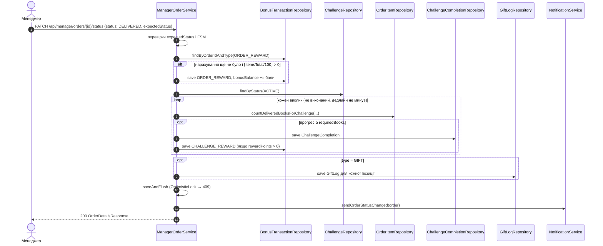

#### 7.3.5. Переліки та масові дії менеджера (SRS 7.2.1, 7.2.2.6, 7.2.2.7)

`GET /api/manager/orders?status=&unpaidOverdue=&archived=` (типово `size = 10`). Параметри мають пріоритет у такому порядку:

| Параметр | Вибірка |
|---|---|
| `unpaidOverdue=true` | `findUnpaidOrdersOlderThanPaged(now − 7 днів)`: `AWAITING_PAYMENT`, створені понад 7 днів тому |
| `archived=true` | `findArchivedOrdersOlderThanPaged(now − 3×365 днів)`: `DELIVERED`/`CANCELLED`, у яких `COALESCE(statusChangedAt, createdAt)` старше за межу |
| `status=…` | За статусом, за спаданням дати створення |
| — | Усі замовлення за спаданням дати створення |

Масові дії приймають `BatchOrderActionRequest` (список ідентифікаторів) і працюють за принципом «все або нічого»: якщо хоча б одне замовлення не відповідає критеріям, кидається `409` і нічого не змінюється.

| Ендпоінт | Критерії кожного замовлення | Дії |
|---|---|---|
| `POST /api/manager/orders/cancel-unpaid-overdue` | `AWAITING_PAYMENT`, `TRANSFER`, `createdAt` старше 7 днів | `CANCELLED`, повернення залишків і балів (`REFUND`), історія «Масове скасування: прострочена оплата переказом (>7 днів)», сповіщення покупцю |
| `DELETE /api/manager/orders/archive` | `DELIVERED` або `CANCELLED`, `createdAt` старше 3×365 днів | Видалення історії статусів і замовлення (позиції видаляються каскадом). `gift_log`, `ratings` і `bonus_transactions` зберігаються завдяки `ON DELETE SET NULL` |

Якщо список порожній — `400`; якщо замовлення не знайдено — `409`.

> **Розбіжності з SRS, виявлені в коді:**
> 1. SRS (Таблиця 3) з `PAID` дозволяє перехід лише в `DELIVERED`, а код дозволяє також `PAID → CANCELLED`.
> 2. SRS дозволяє менеджеру скасувати замовлення `AWAITING_PAYMENT` лише в потоках 7.2.2.4 (відмова від отримання за `ON_DELIVERY`) та 7.2.2.6 (прострочена оплата переказом). Код дозволяє менеджеру скасувати будь-яке замовлення `AWAITING_PAYMENT` без додаткових умов.
> 3. Перелік `unpaidOverdue=true` не фільтрує спосіб оплати: у ньому є й замовлення `ON_DELIVERY`, хоча масова дія для них поверне `409`. SRS 7.2.2.6 передбачає лише замовлення з оплатою переказом.
> 4. Перелік `archived=true` відбирає замовлення за `COALESCE(statusChangedAt, createdAt)`, а масове видалення перевіряє `createdAt`. SRS 7.2.2.7 вимагає «створених понад 3 роки тому».

### 7.4. Програма лояльності (C7, C8)

Нарахування та списання балів розподілено між сервісами. `LoyaltyService` лише читає дані.

| Тип `BonusTransaction` | Знак | Де створюється | Правило |
|---|---|---|---|
| `SPENT` | − | `OrderService.createRegularOrder` / `createGiftOrder` | Списання `pointsUsed` під час оформлення |
| `REFUND` | + | `OrderService.cancelOrder`, `ManagerOrderService.updateOrderStatus` (→ `CANCELLED`), `ManagerOrderService.cancelUnpaidOverdueOrders` | Повернення `pointsUsed` |
| `ORDER_REWARD` | + | `ManagerOrderService.updateOrderStatus` (→ `DELIVERED`) | `⌊itemsTotal / 100⌋`, не більше одного разу на замовлення; діє і для `GIFT` (SRS 1.3) |
| `CHALLENGE_REWARD` | + | `ManagerOrderService.updateOrderStatus` (→ `DELIVERED`) | `challenge.rewardPoints`, один раз на пару користувач–виклик |
| `RATING_REWARD` | + | `RatingService.addRating` | `+1` бал за кожну нову оцінку |

Кожна транзакція змінює денормалізований `users.bonus_balance` (`CHECK >= 0`) у тій самій транзакції БД.

`LoyaltyService.getLoyaltyBalance(userId)` повертає `LoyaltyBalanceResponse(bonusBalance, transactions)` з журналом за спаданням дати. Обидва ендпоінти, `GET /api/loyalty/balance` і `GET /api/loyalty/transactions`, викликають цей самий метод.

### 7.5. Оцінювання видань (C6) — `RatingService`

| Ендпоінт | Доступ | Метод |
|---|---|---|
| `POST /api/ratings` | автентифікований | `addRating(userId, CreateRatingRequest { bookId, value 1..5, orderId? })` → `201` |
| `GET /api/ratings/me` | автентифікований | `getUserRatings`: власні оцінки за спаданням дати |
| `GET /api/ratings/book/{bookId}` | публічний | `getBookRatings`: `PublicRatingResponse { id, bookId, value, createdAt }` **без** даних користувача |

Передумови `addRating`:

- оцінити можна лише книгу з **поставленого** (`DELIVERED`) замовлення користувача;
- якщо `orderId` передано, замовлення має існувати (`404`), належати користувачу, мати статус `DELIVERED` і містити цю книгу (інакше `400`);
- якщо `orderId` не передано, береться перше знайдене поставлене замовлення з цією книгою (`findDeliveredOrdersByUserIdAndBookId`); якщо такого немає — `400`;
- оцінку можна поставити лише один раз, змінювати її не можна: повторна спроба → `409` «Ви вже оцінили цю книгу». Додатково це забезпечує індекс `uk_ratings_user_book`.

Побічна дія: `bonusBalance += 1` і транзакція `RATING_REWARD` (з посиланням на замовлення та книгу).

### 7.6. Читацькі виклики (C7, M4) — `ChallengeService`

#### 7.6.1. Життєвий цикл

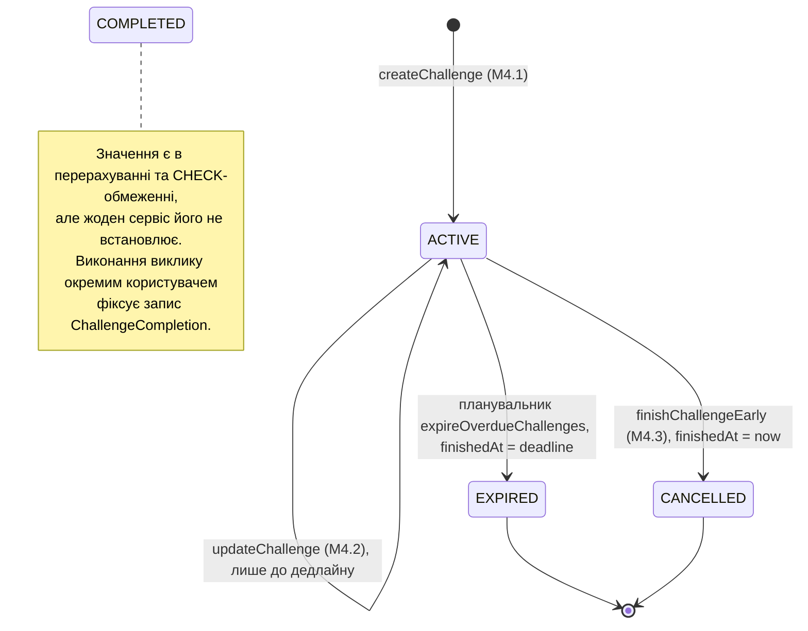

#### 7.6.2. Операції

| Метод | Ендпоінт | Правила |
|---|---|---|
| `createChallenge` (M4.1) | `POST /api/manager/challenges` | DTO: `title` (`@NotBlank`), `requiredBooks` (`@Min(1)`), `deadline` (`@Future`), `rewardPoints` (`@Min(0)`), необов'язкові `description` і `genreId` (якщо жанру немає — `404`). Статус `ACTIVE` |
| `updateChallenge` (M4.2) | `PUT /api/manager/challenges/{id}` | Лише для `ACTIVE` із дедлайном у майбутньому (інакше `400`); перезаписує всі поля |
| `finishChallengeEarly` (M4.3) | `POST /api/manager/challenges/{id}/finish` | Лише `ACTIVE` до дедлайну (`400`). Перебирає **всіх** користувачів і надсилає `sendChallengeTerminatedEarly` тим, хто має прогрес `> 0` і ще не виконав виклик. Потім `status = CANCELLED`, `finishedAt = now`. Повертає `FinishChallengeResponse` з `notifiedCount` |
| `getAllChallengesForManager` | `GET /api/manager/challenges?status=` | Усі виклики або виклики з указаним статусом, за спаданням дати створення |
| `getActiveChallenges` (C7) | `GET /api/challenges` (публічний) | Активні виклики з дедлайном у майбутньому, за зростанням дедлайну, разом із прогресом поточного користувача. Далі йдуть уже виконані ним виклики, які більше не активні. Для гостя прогрес дорівнює 0 |
| `getChallengeById` | `GET /api/challenges/{id}` (публічний) | Деталі виклику з прогресом |
| `expireOverdueChallenges` | — | `@Scheduled(fixedDelayString = "PT1M", initialDelayString = "PT10S")`: щохвилини, з першим запуском через 10 с після старту |

#### 7.6.3. Обчислення прогресу

Прогрес **не зберігається** в БД, а щоразу обчислюється запитом `OrderItemRepository.countDeliveredBooksForChallenge(userId, challenge.createdAt, challenge.deadline, genreId)`:

- рахується сума `order_items.quantity` у замовленнях користувача зі статусом `DELIVERED` (зокрема `GIFT`);
- датою поставки вважається `COALESCE(deliveredAt, statusChangedAt, createdAt)`, і вона має бути в межах `[createdAt виклику; deadline]`;
- якщо `genreId` задано, враховуються лише книги цього жанру;
- якщо виклик уже виконано (є `ChallengeCompletion`), прогрес дорівнює `requiredBooks`.

Фіксація виконання та нарахування нагороди відбуваються лише в момент переходу замовлення в `DELIVERED` (п. 7.3.4). Якщо змінити умови виклику, прогрес перераховується автоматично, але вже зафіксовані виконання лишаються.

### 7.7. Подарунковий набір (C9) — `GiftSetService`

Усі методи `@Transactional(readOnly = true)`, ендпоінти публічні (`/api/gift-sets`).

| Ендпоінт | Метод |
|---|---|
| `POST /api/gift-sets/generate` | `generateGiftSet(GenerateGiftSetRequest { budget ≥ 50.00, genreIds (@NotEmpty), bookCount?, excludeBookIds? })` |
| `POST /api/gift-sets/replace` | `replaceBook(ReplaceGiftSetBookRequest { currentBookIds, bookIdToReplace, genreIds, budget })` |
| `POST /api/gift-sets/replace-candidates` | `getReplaceCandidates(...)` → `ReplaceCandidatesResponse(candidates, maxPriceAllowed)` |

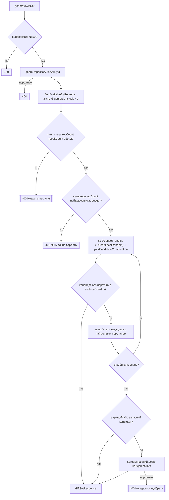

- Якщо задано `bookCount`, пошук із поверненням (backtracking) знаходить рівно `bookCount` книг сумарною ціною `≤ budget`. Без `bookCount` випадково обирається цільовий розмір від 1 до `min(5, кількість доступних)`, і книги додаються жадібно, поки вміщуються в бюджет.
- `excludeBookIds` дає змогу «перегенерувати» набір: перевага надається кандидату без спільних книг із попереднім набором.
- Відповідь: `GiftSetResponse(items, totalPrice, budget, remainingBudget = budget − totalPrice, genres)`.
- `replaceBook`: `maxPriceAllowed = budget − Σ ціни інших книг` (якщо `< 0` — `400`). Кандидати — `findCandidatesForReplace` (жанр ∈ `genreIds`, `stock > 0`, книга не в наборі, `price ≤ maxPriceAllowed`); заміну обирають випадково, порядок книг зберігається. Якщо кандидатів немає — `400`. `getReplaceCandidates` повертає список кандидатів без помилок (порожній, якщо `maxPriceAllowed < 0`).
- Набір **не зберігається** в БД. Щоб купити книги з набору, клієнт передає їх як позиції замовлення.

### 7.8. Заклади-одержувачі (M8, M12) — `InstitutionService`

| Ендпоінт | Метод | Правила |
|---|---|---|
| `GET /api/institutions?type=&query=` (публічний) | `getInstitutions` | `searchInstitutions`: фільтр за типом і підрядком у назві або адресі, сортування за назвою |
| `GET /api/institutions/{id}` (публічний) | `getInstitutionById` | `404` |
| `GET /api/manager/institutions?query=&type=` | `getManagerInstitutions` | Додатково `giftOrdersCount` (кількість замовлень закладу, `countByInstitutionId`) і `canDelete` |
| `GET /api/manager/institutions/{id}` | `getManagerInstitutionById` | — |
| `POST /api/manager/institutions` (M8.1) | `createInstitution` | `InstitutionUpsertRequest { name, address, contactPerson (@NotBlank), type (@NotNull) }` (колонка `institutions.phone` через API не заповнюється); поля обрізаються від пробілів; назва унікальна без урахування регістру (`409`, а також індекс `uk_institutions_lower_name`). Відповідь — `200` |
| `PUT /api/manager/institutions/{id}` (M8.2) | `updateInstitution` | `404`; `409` — назва належить іншому закладу. Зміни **не** впливають на вже оформлені замовлення, які зберігають знімки |
| `DELETE /api/manager/institutions` (M8.3) | `deleteInstitutions(DeleteInstitutionsRequest { institutionIds (@NotEmpty) })` | Див. нижче |

Правило `canDelete`: у закладу немає замовлень зі статусами `AWAITING_PAYMENT` або `PAID`.

Видалення відбувається за принципом «все або нічого»:

1. Для кожного ідентифікатора заклад має існувати (`404`).
2. Якщо будь-який заклад має активні замовлення (`AWAITING_PAYMENT`, `PAID`), повертається `409` з переліком «Назва (ID: n)», і нічого не видаляється.
3. Інакше:
   - `giftLogRepository.detachInstitutions(ids)`;
   - для фінальних замовлень (`DELIVERED`, `CANCELLED`) цих закладів — `detachOrders`, після чого замовлення **видаляються**;
   - нарешті видаляються самі заклади.

   Записи журналу дарунків зберігаються зі знімком назви закладу.

### 7.9. Журнал подарованих книг (M9) — `GiftLogService`

`GET /api/manager/gift-log?institutionId=&institutionName=&dateFrom=&dateTo=` (дати у форматі ISO `yyyy-MM-dd`).

- Фільтрація — `GiftLogSpecifications.withFilters(...)`. Якщо `dateTo < dateFrom` — `400`.
- Сортування: `deliveredDate DESC`, потім `id DESC`. Попри назву `GiftLogPageResponse`, пагінації немає.
- `totalDonatedBooks` — сума `quantity` **відфільтрованих** записів.
- Записи створює лише `ManagerOrderService` під час переходу замовлення `GIFT` у `DELIVERED`.

### 7.10. Аналітична панель (M10) — `AnalyticsService`

Клас `@Transactional(readOnly = true)`, нативні SQL-запити через `JdbcClient`.

**Період** (`validateAndResolvePeriod`):

- якщо `from` і `to` не задано — останні 3 місяці до сьогодні;
- якщо задано лише одну межу, друга доповнюється: `to` = сьогодні, `from` = `to − 3 місяці`;
- `to < from` або `to` у майбутньому → `400`;
- межі переводяться в UTC: від початку дня `from` до кінця дня `to`.

| Ендпоінт | Метрика |
|---|---|
| `GET /api/manager/analytics/demand?from=&to=` | Затребуваність: `SUM(order_items.quantity)` за замовленнями, створеними в періоді, крім `CANCELLED`. Групування за жанром і за книгою (для видалених книг — назва зі знімка `book_title`); сортування за кількістю за спаданням, потім за назвою |
| `GET /api/manager/analytics/stock` | Залишки: `SUM(stock)` за жанрами (жанри без книг дають 0) і залишок кожної не видаленої книги; сортування за залишком за спаданням. Порогу «мало на складі» та обмеження кількості рядків немає |
| `GET /api/manager/analytics/ratings?from=&to=` | Рейтинги: `ROUND(AVG(value), 2)` і `COUNT` за жанрами та книгами; сортування за середнім значенням за спаданням (порожні — в кінці), потім за кількістю |

> **Спостереження.** У `getRatingAnalytics` перевіряється весь період, але в запиті використовується лише верхня межа (`created_at <= to`). Тому рейтинги накопичуються з початку існування даних, а параметр `from` фактично ігнорується.

### 7.11. Адміністрування облікових записів (M5, M6, M7, M11)

#### 7.11.1. Пошук, картка, блокування, розблокування — `ManagerUserService`

| Ендпоінт | Метод | Правила |
|---|---|---|
| `GET /api/manager/users?email=&status=` (M11) | `getUsers` | `UserSpecifications.findUsers`: лише роль `USER`, підрядок email, статус; сторінка `ManagerUserSummaryResponse(id, email, status, createdAt, lastLoginAt)` |
| `GET /api/manager/users/{id}` (M11) | `getUserDetails` | `ordersByStatus` — значення для всіх 4 статусів (порожні = 0), `totalOrders`, `bonusBalance`; `blockedAt` і `blockReason` — лише для `BLOCKED` |
| `POST /api/manager/users/{id}/block` (M6) | `blockUser(BlockUserRequest { reason: @NotBlank, ≤ 500 })` | `404`; `409` — обліковий запис менеджера; `409` — користувач уже заблокований. Встановлює `BLOCKED`, `blockReason`, `blockedAt = now` і надсилає `sendAccountBlocked`. Чинність у відкритій сесії забезпечує `AccountStatusFilter` (п. 6.8) |
| `GET /api/manager/users/unblock-requests` (M7) | `getUnblockRequests` | Усі запити за спаданням дати, разом із причиною та датою блокування |
| `POST /api/manager/users/unblock` (M7) | `unblockUsers(UnblockUsersRequest { userIds: @NotEmpty })` | Принцип «все або нічого»: `404`; `409`, якщо користувач не заблокований. Встановлює `ACTIVE`, очищає `blockReason`/`blockedAt`, скидає `failedLoginAttempts` і `lockedUntil`, **видаляє** запити на розблокування користувача (`deleteByUserId`) і надсилає `sendAccountUnblocked` |

> **Спостереження.** Перерахування `UnblockRequestStatus` і колонки `manager_comment`, `resolved_by_user_id`, `resolved_at` у сервісах не використовуються. Окремої операції відхилення запиту (`REJECTED`) немає: запит або чекає на розгляд, або видаляється під час розблокування.

#### 7.11.2. Видалення неактивних облікових записів (M5) — `ManagerInactiveUserService`

Межа неактивності — `now − 2 роки`. Кандидатами (`GET /api/manager/users/inactive`) є користувачі з роллю `USER`:

- зі статусом `ACTIVE`, якщо `COALESCE(lastLoginAt, createdAt)` раніше за межу;
- зі статусом `BLOCKED`, якщо `blockedAt` раніше за межу.

Відповідь — `InactiveUserResponse(id, email, status, referenceDate)`.

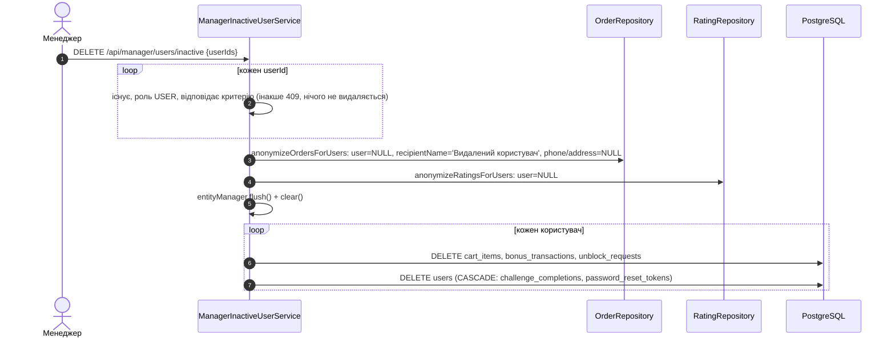

Замовлення та оцінки зберігаються знеособленими, тож фінансова звітність і агреговані рейтинги не руйнуються (SRS M5, розділ 6). Сповіщення не надсилаються.

### 7.12. Доставка «Новою поштою» — `NovaPoshtaDeliveryService`

Інтеграція підтримує вибір міста й відділення під час оформлення замовлення (C2, спосіб `POST_OFFICE`).

| Ендпоінт (публічний) | Параметри | Відповідь |
|---|---|---|
| `GET /api/delivery/cities` | `query` (необов'язковий, типово `""`) | `List<DeliveryCityResponse { ref, name, area, displayName }>` |
| `GET /api/delivery/warehouses` | `cityRef` (обов'язковий), `query` (необов'язковий) | `List<DeliveryWarehouseResponse { ref, number, label, formattedAddress }>` |

- **Клієнт:** Spring `RestClient` із `SimpleClientHttpRequestFactory`; тайм-аути з'єднання та читання — `app.novaposhta.timeout-ms` (типово 3000 мс). Запити — JSON `POST` на `app.novaposhta.api-url` з `apiKey` = `app.novaposhta.api-key`.
- **Методи API:** `modelName: "Address"`. Для міст викликається `getCities` (`FindByString`, `Limit: "20"`), для відділень — `getWarehouses` (`CityRef`, `FindByString`, `Limit: "50"`).
- **Стійкість до збоїв:** якщо API повернуло порожню чи неуспішну відповідь або сталася помилка, сервіс переходить на **локальний довідник** (10 міст), а помилку логує на рівні `WARN`. Клієнт завжди отримує `200`. Порожній пошуковий рядок для міст одразу повертає локальний список; порожній `cityRef` — порожній список відділень.
- **Кеш:** `ConcurrentHashMap` для міст (за нормалізованим запитом) і відділень (за `cityRef` + запитом). Термін дії та механізм очищення **не реалізовано**: кеш живе до перезапуску застосунку.
- Якщо ключ API не задано, запити все одно надсилаються з порожнім `apiKey`, а за неуспішної відповіді спрацьовує запасний довідник.

### 7.13. Поштові сповіщення — `NotificationService`

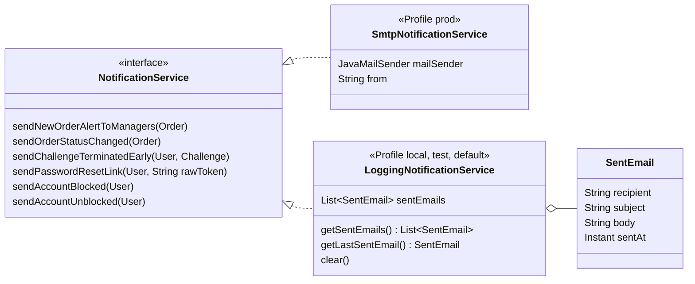

| Метод | Ініціатор | Одержувач (SMTP) | Тема (SMTP) |
|---|---|---|---|
| `sendNewOrderAlertToManagers` | `OrderService` (C2) | Фіксована адреса `managers@readmania.ua` | «Нове замовлення #… на суму … грн» |
| `sendOrderStatusChanged` | `OrderService.cancelOrder`, `ManagerOrderService` | Email покупця (для знеособленого замовлення — `customer@example.com`) | «Зміна статусу замовлення #…: …» |
| `sendChallengeTerminatedEarly` | `ChallengeService.finishChallengeEarly` | Учасник із прогресом `> 0` | «Читацький виклик '…' завершено достроково» |
| `sendPasswordResetLink` | `AuthService.requestPasswordReset` | Користувач | «Відновлення пароля у ReadMania»; у тілі відносне посилання `/reset-password?token=…` |
| `sendAccountBlocked` | `ManagerUserService.blockUser` | Користувач | «Ваш обліковий запис у ReadMania заблоковано» |
| `sendAccountUnblocked` | `ManagerUserService.unblockUsers` | Користувач | «Ваш обліковий запис у ReadMania розблоковано» |

- **Асинхронність:** `@Async` стоїть лише на шести методах `SmtpNotificationService` (з `@EnableAsync` у `ReadmaniaBackendApplication`). `LoggingNotificationService` працює синхронно, і тести можуть одразу перевіряти `getSentEmails()`.
- **Відправник:** `${spring.mail.username:noreply@readmania.ua}`. Налаштування SMTP (`spring.mail.*`) у репозиторії відсутні, зокрема їх немає в `application-prod.yml`, тож їх потрібно передати через змінні середовища.
- **Обробка помилок:** будь-який виняток під час відправлення логується й поглинається, тому бізнес-операція не відкочується через збій пошти.
- **Обмеження:**
  - базову URL-адресу фронтенду для посилання скидання пароля не налаштовано, тож посилання відносне;
  - адреса менеджерів жорстко задана в коді;
  - `LoggingNotificationService` записує сирий токен скидання пароля в лог, тому цю реалізацію не можна використовувати в продуктивному середовищі.

Розбіжності `docs/EMAIL_NOTIFICATIONS.md` з кодом: у документі інші сигнатури методів (наприклад, `email, rawToken` замість `User, rawToken`; `email, reason` для блокування) і твердження, що вся відправка асинхронна.

---

## 8. REST API

### 8.1. Загальні угоди

| Аспект | Угода |
|---|---|
| Префікс | Усі бізнес-ендпоінти мають префікс `/api`; менеджерські — `/api/manager` |
| Формат | `application/json` (UTF-8); виняток — завантаження файлів (`multipart/form-data`, поле `file`) і обкладинки (`image/*`) |
| Автентифікація | Сесійна cookie `JSESSIONID` після `POST /api/auth/login` (розділ 6) |
| CSRF | Для `POST`/`PUT`/`PATCH`/`DELETE` потрібен заголовок `X-XSRF-TOKEN` зі значенням cookie `XSRF-TOKEN`, крім шляхів з п. 6.7 |
| Пагінація | Параметри Spring Data `page` (з 0), `size`, `sort`. Відповідь `Page` серіалізується як `PagedModel` (`@EnableSpringDataWebSupport(pageSerializationMode = VIA_DTO)`): `{ "content": [...], "page": { "size", "number", "totalElements", "totalPages" } }` |
| Дати | `Instant` — рядок ISO-8601 в UTC; параметри-дати аналітики та журналу дарунків — `yyyy-MM-dd` (`@DateTimeFormat(iso = DATE)`) |
| Валідація | `@Valid` на тілах запитів; помилки повертаються у форматі розділу 9 (`400` + `errors[]`) |
| Помилки | RFC 9457 `application/problem+json` (розділ 9) |
| Специфікація | OpenAPI 3.1.0: `docs/openapi.json` (генерує `OpenApiExportIT`), Swagger UI — `/swagger-ui.html` (лише профіль `local`) |

**Звірка з кодом.** Набір операцій у цьому розділі автоматично зібрано з анотацій `@*Mapping` 18 контролерів: 77 пар «метод + шлях», з урахуванням двох базових шляхів `ProfileController`. Він **повністю збігається** з `docs/openapi.json`: розбіжностей немає ні в один, ні в інший бік.

Позначення в стовпці «Доступ»:

- **P** — публічний (`permitAll`);
- **A** — потрібна автентифікація (будь-яка роль);
- **M** — потрібна роль `MANAGER`.

### 8.2. Автентифікація та профіль

| Метод | Шлях | Доступ | Тіло / параметри | Відповідь |
|---|---|---|---|---|
| `POST` | `/api/auth/register` | P | `RegisterRequest { email (@Email), password (≥ 6), confirmPassword, fullName? }` | `201` `UserResponse` |
| `POST` | `/api/auth/login` | P | `LoginRequest { email (@Email), password }` | `200` `UserResponse` + `Set-Cookie: JSESSIONID` |
| `POST` | `/api/auth/logout` | P | — | `200` `{ "message": "Ви успішно вийшли із системи" }` |
| `GET` | `/api/auth/me` | A | — | `200` `UserResponse` |
| `POST` | `/api/auth/password-reset/request` | P | `PasswordResetRequest { email }` | `200` `{ "message": "Якщо обліковий запис існує, лист надіслано" }` |
| `POST` | `/api/auth/password-reset/confirm` | P | `PasswordResetConfirmRequest { token, newPassword (≥ 6), confirmPassword }` | `200` `{ "message": "Пароль успішно змінено" }` |
| `POST` | `/api/auth/unblock-request` | P | `CreateUnblockRequest { email, password, reason (≤ 1000) }` | `200` `{ "message": "Запит на розблокування успішно надіслано" }` |
| `GET` | `/api/account`, `/api/profile` | A | — | `200` `UserResponse` |
| `PUT` | `/api/account`, `/api/profile` | A | `UpdateProfileRequest { fullName?, phone?, deliveryAddress?, email? (@Email), currentPassword (@NotBlank) }` | `200` `UserResponse` |
| `PUT` | `/api/account/password`, `/api/profile/password` | A | `ChangePasswordRequest { currentPassword, newPassword (≥ 6), confirmPassword }` | `200` `UserResponse` |

### 8.3. Каталог (публічний)

| Метод | Шлях | Доступ | Параметри | Відповідь |
|---|---|---|---|---|
| `GET` | `/api/catalog/books` | P | `query`/`q`, `genre`, `genreId`, `author`, `authorId`, `priceMin`, `priceMax`, `stockMin`, `stockMax`, `inStock`, `page`, `size`, `sort` (п. 7.1.1) | `200` `Page<BookSummaryResponse>` |
| `GET` | `/api/catalog/books/{id}` | P | — | `200` `BookDetailsResponse` |
| `GET` | `/api/catalog/books/{id}/cover` | P | — | `200` `byte[]` (`Content-Type` зображення, `Cache-Control: max-age=86400, public`) |
| `GET` | `/api/catalog/genres` | P | — | `200` `List<GenreResponse>` (з `booksCount`) |
| `GET` | `/api/catalog/authors` | P | — | `200` `List<AuthorResponse>` |

### 8.4. Кошик

| Метод | Шлях | Доступ | Тіло | Відповідь |
|---|---|---|---|---|
| `GET` | `/api/cart` | A | — | `200` `CartResponse` |
| `POST` | `/api/cart/items` | A | `AddToCartRequest { bookId, quantity (≥ 1, типово 1) }` | `200` `CartResponse` |
| `PUT` | `/api/cart/items/{bookId}` | A | `UpdateCartItemRequest { quantity (≥ 1) }` | `200` `CartResponse` |
| `DELETE` | `/api/cart/items/{bookId}` | A | — | `200` `CartResponse` |
| `DELETE` | `/api/cart` | A | — | `204` |

### 8.5. Замовлення покупця

| Метод | Шлях | Доступ | Тіло / параметри | Відповідь |
|---|---|---|---|---|
| `POST` | `/api/orders/preview` | A | `OrderPreviewRequest { items?: [OrderItemRequest], bonusPoints (≥ 0) }` (тіло необов'язкове) | `200` `OrderPreviewResponse` |
| `POST` | `/api/orders` | A | `CreateOrderRequest { items?, deliveryMethod (@NotNull), address (@NotBlank), contacts: OrderContactDto { recipientName, phone (^\+?[0-9]{10,15}$) }, paymentMethod (@NotNull), bonusPoints (≥ 0) }` | `201` `OrderDetailsResponse` |
| `POST` | `/api/orders/gift` | A | `CreateGiftOrderRequest { institutionId (@NotNull), items?, paymentMethod (типово TRANSFER), bonusPoints (≥ 0) }` | `201` `OrderDetailsResponse` |
| `GET` | `/api/orders` | A | `page`, `size` (типово 10) | `200` `Page<OrderSummaryResponse>` |
| `GET` | `/api/orders/{id}` | A | — | `200` `OrderDetailsResponse` (з історією статусів і `userRating`) |
| `POST` | `/api/orders/{id}/cancel` | A | — | `200` `OrderDetailsResponse` |

`OrderItemRequest { bookId (@NotNull), quantity (≥ 1, типово 1) }`. Якщо `items` не передано або список порожній, використовуються доступні позиції кошика.

### 8.6. Лояльність, оцінки, виклики, набори, заклади, доставка

| Метод | Шлях | Доступ | Тіло / параметри | Відповідь |
|---|---|---|---|---|
| `GET` | `/api/loyalty/balance` | A | — | `200` `LoyaltyBalanceResponse { bonusBalance, transactions[] }` |
| `GET` | `/api/loyalty/transactions` | A | — | `200` `LoyaltyBalanceResponse` (той самий метод) |
| `POST` | `/api/ratings` | A | `CreateRatingRequest { bookId, orderId?, value (1..5) }` | `201` `RatingResponse` |
| `GET` | `/api/ratings/me` | A | — | `200` `List<RatingResponse>` |
| `GET` | `/api/ratings/book/{bookId}` | P | — | `200` `List<PublicRatingResponse>` |
| `GET` | `/api/challenges` | P | — | `200` `List<ChallengeResponse>` (з прогресом, якщо користувач автентифікований) |
| `GET` | `/api/challenges/{id}` | P | — | `200` `ChallengeResponse` |
| `POST` | `/api/gift-sets/generate` | P | `GenerateGiftSetRequest { budget (≥ 50.00), genreIds (@NotEmpty), bookCount? (≥ 1), excludeBookIds? }` | `200` `GiftSetResponse` |
| `POST` | `/api/gift-sets/replace` | P | `ReplaceGiftSetBookRequest { currentBookIds (@NotEmpty), bookIdToReplace, genreIds (@NotEmpty), budget }` | `200` `GiftSetResponse` |
| `POST` | `/api/gift-sets/replace-candidates` | P | `ReplaceGiftSetBookRequest` | `200` `ReplaceCandidatesResponse` |
| `GET` | `/api/institutions` | P | `type?`, `query?` | `200` `List<InstitutionResponse>` |
| `GET` | `/api/institutions/{id}` | P | — | `200` `InstitutionResponse` |
| `GET` | `/api/delivery/cities` | P | `query?` | `200` `List<DeliveryCityResponse>` |
| `GET` | `/api/delivery/warehouses` | P | `cityRef` (обов'язковий), `query?` | `200` `List<DeliveryWarehouseResponse>` |

> **Зауваження щодо CSRF.** Ендпоінти `/api/gift-sets/**` публічні, але використовують `POST`. Тому в профілях, де CSRF увімкнено, анонімний клієнт теж має передавати `X-XSRF-TOKEN`. Cookie з токеном він отримує з будь-якого попереднього `GET`.

### 8.7. Панель менеджера (`/api/manager/**`, роль `MANAGER`)

**Каталог (M1, M2):**

| Метод | Шлях | Тіло | Відповідь |
|---|---|---|---|
| `POST` | `/api/manager/books` | `CreateBookRequest { title (≤ 255), isbn (≤ 20), price (≥ 0), stock (≥ 0), publisher (≤ 255), publicationYear (1450..2100), description?, genreId? \| genre?, authorIds? \| authors? \| author? }` | `201` `BookDetailsResponse` |
| `PUT` | `/api/manager/books/{id}` | `UpdateBookRequest` (ті самі поля) | `200` `BookDetailsResponse` |
| `DELETE` | `/api/manager/books/{id}` | — | `204` |
| `POST` | `/api/manager/books/{id}/cover` | `multipart/form-data`, поле `file` | `200` (без тіла) |
| `POST` | `/api/manager/books/import-csv` | `multipart/form-data`, поле `file` | `200` `CsvImportResponse` |
| `POST` | `/api/manager/genres` | `GenreRequest { name (≤ 100) }` | `201` `GenreResponse` |
| `PUT` | `/api/manager/genres/{id}` | `GenreRequest` | `200` `GenreResponse` |
| `DELETE` | `/api/manager/genres/{id}` | — | `204` |
| `POST` | `/api/manager/authors` | `CreateAuthorRequest { fullName (≤ 255) }` | `201` `AuthorResponse` |

**Замовлення (M3):**

| Метод | Шлях | Тіло / параметри | Відповідь |
|---|---|---|---|
| `GET` | `/api/manager/orders` | `status?`, `unpaidOverdue?`, `archived?`, `page`, `size` (типово 10) | `200` `Page<OrderSummaryResponse>` |
| `GET` | `/api/manager/orders/{id}` | — | `200` `OrderDetailsResponse` |
| `PATCH` | `/api/manager/orders/{id}/status` | `UpdateOrderStatusRequest { status (@NotNull), expectedStatus?, comment? }` | `200` `OrderDetailsResponse` |
| `POST` | `/api/manager/orders/cancel-unpaid-overdue` | `BatchOrderActionRequest { orderIds (@NotEmpty) }` | `200` `{ "message", "cancelledCount" }` |
| `DELETE` | `/api/manager/orders/archive` | `BatchOrderActionRequest` | `200` `{ "message", "deletedCount" }` |

**Читацькі виклики (M4):**

| Метод | Шлях | Тіло / параметри | Відповідь |
|---|---|---|---|
| `GET` | `/api/manager/challenges` | `status?` | `200` `List<ChallengeResponse>` |
| `POST` | `/api/manager/challenges` | `CreateChallengeRequest { title, description?, requiredBooks (≥ 1), genreId?, deadline (@Future), rewardPoints (≥ 0) }` | `201` `ChallengeResponse` |
| `PUT` | `/api/manager/challenges/{id}` | `UpdateChallengeRequest` (ті самі поля) | `200` `ChallengeResponse` |
| `POST` | `/api/manager/challenges/{id}/finish` | — | `200` `FinishChallengeResponse` |

**Облікові записи (M5–M7, M11):**

| Метод | Шлях | Тіло / параметри | Відповідь |
|---|---|---|---|
| `GET` | `/api/manager/users` | `email?`, `status?`, `page`, `size` (типово 10, `sort=createdAt,desc`) | `200` `Page<ManagerUserSummaryResponse>` |
| `GET` | `/api/manager/users/{id}` | — | `200` `ManagerUserDetailsResponse` |
| `POST` | `/api/manager/users/{id}/block` | `BlockUserRequest { reason (≤ 500) }` | `200` `ManagerUserDetailsResponse` |
| `GET` | `/api/manager/users/unblock-requests` | — | `200` `List<ManagerUnblockRequestResponse>` |
| `POST` | `/api/manager/users/unblock` | `UnblockUsersRequest { userIds (@NotEmpty) }` | `200` `{ "message": "Облікові записи успішно розблоковано" }` |
| `GET` | `/api/manager/users/inactive` | — | `200` `List<InactiveUserResponse>` |
| `DELETE` | `/api/manager/users/inactive` | `DeleteInactiveUsersRequest { userIds (@NotEmpty) }` | `200` `{ "message": "Неактивні облікові записи успішно видалено" }` |

**Заклади, журнал дарунків, аналітика (M8–M10, M12):**

| Метод | Шлях | Тіло / параметри | Відповідь |
|---|---|---|---|
| `GET` | `/api/manager/institutions` | `query?`, `type?` | `200` `List<InstitutionDetailsResponse>` |
| `GET` | `/api/manager/institutions/{id}` | — | `200` `InstitutionDetailsResponse` |
| `POST` | `/api/manager/institutions` | `InstitutionUpsertRequest { name, type, address, contactPerson }` | `200` `InstitutionDetailsResponse` |
| `PUT` | `/api/manager/institutions/{id}` | `InstitutionUpsertRequest` | `200` `InstitutionDetailsResponse` |
| `DELETE` | `/api/manager/institutions` | `DeleteInstitutionsRequest { institutionIds (@NotEmpty) }` | `200` `{ "message": "Заклади успішно видалено" }` |
| `GET` | `/api/manager/gift-log` | `institutionId?`, `institutionName?`, `dateFrom?`, `dateTo?` | `200` `GiftLogPageResponse { items[], totalDonatedBooks }` |
| `GET` | `/api/manager/analytics/demand` | `from?`, `to?` (`yyyy-MM-dd`) | `200` `DemandAnalyticsResponse` |
| `GET` | `/api/manager/analytics/stock` | — | `200` `StockAnalyticsResponse` |
| `GET` | `/api/manager/analytics/ratings` | `from?`, `to?` | `200` `RatingAnalyticsResponse` |

### 8.8. Службові ендпоінти

| Метод | Шлях | Доступ | Призначення |
|---|---|---|---|
| `GET` | `/actuator/health` | P | Стан застосунку без деталей (`show-details: never`); використовується в `HEALTHCHECK` Docker |
| `GET` | `/v3/api-docs`, `/swagger-ui.html` | P лише в `local`; інакше заборонено | Специфікація OpenAPI та Swagger UI |

### 8.9. Типовий сценарій взаємодії SPA з API

```mermaid
sequenceDiagram
    autonumber
    actor U as Користувач
    participant SPA as React SPA
    participant API as Backend /api
    SPA->>API: GET /api/catalog/books?query=...&page=0
    API-->>SPA: 200 Page + Set-Cookie XSRF-TOKEN
    U->>SPA: Увійти
    SPA->>API: POST /api/auth/login {email, password}
    API-->>SPA: 200 UserResponse + Set-Cookie JSESSIONID
    SPA->>API: POST /api/cart/items {bookId, quantity} + X-XSRF-TOKEN
    API-->>SPA: 200 CartResponse
    SPA->>API: POST /api/orders/preview {bonusPoints}
    API-->>SPA: 200 OrderPreviewResponse (maxBonusPoints, totalToPay)
    SPA->>API: POST /api/orders {deliveryMethod, address, contacts, paymentMethod, bonusPoints}
    API-->>SPA: 201 OrderDetailsResponse (AWAITING_PAYMENT)
    SPA->>API: GET /api/orders/{id}
    API-->>SPA: 200 OrderDetailsResponse (історія статусів)
```

---

## 9. Обробка помилок

### 9.1. Формат відповіді (RFC 9457)

Усі помилки повертаються як `application/problem+json` (Spring `ProblemDetail`). Відповідь має такі поля:

| Поле | Опис |
|---|---|
| `type` | URI типу помилки. Для доменно-специфічних помилок — URN `urn:readmania:error:*`; для решти — типове `about:blank` |
| `title` | Короткий заголовок (переважно українською, для 401/403 — англійською) |
| `status` | HTTP-код |
| `detail` | Повідомлення для користувача (з тексту винятку) |
| `instance` | URI запиту |
| Розширення | `errors` (валідація), `currentStatus` (конфлікт статусу замовлення), `blockReason`, `blockedAt` (блокування), `retryAfter` (обмеження спроб входу), `errorId` (500) |

Приклад помилки валідації (вимоги SRS U2, U3):

```json
{
  "type": "about:blank",
  "title": "Помилка валідації",
  "status": 400,
  "detail": "Перевірте правильність заповнення полів",
  "instance": "/api/orders",
  "errors": [
    { "field": "contacts.phone", "message": "<повідомлення з анотації DTO>" },
    { "field": "deliveryMethod", "message": "<повідомлення з анотації DTO>" }
  ]
}
```

Елемент масиву `errors` — запис `ua.readmania.common.ValidationError(String field, String message)`. Тексти повідомлень беруться з атрибутів `message` анотацій Bean Validation у DTO. Їх сформульовано за SRS U3: поле, причина, приклад, наприклад «Рік видання обов'язковий. Приклад: 2024».

### 9.2. Ієрархія доменних винятків (`ua.readmania.common`)

```mermaid
classDiagram
    direction TB
    class RuntimeException
    class NotFoundException
    class ConflictException
    class BusinessRuleException {
        HttpStatus status = BAD_REQUEST
    }
    class OrderStatusConflictException {
        OrderStatus currentStatus
    }
    class AccountBlockedException {
        String blockReason
        Instant blockedAt
    }
    class LoginRateLimitedException {
        Instant retryAfter
        HttpStatus status = FORBIDDEN
    }
    class ValidationError {
        <<record>>
        String field
        String message
    }
    RuntimeException <|-- NotFoundException
    RuntimeException <|-- ConflictException
    RuntimeException <|-- BusinessRuleException
    RuntimeException <|-- OrderStatusConflictException
    RuntimeException <|-- AccountBlockedException
    RuntimeException <|-- LoginRateLimitedException
```

Усі винятки — неперевірювані (`RuntimeException`), тож під час кидання з `@Transactional`-методів транзакція відкочується.

### 9.3. Таблиця відображення `GlobalExceptionHandler`

`GlobalExceptionHandler` позначено `@RestControllerAdvice`; він розширює `ResponseEntityExceptionHandler`.

| Виняток | HTTP | `type` / `title` | Розширення |
|---|---|---|---|
| `NotFoundException` | 404 | `title` «Ресурс не знайдено» | — |
| `ConflictException` | 409 | «Конфлікт даних» | — |
| `OrderStatusConflictException` | 409 | `urn:readmania:error:order-status-conflict`, «Конфлікт статусу замовлення» | `currentStatus` |
| `BusinessRuleException` | `ex.getStatus()` (типово 400) | «Порушення бізнес-правил» / «Конфлікт бізнес-правил» (для 409) | — |
| `AccountBlockedException` | 403 | `urn:readmania:error:account-blocked`, «Forbidden» | `blockReason`, `blockedAt` |
| `LoginRateLimitedException` | `ex.getStatus()` (типово 403) | `urn:readmania:error:login-rate-limited`, «Login Rate Limited» | `retryAfter` |
| `ObjectOptimisticLockingFailureException`, `OptimisticLockException` | 409 | «Конфлікт одночасного редагування» | — |
| `DataIntegrityViolationException` | 409 | «Конфлікт цілісності даних» (деталі SQL у відповідь не потрапляють, лише в лог `WARN`) | — |
| `ConstraintViolationException` | 400 | «Помилка валідації» | `errors` (ім'я поля — останній сегмент `propertyPath`) |
| `MethodArgumentTypeMismatchException` | 400 | «Некоректний тип параметра» | — |
| `IllegalArgumentException` | 400 | «Некоректний запит» | — |
| `MethodArgumentNotValidException` (`@Valid` тіла) | 400 | «Помилка валідації» | `errors` |
| `HandlerMethodValidationException` | 400 | «Помилка валідації» | `errors` (ім'я параметра) |
| `HttpMessageNotReadableException` | 400 | «Некоректне тіло запиту» | — |
| `MissingServletRequestParameterException` | 400 | «Відсутній обов'язковий параметр» | — |
| `HttpRequestMethodNotSupportedException` | 405 | «Метод не підтримується» | — |
| `HttpMediaTypeNotSupportedException` | 415 | «Непідтримуваний тип медіа» | — |
| `NoResourceFoundException` | 404 або forward | Для `/api/**` — «Ресурс не знайдено». Для інших шляхів запит перенаправляється (forward) на `/index.html`, щоб працювала клієнтська маршрутизація SPA (SRS R3) | — |
| `AccessDeniedException`, `AuthenticationException` (зокрема в ланцюжку `cause`) | — | Прокидаються далі до Spring Security, який повертає 403 або 401 | — |
| Будь-який інший `Exception` | 500 | «Внутрішня помилка сервера»; `detail` містить ідентифікатор помилки | `errorId` (UUID); повний стек записується в лог `ERROR` разом з `errorId`, але не повертається клієнту |

Помилки рівня фільтрів формуються поза `GlobalExceptionHandler`:

- `ProblemDetailsAuthenticationEntryPoint` — `401`, `title` «Unauthorized», без `type`;
- `ProblemDetailsAccessDeniedHandler` — `403`, `urn:readmania:error:access-denied`;
- `AccountStatusFilter` — `403`, `urn:readmania:error:account-blocked`.

### 9.4. Маршрут винятку

```mermaid
flowchart TD
    REQ([Запит]) --> F{Фільтри безпеки}
    F -- немає автентифікації --> E401[[401 ProblemDetailsAuthenticationEntryPoint]]
    F -- бракує ролі або CSRF --> E403[[403 ProblemDetailsAccessDeniedHandler]]
    F -- BLOCKED --> E403B[[403 AccountStatusFilter]]
    F -- ok --> C[Controller → Service]
    C -- "@Valid не пройшла" --> V[[400 errors]]
    C -- доменний виняток --> G{GlobalExceptionHandler}
    G -- NotFound --> R404[[404]]
    G -- Conflict / OrderStatusConflict / OptimisticLock / DataIntegrity --> R409[[409]]
    G -- BusinessRule --> RBR[["400 або status з винятку"]]
    G -- AccountBlocked / LoginRateLimited --> R403[[403 з URN]]
    G -- AuthenticationException --> RETHROW[прокинути далі] --> E401
    G -- інше --> R500[[500 + errorId]]
```

### 9.5. Каталог URN-типів помилок

| URN | HTTP | Джерело | Призначення для клієнта |
|---|---|---|---|
| `urn:readmania:error:access-denied` | 403 | `ProblemDetailsAccessDeniedHandler` | Недостатньо прав або невалідний CSRF-токен |
| `urn:readmania:error:account-blocked` | 403 | `AccountStatusFilter`, `AuthService.login` | Обліковий запис заблоковано: показати `blockReason` і запропонувати подати запит на розблокування |
| `urn:readmania:error:login-rate-limited` | 403 | `AuthService.login` | Тимчасове блокування входу: показати час до `retryAfter` |
| `urn:readmania:error:order-status-conflict` | 409 | `OrderService`, `ManagerOrderService` | Статус змінив інший учасник або перехід недопустимий: оновити картку замовлення за `currentStatus` (SRS 7.2.2.8) |

### 9.6. Рекомендації для розробників

1. Для доменних помилок кидайте винятки з `ua.readmania.common`, а не `ResponseStatusException` чи `RuntimeException`: так формат відповіді лишиться однаковим.
2. Щоб повернути `409` за порушення бізнес-правила, використовуйте `new BusinessRuleException(msg, HttpStatus.CONFLICT)` (як у масових діях замовлень) або `ConflictException`.
3. Не передавайте в `detail` внутрішні деталі (SQL, назви таблиць, стектрейси). Для неочікуваних збоїв достатньо `errorId`.
4. Новий URN-тип додавайте в `GlobalExceptionHandler` з префіксом `urn:readmania:error:` і описуйте в п. 9.5 та в `docs/API.md`.
5. Тексти повідомлень валідації пишіть українською за схемою SRS U3: поле, причина, приклад правильного значення.

---

## 10. Тестування

### 10.1. Стратегія

ТЗ (розділ 8) передбачає модульне, інтеграційне та системне тестування. У репозиторії автоматизовано **інтеграційний рівень**: тести піднімають повний контекст Spring Boot і справжню PostgreSQL 17 у Docker-контейнері (Testcontainers). Тому разом із кодом перевіряються міграції Flyway, обмеження та індекси БД, ланцюжок фільтрів безпеки й серіалізація JSON. Моків рівня репозиторію немає. Замість SMTP використовується `LoggingNotificationService`, що зберігає листи в пам'яті.

```mermaid
flowchart LR
    T["Тестовий клас (*Test / *IT)"] --> B["BaseIntegrationTest<br/>@SpringBootTest, @ActiveProfiles(test), @Transactional"]
    B --> TC["TestcontainersConfiguration<br/>singleton postgres:17 + @ServiceConnection"]
    TC --> PG[("PostgreSQL 17<br/>readmania_test")]
    B --> CTX["Spring-контекст:<br/>Flyway V1–V10 → Hibernate validate"]
    T --> MVC["MockMvc (@AutoConfigureMockMvc)<br/>+ CSRF-токен через MockMvcBuilderCustomizer"]
    T --> LNS["LoggingNotificationService<br/>getSentEmails()"]
```

### 10.2. Інфраструктура тестів

| Клас / ресурс | Призначення |
|---|---|
| `BaseIntegrationTest` | Абстрактна база: `@SpringBootTest`, `@ActiveProfiles("test")`, `@Import(TestcontainersConfiguration.class)`, `@Transactional`. Кожен тест відкочує свої зміни. Профіль `test` вимикає CSRF (п. 6.7) |
| `TestcontainersConfiguration` | Один статичний контейнер `postgres:17` (БД `readmania_test`) на всю JVM: він запускається один раз у статичному блоці. `@ServiceConnection` автоматично налаштовує datasource. Бін `MockMvcBuilderCustomizer` додає CSRF-токен до кожного запиту MockMvc (через `CsrfTestHelper.csrfToken()`) |
| `CsrfTestHelper` | Статичний `csrfToken()` (`test-csrf-token` в атрибуті, заголовку `X-XSRF-TOKEN` і cookie `XSRF-TOKEN`) та `@TestConfiguration` з `MockMvcConfigurer` |
| `src/test/resources/application.yml`, `application-test.yml` | Затіняють основну конфігурацію: Flyway лише з `db/migration` (тестові дані з `db/seed` **не** завантажуються), `ddl-auto: validate` |

Деякі класи не наслідують `BaseIntegrationTest`, бо потребують іншого профілю:

- `SecurityConfigTest` і `GlobalExceptionHandlerTest` працюють у профілі `default`;
- `LocalProfileSecurityConfigTest` і `LocalProfileBootstrapAndSeedTest` — у профілі `local`;
- `OpenApiExportIT` — у профілях `test` + `local`.

`SchemaIT` вимикає транзакцію тесту (`@Transactional(propagation = NOT_SUPPORTED)`) і перед кожним тестом очищає таблиці через `TRUNCATE`, щоб перевіряти реальну поведінку обмежень і каскадів.

### 10.3. Перелік тестових класів

| Клас | Тестів | Профіль | Що перевіряє |
|---|---|---|---|
| `AuthIntegrationTest` | 15 | `test` | G2 (реєстрація, дублікати, валідація), G3 (вхід, сесія, 5 спроб → блокування на 15 хв, скидання пароля без розкриття токена), M6 (блокування в активній сесії), C10 (вихід), C5 (профіль, email, пароль), запит на розблокування |
| `catalog/CatalogIntegrationTest` | 19 | `test` | G1 (пагінація, фільтри, сортування, 400 для некоректних параметрів, кешування обкладинок, `booksCount`), M1.1–M1.3 (CRUD, `canDelete`, м'яке видалення, 409 для ISBN), жанри, автори, обкладинки, M2 (CSV), 401/403 |
| `common/GlobalExceptionHandlerTest` | 19 | `default` | Відповідність винятків кодам 400/401/403/404/405/409/415/500, `errors[]`, `errorId`, відсутність витоку SQL, SPA forward для не-API шляхів (через тестовий контролер `TestControllerConfig`) |
| `delivery/DeliveryControllerIT` | 5 | `test` | Міста та відділення «Нової пошти» (через запасний довідник), 400 без `cityRef` |
| `domain/DomainRepositoryIT` | 6 | `test` | Відображення сутностей, `@Version`, `@SQLRestriction`, `BookSpecifications`, `@EmbeddedId`, знімки замовлень |
| `LocalProfileBootstrapAndSeedTest` | 2 | `local` | Тестові облікові записи з `R__dev_seed.sql` / `ManagerBootstrapInitializer`, `LocalCoverSeeder` |
| `manager/ManagerInactiveUserIntegrationTest` | 3 | `test` | M5: вибірка неактивних, 409 для невідповідних, знеособлення |
| `manager/ManagerInstitutionIntegrationTest` | 10 | `test` | M8/M12: публічний і менеджерський списки, `canDelete`, CRUD, унікальність назви, видалення |
| `manager/ManagerSliceIntegrationTest` | 4 | `test` | Наскрізні сценарії: блокування → запит → розблокування; M5 зі збереженням аналітики; видалення закладу зі збереженням `gift_log`; точність аналітики M10 |
| `manager/ManagerUserIntegrationTest` | 4 | `test` | M11 (пошук, картка), M6 (блокування), M7 (масове розблокування) |
| `OpenApiExportIT` | 1 | `test`, `local` | Отримує `/v3/api-docs` і записує відформатований JSON у `docs/openapi.json` |
| `order/OrderIntegrationTest` | 13 | `test` | C1 (кошик), C8 (розрахунок, 30 %), C2 (звичайне та подарункове замовлення, знімки, кошик), C3, M3 (FSM, `expectedStatus`), побічні дії `DELIVERED` (C7, C8, M9), масові дії, конкурентне замовлення останнього примірника (409) |
| `ReadmaniaBackendApplicationTests` | 1 | `test` | `contextLoads()`. **Не виконується** через шаблони surefire (див. нижче) |
| `SchemaIT` | 21 | `test` | Обмеження й індекси БД: регістронезалежний email, частковий ISBN, CHECK для оцінок, залишків, знижки, статусів (A.1) і року (A.4), `SET NULL`/`RESTRICT`, `uk_bonus_order_reward`, `GIFT`, V9, V10, D7 (FK-індекси), ідемпотентність `R__dev_seed.sql` |
| `security/LocalProfileSecurityConfigTest` | 1 | `local` | Swagger відкритий у `local` |
| `security/SecurityConfigTest` | 10 | `default` | BCrypt, 401/403 у форматі Problem Details, публічні шляхи, `/actuator/health`, Swagger закритий поза `local`, default deny |
| `Slice4GamificationAndGiftSetIT` | 16 | `test` | C6 (оцінки, +1 бал, 400/409), M4.1–M4.3 (виклики, сповіщення), C7, автоматичне `EXPIRED`, C9 (генерація, кратність 50, відмови, заміна, `excludeBookIds`) |
| **Разом** | **150** (виконується 149) | | |

### 10.4. Запуск і результати

```bash
cd backend
./mvnw test                     # потрібен запущений Docker
./mvnw test -Dtest=OrderIntegrationTest          # окремий клас
./mvnw test -Dtest='SchemaIT#shouldEnforceFourOrderStatuses'   # окремий тест
```

Під час підготовки цієї настанови тести запускали командою `./mvnw -B test` (JDK Temurin 21, Docker 29). Результат: **`Tests run: 149, Failures: 0, Errors: 0, Skipped: 0` — `BUILD SUCCESS`**.

> **Важливо.**
> 1. `maven-surefire-plugin` запускає лише класи `**/*Test.java` і `**/*IT.java`. Клас `ReadmaniaBackendApplicationTests` (закінчення `Tests`) під ці шаблони **не підпадає** і не виконується ні локально, ні в CI. Щоб він запускався, його треба перейменувати (наприклад, на `ReadmaniaBackendApplicationTest`) або розширити `<includes>`.
> 2. `OpenApiExportIT` під час кожного запуску **перезаписує** `docs/openapi.json`. Після зміни контролерів або DTO закомітьте оновлений файл.
> 3. Для запуску потрібен JDK, а не JRE (компілятор), і доступний Docker-демон.

### 10.5. Рекомендації до нових тестів

- Новий інтеграційний тест успадковуйте від `BaseIntegrationTest` і додавайте `@AutoConfigureMockMvc`, якщо потрібен HTTP-рівень. Називайте клас із закінченням `Test` або `IT`.
- Перевіряйте не лише успішний сценарій, а й коди помилок та тіло Problem Details (`type`, `errors`), як у наявних тестах.
- Надіслані листи перевіряйте через `LoggingNotificationService.getSentEmails()`. Перед перевіркою викликайте `clear()`.
- Нове обмеження БД покривайте тестом у `SchemaIT`.
- `@DisplayName` пишіть з кодом вимоги (`C2:`, `M3:`, `D7:`), щоб зберегти трасування (розділ 11).

---

## 11. Матриця трасування вимог

Позначення статусу:

- ✅ — реалізовано й покрито автоматизованими тестами;
- ☑️ — реалізовано, але без окремого автоматизованого тесту;
- ⚠️ — реалізовано з відхиленням від SRS (див. посилання);
- ⬜ — поза межами бекенду (фронтенд, хостинг, організаційні заходи) або відсутнє в репозиторії.

### 11.1. Функціональні вимоги (варіанти використання SRS)

| ВВ | Назва | Реалізація | Тести | Статус |
|---|---|---|---|---|
| G1 | Пошук і перегляд каталогу | `CatalogController`, `CatalogService`, `BookSpecifications` | `CatalogIntegrationTest`, `DomainRepositoryIT` | ✅ |
| G2 | Реєстрація | `AuthController.register`, `AuthService.register` | `AuthIntegrationTest` | ✅ |
| G3 | Автентифікація (+ захист від підбору пароля, скидання пароля) | `AuthService.login`, `requestPasswordReset`, `confirmPasswordReset` | `AuthIntegrationTest`, `SchemaIT` | ✅ |
| C1.1–C1.3 | Керування кошиком | `CartController`, `CartService` | `OrderIntegrationTest` | ✅ |
| C2 | Оформлення замовлення (звичайне, у дар) | `OrderService.createRegularOrder`, `createGiftOrder`, `NovaPoshtaDeliveryService` | `OrderIntegrationTest`, `DeliveryControllerIT` | ✅ |
| C3 | Скасування замовлення | `OrderService.cancelOrder` | `OrderIntegrationTest` | ✅ |
| C4 | Перегляд статусу, історії замовлень і оцінок | `OrderController.getUserOrders`, `getOrderById` (`userRating`), `RatingController.getMyRatings` | `OrderIntegrationTest`, `Slice4GamificationAndGiftSetIT` | ✅ |
| C5 | Керування обліковим записом | `ProfileController`, `UserService` | `AuthIntegrationTest` | ✅ |
| C6 | Оцінювання видання | `RatingService.addRating` | `Slice4GamificationAndGiftSetIT` | ✅ |
| C7 | Відстеження викликів і балів | `ChallengeService.getActiveChallenges`, `LoyaltyService` | `Slice4GamificationAndGiftSetIT`, `OrderIntegrationTest` | ✅ |
| C8 | Застосування бонусних балів | `OrderService.previewOrder`, створення замовлення, `chk_orders_*` | `OrderIntegrationTest`, `SchemaIT` | ✅ |
| C9 | Генерація подарункового набору | `GiftSetService` | `Slice4GamificationAndGiftSetIT` | ✅ |
| C10 | Вихід з облікового запису | `AuthService.logout` | `AuthIntegrationTest` | ✅ |
| M1.1–M1.3 | Керування каталогом | `ManagerCatalogService` | `CatalogIntegrationTest`, `SchemaIT` | ✅ |
| M2 | Імпорт CSV | `CsvImportService` | `CatalogIntegrationTest` | ✅ (імпорт частковий, п. 7.1.3) |
| M3 | Обробка замовлень | `ManagerOrderService` | `OrderIntegrationTest`, `SchemaIT` | ⚠️ (п. 7.3.5) |
| M4.1–M4.3 | Керування читацькими викликами | `ChallengeService`, `ManagerChallengeController` | `Slice4GamificationAndGiftSetIT` | ✅ |
| M5 | Видалення неактивних облікових записів | `ManagerInactiveUserService` | `ManagerInactiveUserIntegrationTest`, `ManagerSliceIntegrationTest`, `SchemaIT` | ✅ |
| M6 | Блокування облікового запису | `ManagerUserService.blockUser`, `AccountStatusFilter` | `ManagerUserIntegrationTest`, `AuthIntegrationTest`, `ManagerSliceIntegrationTest` | ✅ |
| M7 | Розблокування облікового запису | `AuthService.submitUnblockRequest`, `ManagerUserService.unblockUsers` | `ManagerUserIntegrationTest`, `ManagerSliceIntegrationTest` | ✅ (окремого відхилення запиту немає, п. 7.11.1) |
| M8.1–M8.3 | Ведення переліку закладів | `InstitutionService` | `ManagerInstitutionIntegrationTest`, `ManagerSliceIntegrationTest`, `SchemaIT` | ✅ |
| M9 | Перегляд історії подарованих книг | `GiftLogService`, створення в `ManagerOrderService` | `OrderIntegrationTest`, `ManagerSliceIntegrationTest` | ✅ |
| M10 | Аналітична панель | `AnalyticsService` | `ManagerSliceIntegrationTest` | ⚠️ (у рейтингах ігнорується `from`, п. 7.10) |
| M11 | Пошук і перегляд облікових записів | `ManagerUserService.getUsers`, `getUserDetails`, `UserSpecifications` | `ManagerUserIntegrationTest` | ✅ |
| M12 | Пошук і перегляд закладів | `InstitutionService.getManagerInstitutions`, `searchInstitutions` | `ManagerInstitutionIntegrationTest` | ✅ |

Уточнення SRS, які зафіксовано в міграції V9 і перевірено тестами `SchemaIT`:

- **A.1** — 4 статуси замовлення;
- **A.4** — видавництво та рік видання;
- **A.10** — контактна особа закладу в замовленні.

### 11.2. Нефункціональні вимоги (SRS, розділ 8)

| Код | Вимога (стисло) | Реалізація / підтвердження | Статус |
|---|---|---|---|
| P1 | Основний контент каталогу ≤ 2,5 с | Індекси пошуку, `@EntityGraph`, пакетні агрегати рейтингів, кешування обкладинок 24 год; навантажувальних тестів немає | ☑️ |
| P2 | Затримка першої взаємодії ≤ 0,1 с | Клієнтська частина | ⬜ |
| P3 | Реакція на дію ≤ 2 с | Не вимірюється автоматично | ☑️ |
| P4 | ≥ 100 одночасних користувачів | Оптимістичні блокування; навантажувальних тестів немає | ☑️ |
| R1, R2 | SLA ≥ 95 %, доступність хостингу ≥ 99 % | Хостинг | ⬜ |
| R3 | Інформативні відповіді на помилки | `GlobalExceptionHandler`, RFC 9457, SPA forward | ✅ (`GlobalExceptionHandlerTest`) |
| R4 | Відновлення ≤ 3 год | Docker-образи, `HEALTHCHECK`, скрипт відновлення `scripts/restore.sh`, процедуру описано в `docs/guides/it-guide.html` | ✅ |
| R5 | Щоденний `pg_dump`, зберігання 14 днів | Сервіс `db-backup` у `docker-compose.yml` (демон `scripts/docker-backup-daemon.sh`, щодня о 03:00 UTC), скрипти `scripts/backup.sh`, `scripts/restore.sh`, команди `./run-docker.sh backup` та `restore`; кастомний стиснений дамп (`-Fc`), автоматична ротація з видаленням копій старше 14 днів, збереження обкладинок у БД | ✅ |
| U1 | Елементи керування за роллю | Бекенд: RBAC (`/api/manager/**`); UI — фронтенд | ✅ (`SecurityConfigTest`) |
| U2 | Валідація на front-end і back-end | Bean Validation у DTO, `@Valid` | ✅ |
| U3 | Повідомлення з полем, причиною, прикладом | `errors[{field, message}]`, тексти `message` у DTO | ✅ |
| U4–U7 | Карта сайту, адаптивність, офлайн-режим, доступність | Клієнтська частина | ⬜ |
| U8 | Кнопка «Довідка» → настанова PDF | Файли `docs/guides/user-guide.pdf`, `manager-guide.pdf`, `it-guide.pdf`; кнопка — фронтенд | ⬜ |
| S1 | Java 17+, PostgreSQL | Java 21, PostgreSQL 17 | ✅ |
| S2, S3 | HTTPS, ізольована БД | `forward-headers-strategy`, `Secure` cookie у `prod`; налаштування хостингу | ⬜ |
| S4 | Супровід ІТ-фахівцем | Ця настанова, `docs/guides/it-guide.*` | ☑️ |
| S5 | Наповнення через адмінпанель без SQL | API менеджера, CSV-імпорт | ✅ |
| D1 | Семантичні URL | REST-шляхи бекенду; маршрути сторінок — фронтенд | ⬜ |
| D2 | Захист від SQLi, XSS, несанкціонованого доступу | Spring Security, JPA і параметризовані запити, CSRF, заголовки Nginx | ✅ |
| D3 | BCrypt | `BCryptPasswordEncoder` | ✅ (`SecurityConfigTest`) |
| D4 | Сучасні ОС | Контейнеризація | ☑️ |
| D5 | Java 17+, Spring Boot, MVC, Data JPA / Hibernate | Java 21, Spring Boot 4.1.1 | ✅ |
| D6 | React | React 19 | ✅ |
| D7 | PostgreSQL UTF-8, 3НФ, індекси назви, автора, жанру та FK | Міграції V2–V10 | ✅ (`SchemaIT` D7) |
| D8 | Доступ лише через вебінтерфейс | Публічний REST API без окремих клієнтів | ☑️ |
| D9 | Без експорту звітних форм | Ендпоінтів експорту немає (лише імпорт CSV) | ✅ |
| O1 | Настанова користувача українською | `docs/guides/user-guide.*` | ☑️ |

### 11.3. Вимоги ТЗ до документації (розділ 5)

| Вимога ТЗ | Артефакт |
|---|---|
| UML-діаграми (Use Case, Class Diagram) | Діаграми класів — розділи 2, 5, 7, 9 цієї настанови; діаграми ВВ — SRS, розділ 5 |
| ER-діаграма | П. 4.5 цієї настанови, `docs/ERD.md` |
| Автозгенерована документація REST API | `docs/openapi.json` (`OpenApiExportIT`), Swagger UI (профіль `local`), розділ 8 |
| Програма і методика випробувань | Поза репозиторієм; автоматизовану частину описано в розділі 10 |

---

## 12. Порядок внесення змін

### 12.1. Загальний процес

```mermaid
flowchart LR
    A[Гілка від main] --> B["Зміни: міграція → сутність → репозиторій → сервіс → DTO → контролер → SecurityConfig"]
    B --> C["Тести: *Test / *IT"]
    C --> D["./mvnw verify локально"]
    D --> E["Оновити docs/openapi.json, API.md, .http, цю настанову"]
    E --> F[Pull request у main]
    F --> G["GitHub Actions: Backend CI (./mvnw -B verify)"]
    G -->|зелений| H[Merge]
```

### 12.2. Додавання зміни схеми БД

1. Створіть `backend/src/main/resources/db/migration/V11__<опис>.sql` (п. 4.11). Застосовані міграції не редагуйте.
2. Кожну нову FK-колонку покрийте індексом; для бізнес-інваріантів додайте іменовані `CHECK` (`chk_…`).
3. Оновіть JPA-сутність: це обов'язково через `ddl-auto: validate`.
4. За потреби доповніть `R__dev_seed.sql`, зберігши ідемпотентність.
5. Додайте перевірки в `SchemaIT` та оновіть ER-діаграму (п. 4.5 і `docs/ERD.md`).

### 12.3. Додавання нового ендпоінта

1. **DTO** у `ua.readmania.dto.<підсистема>`: Request з анотаціями Bean Validation і українськими повідомленнями (U3), Response зі статичною фабрикою `fromEntity` за зразком наявних.
2. **Сервіс:** бізнес-логіка з `@Transactional`; помилки — винятки з `ua.readmania.common` (розділ 9).
3. **Контролер:** використовуйте наявний базовий шлях або новий `@RequestMapping`; поточного користувача отримуйте через `@AuthenticationPrincipal CustomUserDetails` (п. 6.11).
4. **Безпека:** менеджерські операції розміщуйте під `/api/manager/**`. Інші шляхи `/api/**` за замовчуванням вимагають автентифікації, а публічний доступ потрібно явно додати в `SecurityConfig` (п. 6.2). Якщо публічний `POST` має працювати без CSRF, додайте його в `ignoringRequestMatchers`.
5. **Тести:** інтеграційний тест через MockMvc з перевіркою успішного сценарію, 400/401/403/404/409 і тіла Problem Details.
6. **Документація:**
   - запустіть `./mvnw test`, щоб `OpenApiExportIT` оновив `docs/openapi.json`;
   - оновіть `docs/API.md`, відповідний файл `backend/http/*.http` і розділ 8 цієї настанови.

### 12.4. Додавання сповіщення

1. Додайте метод у `NotificationService`.
2. Реалізуйте його в `SmtpNotificationService` (з `@Async`) і в `LoggingNotificationService` (через `recordEmail`).
3. Викликайте метод із сервісу після успішної бізнес-операції.
4. Перевірте відправлення в тесті через `getSentEmails()` і оновіть `docs/EMAIL_NOTIFICATIONS.md` та п. 7.13.

### 12.5. Безперервна інтеграція

`Backend CI` запускається на `push` і `pull_request` у `main`, якщо змінено `backend/**`. Workflow виконує `./mvnw -B verify` на JDK Temurin 21 з Testcontainers (п. 3.8). Збірка Docker-образу виконується з `-DskipTests`, тому тести перевіряє лише CI.

### 12.6. Відомі обмеження та технічний борг

Перелік зведено з усіх розділів настанови. Він може слугувати беклогом для наступних ітерацій.

| № | Опис | Розділ |
|---|---|---|
| 1 | FSM дозволяє `PAID → CANCELLED` і скасування менеджером будь-якого `AWAITING_PAYMENT`, а SRS (Таблиця 3) — ні | 7.3.4, 7.3.5 |
| 2 | Перелік `unpaidOverdue` не фільтрує `TRANSFER`; перелік архіву й масове видалення перевіряють вік за різними датами | 7.3.5 |
| 3 | `ChallengeStatus.COMPLETED` ніде не встановлюється | 7.6.1 |
| 4 | `getRatingAnalytics` ігнорує параметр `from` | 7.10 |
| 5 | `UnblockRequestStatus`, `manager_comment`, `resolved_*` не використовуються; відхилити запит на розблокування не можна | 7.11.1 |
| 6 | CSV-імпорт частковий, без відкату; кожен рядок вимагає URL обкладинки | 7.1.3 |
| 7 | Адреса менеджерів `managers@readmania.ua` жорстко задана в коді; посилання скидання пароля відносне; налаштування `spring.mail.*` відсутні | 7.13 |
| 8 | `LoggingNotificationService` записує токен скидання пароля в лог (профіль `default` теж її використовує) | 7.13 |
| 9 | `POST /api/auth/unblock-request` дає змогу з'ясувати, чи існує email | 6.9 |
| 10 | Зміна пароля не завершує інші активні сесії | 6.10 |
| 11 | Кеш «Нової пошти» без терміну дії та очищення | 7.12 |
| 12 | Гілка `book.isDeleted()` → 409 в `OrderService` недосяжна через `@SQLRestriction` | 7.3.2 |
| 13 | Надлишкові індекси `idx_authors_lower_name`, `idx_password_reset_tokens_token` | 4.8 |
| 14 | Тест `ReadmaniaBackendApplicationTests` не виконується через шаблони surefire | 10.4 |
| 15 | Профіль `default` застосовує `R__dev_seed.sql` і `LocalCoverSeeder`; у продуктивному середовищі обов'язково активуйте `prod` | 1.6, 3.5 |
| 16 | Резервне копіювання автоматизовано через контейнер `db-backup` та скрипти `scripts/backup.sh`, `scripts/restore.sh` (SRS R5) | 3.3, 11.2 |
| 17 | Застарілий Javadoc `SecurityConfig` про вимкнений CSRF | 1.6 |
