# Діаграма «Сутність-Зв'язок» (Entity-Relationship Diagram / ERD) — ReadMania

Діаграма та специфікація відображають повну структуру реляційної бази даних PostgreSQL 17 для системи **ReadMania** відповідно до вимог ТЗ, Специфікації вимог (SRS), сценаріїв UX та архітектурного стандарту **O2**.

> **Детальна документація:** Повний та вичерпний опис схеми БД, міграцій Flyway V1–V10, індексів, обмежень цілісності та поведінки зовнішніх ключів наведено в розділі 4 [Настанови розробника (DEVELOPER_GUIDE.md)](DEVELOPER_GUIDE.md).

---

## 1. Графічна ER-діаграма (Mermaid)

```mermaid
erDiagram
    users ||--o{ cart_items : "має в кошику"
    users ||--o{ orders : "оформлює (user_id)"
    users ||--o{ bonus_transactions : "отримує/витрачає бонуси"
    users ||--o{ ratings : "залишає оцінки"
    users ||--o{ challenge_completions : "виконує виклики"
    users ||--o{ order_status_history : "змінює статус (changed_by)"
    users ||--o{ password_reset_tokens : "запитує скидання пароля"
    users ||--o{ unblock_requests : "подає запит (user_id)"
    users ||--o{ unblock_requests : "розглядає запит (resolved_by)"

    genres ||--o{ books : "класифікує (RESTRICT)"
    genres ||--o{ challenges : "тематика виклику (RESTRICT)"

    authors ||--o{ book_authors : "написав"
    books ||--o{ book_authors : "має авторів"
    books ||--|| book_covers : "має обкладинку (CASCADE)"
    books ||--o{ cart_items : "додано в кошик"
    books ||--o{ order_items : "замовляється"
    books ||--o{ ratings : "оцінюється"
    books ||--o{ bonus_transactions : "бонус за оцінку книги"

    institutions ||--o{ orders : "отримує замовлення в дар"
    institutions ||--o{ gift_log : "фіксується в журналі"

    orders ||--|{ order_items : "містить позиції"
    orders ||--o{ order_status_history : "має історію статусів"
    orders ||--o{ bonus_transactions : "нараховує бонуси"
    orders ||--o{ ratings : "підтверджує право на оцінку"
    orders ||--o{ gift_log : "реєструє подарунок"

    challenges ||--o{ challenge_completions : "фіксує виконання"
    challenges ||--o{ bonus_transactions : "винагорода за виклик"

    users {
        BIGINT id PK "GENERATED BY DEFAULT AS IDENTITY"
        VARCHAR email UK "lower(email) унікальний"
        VARCHAR password_hash "BCrypt хеш"
        VARCHAR role "USER, MANAGER"
        VARCHAR status "ACTIVE, BLOCKED"
        VARCHAR block_reason "Причина блокування (M6)"
        TIMESTAMPTZ blocked_at "Дата блокування (M6)"
        INT failed_login_attempts "Кількість невдалих спроб входу (G3)"
        TIMESTAMPTZ locked_until "Тимчасове блокування brute-force на 15 хв (G3)"
        VARCHAR full_name "ПІБ покупця"
        VARCHAR phone "Контактний телефон"
        VARCHAR delivery_address "Адреса доставки за замовчуванням"
        INT bonus_balance "CHECK >= 0"
        TIMESTAMPTZ created_at
        TIMESTAMPTZ last_login_at "Індекс M5 для неактивних"
    }

    password_reset_tokens {
        BIGINT id PK "GENERATED BY DEFAULT AS IDENTITY"
        BIGINT user_id FK "REFERENCES users(id) ON DELETE CASCADE"
        VARCHAR token UK "Одноразовий токен скидання пароля (G3)"
        TIMESTAMPTZ expires_at "Строк дії 1 година"
        TIMESTAMPTZ created_at
        TIMESTAMPTZ used_at
    }

    unblock_requests {
        BIGINT id PK "GENERATED BY DEFAULT AS IDENTITY"
        BIGINT user_id FK "REFERENCES users(id) ON DELETE CASCADE"
        VARCHAR reason "Обґрунтування користувача (M7)"
        VARCHAR status "PENDING, APPROVED, REJECTED"
        VARCHAR manager_comment "Коментар менеджера"
        BIGINT resolved_by_user_id FK "REFERENCES users(id) ON DELETE SET NULL"
        TIMESTAMPTZ resolved_at
        TIMESTAMPTZ created_at
    }

    genres {
        BIGINT id PK "GENERATED BY DEFAULT AS IDENTITY"
        VARCHAR name UK "lower(name) унікальний"
        TIMESTAMPTZ created_at
    }

    authors {
        BIGINT id PK "GENERATED BY DEFAULT AS IDENTITY"
        VARCHAR name "lower(name) унікальний"
        TIMESTAMPTZ created_at
    }

    books {
        BIGINT id PK "GENERATED BY DEFAULT AS IDENTITY"
        VARCHAR title
        VARCHAR publisher "Видавництво (A.4)"
        INT publication_year "Рік видання 1450..2100 (A.4)"
        TEXT description
        VARCHAR isbn "UK (deleted_at IS NULL)"
        BIGINT genre_id FK "REFERENCES genres(id) ON DELETE RESTRICT"
        NUMERIC price "CHECK >= 0"
        INT stock "CHECK >= 0"
        BIGINT version "Оптимістичне блокування"
        TIMESTAMPTZ created_at
        TIMESTAMPTZ updated_at
        TIMESTAMPTZ deleted_at "Soft delete (M1)"
    }

    book_authors {
        BIGINT book_id PK,FK "REFERENCES books(id) ON DELETE CASCADE"
        BIGINT author_id PK,FK "REFERENCES authors(id) ON DELETE RESTRICT"
    }

    book_covers {
        BIGINT book_id PK,FK "REFERENCES books(id) ON DELETE CASCADE"
        VARCHAR content_type "MIME-тип (image/jpeg, image/png)"
        BYTEA data "Двійкові дані зображення"
        TIMESTAMPTZ created_at
    }

    cart_items {
        BIGINT user_id PK,FK "REFERENCES users(id) ON DELETE CASCADE"
        BIGINT book_id PK,FK "REFERENCES books(id) ON DELETE CASCADE"
        INT quantity "CHECK > 0"
        TIMESTAMPTZ created_at
    }

    institutions {
        BIGINT id PK "GENERATED BY DEFAULT AS IDENTITY"
        VARCHAR name UK "UK lower(name) (uk_institutions_lower_name, V10)"
        VARCHAR type "ORPHANAGE, BOARDING_SCHOOL, LIBRARY (chk_institutions_type, M8, M12)"
        VARCHAR address "Адреса"
        VARCHAR contact_person "Контактна особа"
        VARCHAR phone "Телефон"
        TIMESTAMPTZ created_at
    }

    orders {
        BIGINT id PK "GENERATED BY DEFAULT AS IDENTITY (Номер замовлення)"
        BIGINT user_id FK "REFERENCES users(id) ON DELETE SET NULL"
        VARCHAR type "REGULAR, GIFT"
        VARCHAR status "AWAITING_PAYMENT, PAID, DELIVERED, CANCELLED"
        VARCHAR delivery_method "COURIER, POST_OFFICE (NULL для GIFT)"
        VARCHAR payment_method "ON_DELIVERY, TRANSFER"
        VARCHAR recipient_name "Знімок контакту (очищається при M5)"
        VARCHAR recipient_phone "Знімок телефону (очищається при M5)"
        VARCHAR delivery_address "Знімок адреси (очищається при M5)"
        BIGINT institution_id FK "REFERENCES institutions(id) ON DELETE SET NULL"
        VARCHAR institution_name "Обов'язковий для GIFT"
        VARCHAR institution_contact_person "Обов'язковий для GIFT (A.10)"
        NUMERIC items_total "CHECK >= 0"
        NUMERIC discount_amount "points_used * 10, max 30%"
        INT points_used "Кількість списаних балів"
        NUMERIC total_to_pay "items_total - discount_amount"
        BIGINT version "Оптимістичне блокування"
        TIMESTAMPTZ created_at
        TIMESTAMPTZ status_changed_at
        TIMESTAMPTZ delivered_at
    }

    order_items {
        BIGINT id PK "GENERATED BY DEFAULT AS IDENTITY"
        BIGINT order_id FK "REFERENCES orders(id) ON DELETE CASCADE"
        BIGINT book_id FK "REFERENCES books(id) ON DELETE SET NULL"
        VARCHAR book_title "Знімок назви книги"
        NUMERIC book_price "Знімок ціни книги на момент купівлі"
        INT quantity "CHECK > 0"
    }

    order_status_history {
        BIGINT id PK "GENERATED BY DEFAULT AS IDENTITY"
        BIGINT order_id FK "REFERENCES orders(id) ON DELETE CASCADE"
        VARCHAR from_status
        VARCHAR to_status
        TIMESTAMPTZ changed_at
        BIGINT changed_by_user_id FK "REFERENCES users(id) ON DELETE SET NULL"
        VARCHAR comment
    }

    bonus_transactions {
        BIGINT id PK "GENERATED BY DEFAULT AS IDENTITY"
        BIGINT user_id FK "REFERENCES users(id) ON DELETE CASCADE"
        INT points "Сума балів (+ або -)"
        VARCHAR type "ORDER_REWARD, RATING_REWARD, CHALLENGE_REWARD, SPENT, REFUND"
        BIGINT order_id FK "REFERENCES orders(id) ON DELETE SET NULL"
        BIGINT book_id FK "REFERENCES books(id) ON DELETE SET NULL"
        BIGINT challenge_id FK "REFERENCES challenges(id) ON DELETE SET NULL"
        TIMESTAMPTZ created_at
    }

    ratings {
        BIGINT id PK "GENERATED BY DEFAULT AS IDENTITY"
        BIGINT user_id FK "REFERENCES users(id) ON DELETE SET NULL"
        BIGINT book_id FK "REFERENCES books(id) ON DELETE CASCADE"
        BIGINT order_id FK "REFERENCES orders(id) ON DELETE SET NULL"
        SMALLINT value "CHECK (1..5)"
        TIMESTAMPTZ created_at
        TIMESTAMPTZ updated_at
    }

    challenges {
        BIGINT id PK "GENERATED BY DEFAULT AS IDENTITY"
        VARCHAR title
        TEXT description
        INT required_books "CHECK > 0"
        BIGINT genre_id FK "REFERENCES genres(id) ON DELETE RESTRICT"
        TIMESTAMPTZ deadline
        INT reward_points "CHECK >= 0"
        VARCHAR status "ACTIVE, COMPLETED, EXPIRED, CANCELLED"
        TIMESTAMPTZ finished_at
        TIMESTAMPTZ created_at
    }

    challenge_completions {
        BIGINT user_id PK,FK "REFERENCES users(id) ON DELETE CASCADE"
        BIGINT challenge_id PK,FK "REFERENCES challenges(id) ON DELETE CASCADE"
        TIMESTAMPTZ completed_at
    }

    gift_log {
        BIGINT id PK "GENERATED BY DEFAULT AS IDENTITY"
        BIGINT order_id FK "REFERENCES orders(id) ON DELETE SET NULL (Збереження при архівуванні замовлення)"
        BIGINT institution_id FK "REFERENCES institutions(id) ON DELETE SET NULL"
        VARCHAR institution_name
        VARCHAR book_title
        INT quantity "CHECK > 0"
        DATE delivered_date
        TIMESTAMPTZ created_at
    }
```

---

## 2. Специфікація таблиць, стовпців та обмежень цілісності

### 2.1. Таблиця `users` (Користувачі та безпека)
- **Призначення:** Облікові записи покупців та менеджерів, стан блокування, захист від brute-force, баланс програми лояльності.
- **Стовпці:**
  - `id` (BIGINT, PK, IDENTITY)
  - `email` (VARCHAR(255), NOT NULL)
  - `password_hash` (VARCHAR(255), NOT NULL) — BCrypt хеш пароля (D3).
  - `role` (VARCHAR(50), NOT NULL, DEFAULT `'USER'`) — `CHECK (role IN ('USER', 'MANAGER'))`.
  - `status` (VARCHAR(50), NOT NULL, DEFAULT `'ACTIVE'`) — `CHECK (status IN ('ACTIVE', 'BLOCKED'))`.
  - `block_reason` (VARCHAR(1000), NULL) — фіксація причини блокування акаунта (M6).
  - `blocked_at` (TIMESTAMPTZ, NULL) — дата та час блокування.
  - `failed_login_attempts` (INT, NOT NULL, DEFAULT 0) — лічильник невдалих спроб входу (G3).
  - `locked_until` (TIMESTAMPTZ, NULL) — час завершення тимчасового блокування на 15 хв після 5 невдалих спроб (G3).
  - `full_name` (VARCHAR(255), NULL)
  - `phone` (VARCHAR(50), NULL)
  - `delivery_address` (VARCHAR(500), NULL)
  - `bonus_balance` (INT, NOT NULL, DEFAULT 0) — `CHECK (bonus_balance >= 0)`.
  - `created_at` (TIMESTAMPTZ, NOT NULL, DEFAULT CURRENT_TIMESTAMP)
  - `last_login_at` (TIMESTAMPTZ, NULL)
- **Індекси та обмеження:**
  - `uk_users_lower_email` (`UNIQUE INDEX ON users (LOWER(email))`) — нечутливість до регістру при автентифікації та реєстрації.
  - `chk_users_bonus_balance` (`CHECK (bonus_balance >= 0)`) — захист від від'ємного балансу.
  - `idx_users_m5_inactive` (`INDEX ON users (last_login_at) WHERE status = 'ACTIVE'`) — швидкий пошук неактивних записів для M5.

---

### 2.2. Таблиця `password_reset_tokens` (Токени відновлення пароля)
- **Призначення:** Одноразові токени зі строком дії 1 година для безпечного скидання пароля (G3).
- **Стовпці:**
  - `id` (BIGINT, PK, IDENTITY)
  - `user_id` (BIGINT, NOT NULL, FK `users(id) ON DELETE CASCADE`)
  - `token` (VARCHAR(255), NOT NULL)
  - `expires_at` (TIMESTAMPTZ, NOT NULL)
  - `created_at` (TIMESTAMPTZ, NOT NULL, DEFAULT CURRENT_TIMESTAMP)
  - `used_at` (TIMESTAMPTZ, NULL)
- **Індекси:**
  - `uk_password_reset_tokens_token` (`UNIQUE INDEX ON (token)`).
  - `idx_password_reset_tokens_user_id` (`INDEX ON (user_id)`).
  - `idx_password_reset_tokens_expires_at` (`INDEX ON (expires_at)`).

---

### 2.3. Таблиця `unblock_requests` (Запити на розблокування)
- **Призначення:** Фіксація звернень заблокованих користувачів та їх розгляд менеджером (M6, M7).
- **Стовпці:**
  - `id` (BIGINT, PK, IDENTITY)
  - `user_id` (BIGINT, NOT NULL, FK `users(id) ON DELETE CASCADE`)
  - `reason` (VARCHAR(1000), NULL) — текстове обґрунтування користувача.
  - `status` (VARCHAR(50), NOT NULL, DEFAULT `'PENDING'`) — `CHECK (status IN ('PENDING', 'APPROVED', 'REJECTED'))`.
  - `manager_comment` (VARCHAR(1000), NULL) — коментар менеджера.
  - `resolved_by_user_id` (BIGINT, NULL, FK `users(id) ON DELETE SET NULL`)
  - `resolved_at` (TIMESTAMPTZ, NULL)
  - `created_at` (TIMESTAMPTZ, NOT NULL, DEFAULT CURRENT_TIMESTAMP)
- **Індекси:**
  - `idx_unblock_requests_user_id` (`INDEX ON (user_id)`).
  - `idx_unblock_requests_resolved_by` (`INDEX ON (resolved_by_user_id)`).
  - `idx_unblock_requests_status` (`INDEX ON (status)`).

---

### 2.4. Таблиці `genres`, `authors`, `books`, `book_authors`, `book_covers` (Каталог 3НФ)
- **Призначення:** Зберігання нормалізованих видань книг, авторів, зв'язків та бінарних обкладинок.
- **Таблиця `genres`:**
  - `id` (BIGINT, PK, IDENTITY), `name` (VARCHAR(100), NOT NULL), `created_at` (TIMESTAMPTZ).
  - `uk_genres_lower_name` (`UNIQUE INDEX ON genres (LOWER(name))`).
- **Таблиця `authors`:**
  - `id` (BIGINT, PK, IDENTITY), `name` (VARCHAR(255), NOT NULL), `created_at` (TIMESTAMPTZ).
  - `uk_authors_lower_name` (`UNIQUE INDEX ON authors (LOWER(name))`), `idx_authors_lower_name`.
- **Таблиця `books`:**
  - `id` (BIGINT, PK, IDENTITY), `title` (VARCHAR(255), NOT NULL), `publisher` (VARCHAR(255), NOT NULL, DEFAULT `'Невідоме видавництво'`), `publication_year` (INT, NOT NULL, DEFAULT 2024, `CHECK (publication_year BETWEEN 1450 AND 2100)`), `description` (TEXT), `isbn` (VARCHAR(20), NOT NULL).
  - `genre_id` (BIGINT, NOT NULL, FK `genres(id) ON DELETE RESTRICT`).
  - `price` (NUMERIC(12,2), NOT NULL, `CHECK (price >= 0)`), `stock` (INT, NOT NULL, DEFAULT 0, `CHECK (stock >= 0)`).
  - `deleted_at` (TIMESTAMPTZ, NULL) — Soft delete (M1).
  - `version` (BIGINT, NOT NULL, DEFAULT 0) — оптимістичне блокування (D7).
  - `created_at`, `updated_at` (TIMESTAMPTZ).
  - **Індекси:**
    - `uk_books_isbn_active` (`UNIQUE INDEX ON books (isbn) WHERE deleted_at IS NULL`) — унікальність діючого ISBN.
    - `idx_books_publication_year` (`INDEX ON books (publication_year)`) — сортування каталогу за роком видання (A.4).
    - `idx_books_lower_title`, `idx_books_genre_id`, `idx_books_price`, `idx_books_deleted_at`.
- **Таблиця `book_authors`:**
  - `book_id` (BIGINT, NOT NULL, FK `books(id) ON DELETE CASCADE`), `author_id` (BIGINT, NOT NULL, FK `authors(id) ON DELETE RESTRICT`).
  - PK `(book_id, author_id)`.
  - `idx_book_authors_author_id`.
- **Таблиця `book_covers`:**
  - `book_id` (BIGINT, PK, FK `books(id) ON DELETE CASCADE`), `content_type` (VARCHAR(100), NOT NULL), `data` (BYTEA, NOT NULL), `created_at` (TIMESTAMPTZ).

---

### 2.5. Таблиці `cart_items` та `institutions` (Кошик і благодійність)
- **Таблиця `cart_items`:**
  - `user_id` (BIGINT, NOT NULL, FK `users(id) ON DELETE CASCADE`), `book_id` (BIGINT, NOT NULL, FK `books(id) ON DELETE CASCADE`).
  - `quantity` (INT, NOT NULL, `CHECK (quantity > 0)`), `created_at` (TIMESTAMPTZ).
  - PK `(user_id, book_id)`.
  - `idx_cart_items_book_id`.
- **Таблиця `institutions`:**
  - `id` (BIGINT, PK, IDENTITY), `name` (VARCHAR(255), NOT NULL), `address` (VARCHAR(500), NOT NULL), `contact_person` (VARCHAR(255), NOT NULL), `phone` (VARCHAR(50)), `created_at` (TIMESTAMPTZ).
  - `type` (VARCHAR(50), NOT NULL, DEFAULT `'ORPHANAGE'`) — `CHECK (type IN ('ORPHANAGE', 'BOARDING_SCHOOL', 'LIBRARY'))` (обмеження `chk_institutions_type`, M8, M12).
  - **Індекси:** `idx_institutions_name`, `uk_institutions_lower_name` (`UNIQUE INDEX ON institutions (LOWER(name))`, V10).

---

### 2.6. Таблиці `orders`, `order_items`, `order_status_history` (Замовлення)
- **Таблиця `orders`:**
  - `id` (BIGINT, PK, IDENTITY) — єдиний публічний номер замовлення.
  - `user_id` (BIGINT, NULL, FK `users(id) ON DELETE SET NULL`).
  - `type` (VARCHAR(50), NOT NULL) — `CHECK (type IN ('REGULAR', 'GIFT'))`.
  - `status` (VARCHAR(50), NOT NULL, DEFAULT `'AWAITING_PAYMENT'`) — `CHECK (status IN ('AWAITING_PAYMENT', 'PAID', 'DELIVERED', 'CANCELLED'))` (A.1).
  - `delivery_method` (VARCHAR(50), NULL) — `CHECK (delivery_method IN ('COURIER', 'POST_OFFICE'))` (NULL для GIFT).
  - `payment_method` (VARCHAR(50), NOT NULL) — `CHECK (payment_method IN ('ON_DELIVERY', 'TRANSFER'))`.
  - `recipient_name`, `recipient_phone`, `delivery_address` (знімки контактів покупця, очищаються при M5).
  - `institution_id` (BIGINT, NULL, FK `institutions(id) ON DELETE SET NULL`), `institution_name` (VARCHAR(255), NULL), `institution_contact_person` (VARCHAR(255), NULL, A.10).
  - `items_total` (NUMERIC(12,2), NOT NULL, `CHECK (items_total >= 0)`).
  - `discount_amount` (NUMERIC(12,2), NOT NULL, DEFAULT 0.00, `CHECK (discount_amount >= 0)`).
  - `points_used` (INT, NOT NULL, DEFAULT 0, `CHECK (points_used >= 0)`).
  - `total_to_pay` (NUMERIC(12,2), NOT NULL, `CHECK (total_to_pay >= 0)`).
  - `version` (BIGINT, NOT NULL, DEFAULT 0) — оптимістичне блокування змін статусів.
  - `created_at`, `status_changed_at`, `delivered_at` (TIMESTAMPTZ).
  - **Обмеження та індекси:**
    - `chk_orders_discount_points` (`CHECK (discount_amount = (points_used * 10)::numeric(12,2))`).
    - `chk_orders_total_to_pay` (`CHECK (total_to_pay = items_total - discount_amount)`).
    - `chk_orders_max_discount` (`CHECK (discount_amount * 10 <= items_total * 3)`) — знижка $\le 30\%$.
    - `chk_orders_gift_institution` (`CHECK (type != 'GIFT' OR (institution_name IS NOT NULL AND institution_contact_person IS NOT NULL))`).
    - `idx_orders_user_created_at` (`INDEX ON (user_id, created_at DESC)`).
    - `idx_orders_status_created_at` (`INDEX ON (status, created_at DESC)`).
    - `idx_orders_institution_id` (`INDEX ON (institution_id)`).
    - `idx_orders_unpaid_awaiting` (`INDEX ON (created_at) WHERE status = 'AWAITING_PAYMENT'`) — фільтр 7.2.2.6.
    - `idx_orders_archived` (`INDEX ON (status_changed_at) WHERE status IN ('DELIVERED', 'CANCELLED')`) — фільтр 7.2.2.7.
- **Таблиця `order_items`:**
  - `id` (BIGINT, PK, IDENTITY), `order_id` (BIGINT, NOT NULL, FK `orders(id) ON DELETE CASCADE`), `book_id` (BIGINT, NULL, FK `books(id) ON DELETE SET NULL`).
  - `book_title` (VARCHAR(255), NOT NULL), `book_price` (NUMERIC(12,2), NOT NULL, `CHECK (book_price >= 0)`), `quantity` (INT, NOT NULL, `CHECK (quantity > 0)`).
  - `idx_order_items_order_id`, `idx_order_items_book_id`.
- **Таблиця `order_status_history`:**
  - `id` (BIGINT, PK, IDENTITY), `order_id` (BIGINT, NOT NULL, FK `orders(id) ON DELETE CASCADE`), `from_status` (VARCHAR(50)), `to_status` (VARCHAR(50), NOT NULL, `CHECK (to_status IN ('AWAITING_PAYMENT', 'PAID', 'DELIVERED', 'CANCELLED'))`), `changed_at` (TIMESTAMPTZ), `changed_by_user_id` (BIGINT, NULL, FK `users(id) ON DELETE SET NULL`), `comment` (VARCHAR(500)).
  - `idx_order_status_history_order_id`, `idx_order_status_history_changed_by`.

---

### 2.7. Таблиці `bonus_transactions`, `ratings`, `challenges`, `challenge_completions`, `gift_log` (Лояльність, гейміфікація та звітність)
- **Таблиця `bonus_transactions`:**
  - `id` (BIGINT, PK, IDENTITY), `user_id` (BIGINT, NOT NULL, FK `users(id) ON DELETE CASCADE`), `points` (INT, NOT NULL), `type` (VARCHAR(50), NOT NULL, `CHECK (type IN ('ORDER_REWARD', 'RATING_REWARD', 'CHALLENGE_REWARD', 'SPENT', 'REFUND'))`).
  - `order_id` (BIGINT, NULL, FK `orders(id) ON DELETE SET NULL`), `book_id` (BIGINT, NULL, FK `books(id) ON DELETE SET NULL`), `challenge_id` (BIGINT, NULL, FK `challenges(id) ON DELETE SET NULL`), `created_at` (TIMESTAMPTZ).
  - **Індекси:**
    - `uk_bonus_order_reward` (`UNIQUE INDEX ON (order_id) WHERE type = 'ORDER_REWARD'`).
    - `uk_bonus_challenge_reward` (`UNIQUE INDEX ON (user_id, challenge_id) WHERE type = 'CHALLENGE_REWARD'`).
    - `idx_bonus_transactions_user_id`, `idx_bonus_transactions_order_id`, `idx_bonus_transactions_book_id`, `idx_bonus_transactions_challenge_id`.
- **Таблиця `ratings`:**
  - `id` (BIGINT, PK, IDENTITY), `user_id` (BIGINT, NULL, FK `users(id) ON DELETE SET NULL`), `book_id` (BIGINT, NOT NULL, FK `books(id) ON DELETE CASCADE`), `order_id` (BIGINT, NULL, FK `orders(id) ON DELETE SET NULL`), `value` (SMALLINT, NOT NULL, `CHECK (value BETWEEN 1 AND 5)`), `created_at`, `updated_at` (TIMESTAMPTZ).
  - `uk_ratings_user_book` (`UNIQUE INDEX ON (user_id, book_id) WHERE user_id IS NOT NULL`), `idx_ratings_book_id`, `idx_ratings_user_id`, `idx_ratings_order_id`.
- **Таблиця `challenges`:**
  - `id` (BIGINT, PK, IDENTITY), `title` (VARCHAR(255), NOT NULL), `description` (TEXT), `required_books` (INT, NOT NULL, `CHECK (required_books > 0)`), `genre_id` (BIGINT, NULL, FK `genres(id) ON DELETE RESTRICT`), `deadline` (TIMESTAMPTZ, NOT NULL), `reward_points` (INT, NOT NULL, `CHECK (reward_points >= 0)`), `status` (VARCHAR(50), NOT NULL, DEFAULT `'ACTIVE'`, `CHECK (status IN ('ACTIVE', 'COMPLETED', 'EXPIRED', 'CANCELLED'))`), `finished_at`, `created_at` (TIMESTAMPTZ).
  - `idx_challenges_genre_id`, `idx_challenges_status`.
- **Таблиця `challenge_completions`:**
  - `user_id` (BIGINT, NOT NULL, FK `users(id) ON DELETE CASCADE`), `challenge_id` (BIGINT, NOT NULL, FK `challenges(id) ON DELETE CASCADE`), `completed_at` (TIMESTAMPTZ).
  - PK `(user_id, challenge_id)`.
  - `idx_challenge_completions_challenge_id`.
- **Таблиця `gift_log`:**
  - `id` (BIGINT, PK, IDENTITY), `order_id` (BIGINT, NULL, FK `orders(id) ON DELETE SET NULL`), `institution_id` (BIGINT, NULL, FK `institutions(id) ON DELETE SET NULL`), `institution_name` (VARCHAR(255), NOT NULL), `book_title` (VARCHAR(255), NOT NULL), `quantity` (INT, NOT NULL, `CHECK (quantity > 0)`), `delivered_date` (DATE, NOT NULL), `created_at` (TIMESTAMPTZ).
  - `idx_gift_log_institution_delivered`, `idx_gift_log_order_id`.

---

## 3. Мапінг типів PostgreSQL 17 та Java / Hibernate JPA

| Тип у PostgreSQL | Тип у Java (Hibernate) | Анотація / Конфігурація JPA | Примітки |
|---|---|---|---|
| `BIGINT GENERATED BY DEFAULT AS IDENTITY` | `Long` | `@Id @GeneratedValue(strategy = GenerationType.IDENTITY)` | Первинні ключі |
| `VARCHAR(N)` | `String` | `@Column(length = N)` | Рядкові атрибути |
| `TEXT` | `String` | `@Column(columnDefinition = "TEXT")` | Описи та анотації |
| `VARCHAR` (Enum codes) | `Enum` (`UserRole`, `OrderStatus` тощо) | `@Enumerated(EnumType.STRING)` | Збереження точних англійських кодів |
| `NUMERIC(12,2)` | `BigDecimal` | `@Column(precision = 12, scale = 2)` | Грошові суми |
| `INT` | `Integer` | `@Column` | Кількість, залишки, бали |
| `SMALLINT` | `Short` | `@Column` | Оцінки книг (1–5) |
| `TIMESTAMPTZ` | `Instant` | `@Column` | Дата та час в UTC |
| `DATE` | `LocalDate` | `@Column` | Календарні дати (наприклад `delivered_date`) |
| `BYTEA` | `byte[]` | `@Lob @Basic(fetch = FetchType.LAZY)` | Бінарні обкладинки книг |
| `BIGINT version` | `Long` | `@Version` | Оптимістичне блокування (D7) |

---

## 4. Загальний реєстр індексів та стратегія швидких вибірок

1. **Індексація всіх Foreign Key (D7):**  
   Згідно зі стандартом D7, 100% колонок зовнішніх ключів покриті індексами для усунення послідовних сканувань (`Seq Scan`) при `JOIN`, каскадних операціях та перевірках `ON DELETE`.
2. **Часткові індекси (Partial Indexes):**
   - `uk_books_isbn_active` — гарантує унікальність ISBN лише серед активних книг (`WHERE deleted_at IS NULL`), дозволяючи повторне перевидання після м'якого видалення.
   - `idx_users_m5_inactive` — миттєвий пошук неактивних користувачів (`WHERE status = 'ACTIVE'`).
   - `uk_bonus_order_reward` — унеможливлює повторне нарахування балів за одне замовлення.
   - `uk_bonus_challenge_reward` — унеможливлює повторне нарахування за один виклик.
   - `idx_orders_unpaid_awaiting` — швидка вибірка прострочених замовлень > 7 днів (п. 7.2.2.6).
   - `idx_orders_archived` — швидка вибірка архівних замовлень > 3 років (п. 7.2.2.7).
3. **Нечутливість до регістру:**
   - `uk_users_lower_email` (`LOWER(email)`) — запобігає дублюванню акаунтів з різним регістром.
   - `uk_genres_lower_name` (`LOWER(name)`), `uk_authors_lower_name` (`LOWER(name)`) та `uk_institutions_lower_name` (`LOWER(name)`, V10).
