# Діаграма «Сутність-Зв'язок» (Entity-Relationship Diagram / ERD) — ReadMania

Діаграма відображає структуру реляційної бази даних PostgreSQL 17 для системи **ReadMania** відповідно до вимог ТЗ та SRS (вимога **O2**).

---

## 1. Графічна ER-діаграма (Mermaid)

```mermaid
erDiagram
    users ||--o{ cart_items : "має в кошику"
    users ||--o{ orders : "оформлює"
    users ||--o{ bonus_transactions : "отримує/витрачає бонуси"
    users ||--o{ ratings : "залишає оцінки"
    users ||--o{ challenge_completions : "виконує виклики"
    users ||--o{ order_status_history : "змінює статус (менеджер)"

    genres ||--o{ books : "класифікує (RESTRICT)"
    genres ||--o{ challenges : "тематика виклику"

    authors ||--o{ book_authors : "написав"
    books ||--o{ book_authors : "має авторів"
    books ||--|| book_covers : "має обкладинку"
    books ||--o{ cart_items : "додано в кошик"
    books ||--o{ order_items : "замовляється"
    books ||--o{ ratings : "оцінюється"
    books ||--o{ bonus_transactions : "бонус за оцінку книги"

    institutions ||--o{ orders : "отримує благодійне замовлення"
    institutions ||--o{ gift_log : "фіксується в журналі"

    orders ||--|{ order_items : "містить позиції"
    orders ||--o{ order_status_history : "має історію статусів"
    orders ||--o{ bonus_transactions : "нараховує бонуси"
    orders ||--o{ ratings : "підтверджує право на оцінку"
    orders ||--o{ gift_log : "реєструє подарунок"

    challenges ||--o{ challenge_completions : "фіксує виконання"
    challenges ||--o{ bonus_transactions : "винагорода за виклик"

    users {
        BIGINT id PK "GENERATED BY DEFAULT AS IDENTITY"
        VARCHAR email UK "lower(email) унікальний"
        VARCHAR password_hash "BCrypt хеш"
        VARCHAR role "USER, MANAGER"
        VARCHAR status "ACTIVE, BLOCKED"
        VARCHAR block_reason "Причина блокування"
        TIMESTAMPTZ blocked_at
        VARCHAR full_name
        VARCHAR phone
        VARCHAR delivery_address
        INT bonus_balance "CHECK >= 0"
        TIMESTAMPTZ created_at
        TIMESTAMPTZ last_login_at "Індекс M5 для неактивних"
    }

    genres {
        BIGINT id PK "GENERATED BY DEFAULT AS IDENTITY"
        VARCHAR name UK "Унікальна назва жанру"
        TIMESTAMPTZ created_at
    }

    authors {
        BIGINT id PK "GENERATED BY DEFAULT AS IDENTITY"
        VARCHAR name "lower(name) унікальний"
        TIMESTAMPTZ created_at
    }

    books {
        BIGINT id PK "GENERATED BY DEFAULT AS IDENTITY"
        VARCHAR title
        TEXT description
        VARCHAR isbn "UK (deleted_at IS NULL)"
        BIGINT genre_id FK "REFERENCES genres(id) ON DELETE RESTRICT"
        NUMERIC price "CHECK >= 0"
        INT stock "CHECK >= 0"
        BIGINT version "Оптимістичне блокування"
        TIMESTAMPTZ created_at
        TIMESTAMPTZ deleted_at "Soft delete (M1)"
    }

    book_authors {
        BIGINT book_id PK,FK "REFERENCES books(id) ON DELETE CASCADE"
        BIGINT author_id PK,FK "REFERENCES authors(id) ON DELETE RESTRICT"
    }

    book_covers {
        BIGINT book_id PK,FK "REFERENCES books(id) ON DELETE CASCADE"
        VARCHAR content_type "MIME-тип (image/jpeg тощо)"
        BYTEA data "Двійкові дані зображення"
        TIMESTAMPTZ uploaded_at
    }

    cart_items {
        BIGINT user_id PK,FK "REFERENCES users(id) ON DELETE CASCADE"
        BIGINT book_id PK,FK "REFERENCES books(id) ON DELETE CASCADE"
        INT quantity "CHECK > 0"
        TIMESTAMPTZ created_at
    }

    institutions {
        BIGINT id PK "GENERATED BY DEFAULT AS IDENTITY"
        VARCHAR name "Назва закладу"
        VARCHAR address "Адреса"
        VARCHAR contact_person "Контактна особа"
        TIMESTAMPTZ created_at
    }

    orders {
        BIGINT id PK "GENERATED BY DEFAULT AS IDENTITY (Номер замовлення)"
        BIGINT user_id FK "REFERENCES users(id) ON DELETE SET NULL"
        VARCHAR type "REGULAR, GIFT"
        VARCHAR status "AWAITING_PAYMENT, PROCESSING, ASSEMBLED, DELIVERING, DELIVERED, CANCELLED"
        VARCHAR delivery_method "COURIER, POST_OFFICE (NULL для GIFT)"
        VARCHAR payment_method "ON_DELIVERY, TRANSFER"
        VARCHAR recipient_name "Знімок контакту (очищається при M5)"
        VARCHAR recipient_phone "Знімок телефону (очищається при M5)"
        VARCHAR delivery_address "Знімок адреси (очищається при M5)"
        BIGINT institution_id FK "REFERENCES institutions(id) ON DELETE SET NULL"
        VARCHAR institution_name "Обов'язковий для GIFT"
        NUMERIC items_total "CHECK >= 0"
        NUMERIC discount_amount "points_used * 10, max 30%"
        INT points_used "Кількість списаних балів"
        NUMERIC total_to_pay "items_total - discount_amount"
        BIGINT version "Оптимістичне блокування"
        TIMESTAMPTZ created_at
        TIMESTAMPTZ status_changed_at
        TIMESTAMPTZ delivered_at
    }

    order_items {
        BIGINT id PK "GENERATED BY DEFAULT AS IDENTITY"
        BIGINT order_id FK "REFERENCES orders(id) ON DELETE CASCADE"
        BIGINT book_id FK "REFERENCES books(id) ON DELETE SET NULL"
        VARCHAR book_title "Знімок назви книги"
        NUMERIC book_price "Знімок ціни книги на момент купівлі"
        INT quantity "CHECK > 0"
    }

    order_status_history {
        BIGINT id PK "GENERATED BY DEFAULT AS IDENTITY"
        BIGINT order_id FK "REFERENCES orders(id) ON DELETE CASCADE"
        VARCHAR from_status
        VARCHAR to_status
        TIMESTAMPTZ changed_at
        BIGINT changed_by_user_id FK "REFERENCES users(id) ON DELETE SET NULL"
        VARCHAR comment
    }

    bonus_transactions {
        BIGINT id PK "GENERATED BY DEFAULT AS IDENTITY"
        BIGINT user_id FK "REFERENCES users(id) ON DELETE CASCADE"
        INT points "Сума балів (+ або -)"
        VARCHAR type "ORDER_REWARD, RATING_REWARD, CHALLENGE_REWARD, SPENT, REFUND"
        BIGINT order_id FK "REFERENCES orders(id) ON DELETE SET NULL"
        BIGINT book_id FK "REFERENCES books(id) ON DELETE SET NULL"
        BIGINT challenge_id FK "REFERENCES challenges(id) ON DELETE SET NULL"
        TIMESTAMPTZ created_at
    }

    ratings {
        BIGINT id PK "GENERATED BY DEFAULT AS IDENTITY"
        BIGINT user_id FK "REFERENCES users(id) ON DELETE SET NULL"
        BIGINT book_id FK "REFERENCES books(id) ON DELETE CASCADE"
        BIGINT order_id FK "REFERENCES orders(id) ON DELETE SET NULL"
        SMALLINT value "CHECK (1..5)"
        TIMESTAMPTZ created_at
        TIMESTAMPTZ updated_at
    }

    challenges {
        BIGINT id PK "GENERATED BY DEFAULT AS IDENTITY"
        VARCHAR title
        TEXT description
        INT required_books "CHECK > 0"
        BIGINT genre_id FK "REFERENCES genres(id) ON DELETE RESTRICT"
        TIMESTAMPTZ deadline
        INT reward_points "CHECK >= 0"
        VARCHAR status "ACTIVE, COMPLETED, EXPIRED, CANCELLED"
        TIMESTAMPTZ finished_at
        TIMESTAMPTZ created_at
    }

    challenge_completions {
        BIGINT user_id PK,FK "REFERENCES users(id) ON DELETE CASCADE"
        BIGINT challenge_id PK,FK "REFERENCES challenges(id) ON DELETE CASCADE"
        TIMESTAMPTZ completed_at
    }

    gift_log {
        BIGINT id PK "GENERATED BY DEFAULT AS IDENTITY"
        BIGINT order_id FK "REFERENCES orders(id) ON DELETE CASCADE"
        BIGINT institution_id FK "REFERENCES institutions(id) ON DELETE SET NULL"
        VARCHAR institution_name
        VARCHAR book_title
        INT quantity "CHECK > 0"
        DATE delivered_date
        TIMESTAMPTZ created_at
    }
```

---

## 2. Специфікація таблиць та обмежень

### Таблиця `users` (Користувачі)
- **Призначення:** Облікові записи покупців та менеджерів, стан блокування, баланс програми лояльності.
- **Ключові обмеження:**
  - `uk_users_lower_email` (`UNIQUE INDEX ON LOWER(email)`) — нечутливість до регістру при автентифікації.
  - `chk_users_bonus_balance` (`CHECK (bonus_balance >= 0)`) — захист від від'ємного балансу.
  - `idx_users_m5_inactive` (`INDEX ON (last_login_at) WHERE status = 'ACTIVE'`) — швидкий пошук неактивних записів для M5.

### Таблиця `books`, `authors`, `book_authors`, `book_covers` (Каталог 3НФ)
- **Призначення:** Зберігання видань книг, авторів, зв'язків та бінарних обкладинок.
- **Ключові обмеження:**
  - `uk_books_isbn_active` (`UNIQUE INDEX ON (isbn) WHERE deleted_at IS NULL`) — унікальність ISBN для діючих книг з можливістю повторного додавання після архівування.
  - `ON DELETE RESTRICT` для `genre_id` та `author_id` — заборона випадкового видалення довідників із прив'язаними виданнями.
  - `version BIGINT NOT NULL DEFAULT 0` — оптимістичне блокування (D7).

### Таблиця `orders` та `order_items` (Замовлення)
- **Призначення:** Оформлення регулярних та благодійних замовлень з незмінними знімками цін і контактів.
- **Ключові обмеження:**
  - `chk_orders_discount_formula` (`CHECK (discount_amount = points_used * 10)`).
  - `chk_orders_total_formula` (`CHECK (total_to_pay = items_total - discount_amount)`).
  - `chk_orders_max_discount` (`CHECK (discount_amount * 10 <= items_total * 3)`) — знижка не більше 30%.
  - `chk_orders_gift_institution` (`CHECK (type != 'GIFT' OR institution_name IS NOT NULL)`).
  - `version BIGINT NOT NULL DEFAULT 0` — оптимістичне блокування змін статусів замовлення (M3).

### Таблиця `bonus_transactions`, `ratings`, `challenges` (Лояльність та активність)
- **Призначення:** Програма бонусів, оцінки доставлених книг та читацькі челенджі.
- **Ключові обмеження:**
  - `uk_bonus_order_reward` (`UNIQUE INDEX ON (order_id) WHERE type = 'ORDER_REWARD'`) — одноразове нарахування за замовлення.
  - `uk_bonus_challenge_reward` (`UNIQUE INDEX ON (user_id, challenge_id) WHERE type = 'CHALLENGE_REWARD'`).
  - `uk_ratings_user_book` (`UNIQUE INDEX ON (user_id, book_id) WHERE user_id IS NOT NULL`) — одна оцінка книги від користувача.
  - `chk_ratings_value` (`CHECK (value BETWEEN 1 AND 5)`).

### Таблиця `gift_log` (Звітність подарунків)
- **Призначення:** Плаский журнал для швидкої побудови звітності та аналітики подарованих книг (M9).
- **Ключові обмеження:**
  - `uk_gift_log_order_book` (`UNIQUE (order_id, book_title)`).
  - `idx_gift_log_institution_delivered` (`INDEX ON (institution_id, delivered_date)`).
